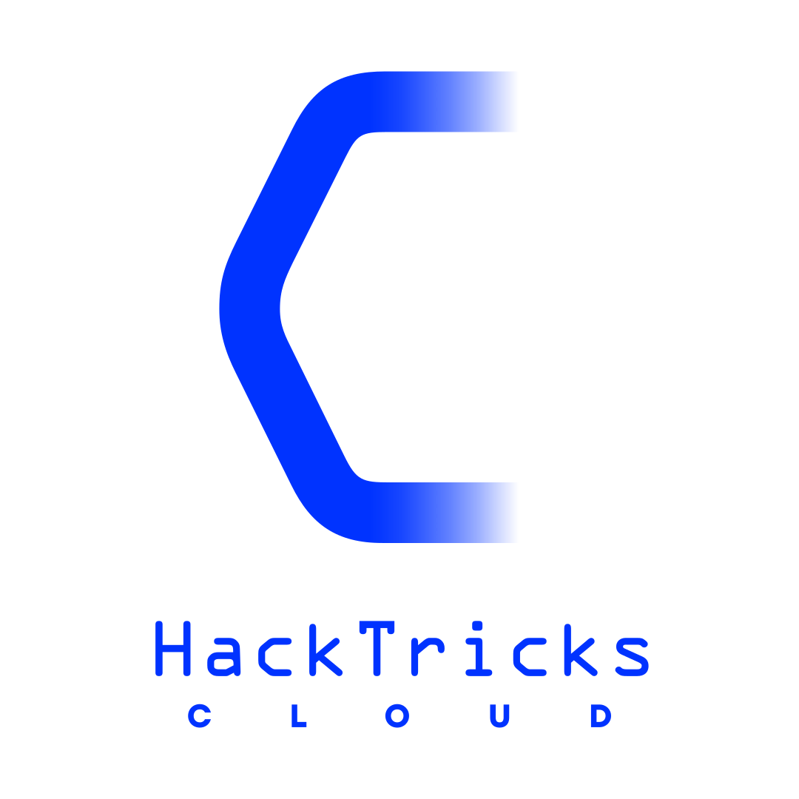

# Pentesting Μεθοδολογία CI/CD

{{#include ../banners/hacktricks-training.md}}

<figure><figcaption></figcaption></figure>

## VCS

Το VCS σημαίνει **Version Control System**· αυτά τα συστήματα επιτρέπουν στους προγραμματιστές να **διαχειρίζονται τον πηγαίο κώδικά τους**. Το πιο συνηθισμένο είναι το **Git**, ένα κατανεμημένο σύστημα ελέγχου εκδόσεων, και συνήθως θα βρείτε εταιρείες να το χρησιμοποιούν σε μία από τις ακόλουθες **πλατφόρμες**.<sup>[[5]](#references)</sup>

- Github
- Gitlab
- Bitbucket
- Gitea
- Gitblit
- Πάροχοι cloud (προσφέρουν τις δικές τους πλατφόρμες VCS).<sup>[[5]](#references)</sup>


## Pipelines CI/CD

Τα pipelines CI/CD επιτρέπουν στους προγραμματιστές να **αυτοματοποιούν την εκτέλεση κώδικα** για διάφορους σκοπούς, όπως η δημιουργία, ο έλεγχος και η ανάπτυξη εφαρμογών. Αυτές οι αυτοματοποιημένες ροές εργασίας **ενεργοποιούνται από συγκεκριμένες ενέργειες**, όπως pushes κώδικα, pull requests ή προγραμματισμένες εργασίες. Είναι χρήσιμα για την απλοποίηση της διαδικασίας από την ανάπτυξη έως την παραγωγή.<sup>[[1]](#references)[[9]](#references)[[10]](#references)[[11]](#references)[[12]](#references)</sup>

Ωστόσο, αυτά τα συστήματα πρέπει να **εκτελούνται κάπου** και συνήθως με **διαπιστευτήρια με αυξημένα προνόμια για την ανάπτυξη κώδικα ή την πρόσβαση σε ευαίσθητες πληροφορίες**.<sup>[[1]](#references)[[13]](#references)[[14]](#references)</sup>

## Μεθοδολογία Pentesting VCS

> [!NOTE]
> Ακόμα κι αν ορισμένες πλατφόρμες VCS επιτρέπουν τη δημιουργία pipelines, σε αυτήν την ενότητα θα αναλύσουμε μόνο πιθανές επιθέσεις στον έλεγχο του πηγαίου κώδικα.

Οι πλατφόρμες που περιέχουν τον πηγαίο κώδικα του έργου σας περιέχουν ευαίσθητες πληροφορίες, επομένως οι χρήστες πρέπει να είναι πολύ προσεκτικοί με τα δικαιώματα που παραχωρούνται σε αυτές τις πλατφόρμες. Ακολουθούν ορισμένα συνηθισμένα προβλήματα σε πλατφόρμες VCS που θα μπορούσε να εκμεταλλευτεί ένας εισβολέας.<sup>[[5]](#references)</sup>

- **Leaks**: Αν ο κώδικάς σας περιέχει leaks σε commits και ο εισβολέας μπορεί να έχει πρόσβαση στο repository (επειδή είναι δημόσιο ή επειδή έχει πρόσβαση), θα μπορούσε να εντοπίσει τα leaks.<sup>[[5]](#references)</sup>
- **Πρόσβαση**: Αν ένας εισβολέας μπορεί να **αποκτήσει πρόσβαση σε έναν λογαριασμό στην πλατφόρμα VCS**, θα μπορούσε να αποκτήσει **μεγαλύτερη ορατότητα και περισσότερα δικαιώματα**.<sup>[[6]](#references)[[27]](#references)</sup>
  - **Εγγραφή**: Ορισμένες πλατφόρμες επιτρέπουν σε εξωτερικούς χρήστες να δημιουργήσουν λογαριασμό.<sup>[[6]](#references)</sup>
  - **SSO**: Ορισμένες πλατφόρμες δεν επιτρέπουν στους χρήστες να εγγραφούν, αλλά επιτρέπουν σε οποιονδήποτε να αποκτήσει πρόσβαση με έγκυρη ταυτότητα SSO.<sup>[[6]](#references)</sup>
  - **Διαπιστευτήρια**: Τα ονόματα χρήστη και οι κωδικοί πρόσβασης, τα προσωπικά tokens, τα κλειδιά SSH, τα tokens OAuth και τα cookies είναι μερικά από τα διαπιστευτήρια που θα μπορούσε να υποκλέψει ένας εισβολέας για να αποκτήσει πρόσβαση σε ένα repository.<sup>[[6]](#references)[[15]](#references)[[27]](#references)</sup>
- **Webhooks**: Οι πλατφόρμες VCS επιτρέπουν στους χρήστες να δημιουργούν webhooks. Αν **δεν προστατεύονται** με μυστικά υψηλής εντροπίας και επικύρωση υπογραφής, ένας **εισβολέας θα μπορούσε να τα εκμεταλλευτεί**.<sup>[[7]](#references)</sup>
  - Αν δεν έχει οριστεί μυστικό, ο εισβολέας θα μπορούσε να εκμεταλλευτεί το webhook της πλατφόρμας τρίτου μέρους.<sup>[[7]](#references)</sup>
  - Αν το μυστικό βρίσκεται στο URL, θα μπορούσε να συμβεί το ίδιο και ο εισβολέας θα είχε επίσης το μυστικό.<sup>[[7]](#references)</sup>
- **Παραβίαση κώδικα:** Αν ένας κακόβουλος παράγοντας έχει κάποιου είδους **πρόσβαση εγγραφής** στα repositories, θα μπορούσε να προσπαθήσει να **εισαγάγει κακόβουλο κώδικα**. Για να πετύχει, ενδέχεται να χρειαστεί να **παρακάμψει τις προστασίες των branches**.<sup>[[8]](#references)</sup>
  - Παραβίαση του main branch για **παραβίαση της παραγωγής**.<sup>[[1]](#references)[[8]](#references)</sup>
  - Παραβίαση του main (ή άλλων branches) για **παραβίαση των μηχανημάτων των προγραμματιστών**, καθώς συνήθως εκτελούν tests, Terraform ή άλλο περιεχόμενο του repository στα μηχανήματά τους.<sup>[[1]](#references)</sup>
  - **Παραβίαση του pipeline** (δείτε την επόμενη ενότητα).<sup>[[1]](#references)</sup>

## Μεθοδολογία Pentesting Pipelines

Ο πιο συνηθισμένος τρόπος ορισμού ενός pipeline είναι η χρήση ενός **αρχείου ρυθμίσεων CI που φιλοξενείται στο repository** το οποίο δημιουργεί το pipeline. Αυτό το αρχείο περιγράφει τη σειρά των εργασιών που εκτελούνται, τις συνθήκες που επηρεάζουν τη ροή και τις ρυθμίσεις του περιβάλλοντος δημιουργίας.\
Αυτά τα αρχεία έχουν συνήθως σταθερή ονομασία και μορφή, για παράδειγμα — Jenkinsfile (Jenkins), .gitlab-ci.yml (GitLab), .circleci/config.yml (CircleCI) και τα αρχεία YAML του GitHub Actions που βρίσκονται στο .github/workflows. Όταν ενεργοποιηθεί, η εργασία του pipeline **λαμβάνει τον κώδικα** από την επιλεγμένη πηγή (π.χ. commit / branch) και **εκτελεί τις εντολές που καθορίζονται στο αρχείο ρυθμίσεων CI** πάνω σε αυτόν τον κώδικα.<sup>[[1]](#references)[[9]](#references)[[10]](#references)[[11]](#references)[[12]](#references)</sup>

Επομένως, ο απώτερος στόχος του εισβολέα είναι να **παραβιάσει με κάποιον τρόπο αυτά τα αρχεία ρυθμίσεων** ή τις **εντολές που εκτελούν**.<sup>[[1]](#references)[[4]](#references)</sup>

> [!TIP]
> Ορισμένα φιλοξενούμενα builders επιτρέπουν στους συνεισφέροντες να επιλέγουν το context δημιουργίας Docker και τη διαδρομή του Dockerfile. Αν το context ελέγχεται από τον εισβολέα, μπορείτε να το ορίσετε εκτός του repository (π.χ., "..") ώστε να συμπεριληφθούν αρχεία του host κατά τη δημιουργία και να γίνει exfiltrate secrets.<sup>[[18]](#references)[[19]](#references)</sup> Δείτε:
>
>{{#ref}}
>docker-build-context-abuse.md
>{{#endref}}

### Στατικός έλεγχος GitLab CI lint και κανονικές εκφράσεις διαδρομών repository

Το GitLab 19.2 εισήγαγε το `rules:exists:regexp`, το οποίο μπορεί να αξιολογήσει μια κανονική έκφραση Ruby έναντι διαδρομών repository κατά την επεξεργασία ενός conditional `include`.<sup>[[11]](#references)</sup> Το pattern εκτελείται στη διεργασία Ruby του GitLab και όχι σε CI runner.<sup>[[43]](#references)</sup> Το `rules:changes:regexp` εισήχθη επίσης στην έκδοση 19.2 και αντιστοιχίζει διαδρομές που έχουν αλλάξει, αλλά το GitLab το υποστηρίζει μόνο σε jobs και όχι σε includes.<sup>[[11]](#references)</sup> Το API CI lint του project μπορεί να αναλύσει στατικά ένα επιλεγμένο commit χωρίς να δημιουργήσει pipeline, καθιστώντας αυτό μια διαφορετική επιφάνεια εκτέλεσης από το [poisoned pipeline execution](#ppe---poisoned-pipeline-execution).<sup>[[43]](#references)[[44]](#references)</sup>

Για παράδειγμα, ένας εισβολέας που μπορεί να κάνει commit ένα `.gitlab-ci.yml` και μια διαδρομή με ειδικά επιλεγμένο όνομα σε ένα δημόσιο project μπορεί να τοποθετήσει μια κανονική έκφραση διαδρομής repository σε έναν κανόνα include. Ο κανόνας αξιολογείται όταν το GitLab επιλύει τις ρυθμίσεις. Το ακόλουθο συντομευμένο pattern δείχνει την ασυμφωνία στην ανάλυση επαναλήψεων· **δεν** είναι πλήρες payload εκτέλεσης κώδικα.<sup>[[43]](#references)</sup>

```yaml
include:
  - local: /benign.yml
    rules:
      - exists:
          regexp: '[[:word:]]{5(?#)7805}'
```

Σε builds που επηρεάζονται, ο repeat scanner του GitLab αναζητά συνεχόμενα ψηφία μέσα σε `{...}`, ενώ το Onigmo αγνοεί το σχόλιο `(?#)` και το διαβάζει ως όριο επανάληψης 57.805.<sup>[[43]](#references)</sup>

Το πλήρες exploit χρειάζεται επίσης μια διαδρομή που να περιέχει έναν έγκυρο χαρακτήρα UTF-8 τεσσάρων byte.<sup>[[43]](#references)</sup> Η Ruby μπορεί να μεταγλωττίσει ξανά την έκφραση για την κωδικοποίηση αυτής της διαδρομής **αφού** το GitLab ελέγξει το αρχικό μέγεθος του μεταγλωττισμένου προγράμματος.<sup>[[43]](#references)[[45]](#references)</sup> Αυτή η επαναμεταγλώττιση γίνεται πριν από το timed matching, επομένως το timeout του match δεν περιορίζει την κατανομή μνήμης.<sup>[[43]](#references)[[45]](#references)</sup>

Αφού δημιουργηθεί το branch, το αποδεδειγμένο trigger επιλέγει το commit του μέσω του `content_ref`.<sup>[[43]](#references)[[44]](#references)</sup> Για ένα δημόσιο project, το request μπορεί να σταλεί χωρίς credentials, αλλά για την προετοιμασία του κακόβουλου branch εξακολουθεί να απαιτείται δικαίωμα εγγραφής στο project.<sup>[[43]](#references)</sup> Μια αποτυχημένη απόκριση HTTP ή ένα crash του worker από μόνα τους δεν αποδεικνύουν εκτέλεση κώδικα.<sup>[[43]](#references)</sup>

```http
GET /api/v4/projects/<project-id>/ci/lint?content_ref=<payload-ref>
```

### PPE - Poisoned Pipeline Execution

Η διαδρομή Poisoned Pipeline Execution (PPE) εκμεταλλεύεται δικαιώματα σε ένα αποθετήριο SCM, ώστε να χειραγωγήσει ένα CI pipeline και να εκτελέσει επιβλαλείς εντολές. Οι χρήστες με τα απαραίτητα δικαιώματα μπορούν να τροποποιήσουν αρχεία διαμόρφωσης CI ή άλλα αρχεία που χρησιμοποιούνται από το job του pipeline, ώστε να συμπεριλάβουν κακόβουλες εντολές. Έτσι «δηλητηριάζεται» το CI pipeline, με αποτέλεσμα να εκτελεστούν αυτές οι κακόβουλες εντολές.<sup>[[1]](#references)[[4]](#references)</sup>

Για να εκτελέσει με επιτυχία μια επίθεση PPE, ένας κακόβουλος παράγοντας πρέπει να μπορεί να:

- Έχει **δικαίωμα εγγραφής στην πλατφόρμα VCS**, καθώς τα pipelines συνήθως ενεργοποιούνται όταν γίνεται push ή pull request. (Δείτε τη μεθοδολογία pentesting VCS για μια σύνοψη των τρόπων απόκτησης πρόσβασης.)<sup>[[1]](#references)[[4]](#references)[[34]](#references)</sup>
  - Σημειώστε ότι μερικές φορές ένα **εξωτερικό PR θεωρείται «δικαίωμα εγγραφής»** στη διαδρομή εκτέλεσης του pipeline.<sup>[[13]](#references)[[34]](#references)</sup>
- Ακόμη κι αν διαθέτει δικαιώματα εγγραφής, πρέπει να βεβαιωθεί ότι μπορεί **να τροποποιήσει το αρχείο διαμόρφωσης CI ή άλλα αρχεία από τα οποία εξαρτάται η διαμόρφωση**.<sup>[[1]](#references)[[4]](#references)</sup>
  - Για αυτό, ενδέχεται να χρειαστεί να μπορεί να **παρακάμψει τις προστασίες των branches**.<sup>[[8]](#references)</sup>

Υπάρχουν τρεις παραλλαγές PPE.<sup>[[1]](#references)[[4]](#references)</sup>

- **D-PPE**: Μια επίθεση **Direct PPE** συμβαίνει όταν ο παράγοντας **τροποποιεί το αρχείο διαμόρφωσης CI** που πρόκειται να εκτελεστεί.<sup>[[1]](#references)[[4]](#references)</sup>
- **I-PPE**: Μια επίθεση **Indirect PPE** συμβαίνει όταν ο παράγοντας **τροποποιεί ένα αρχείο** από το οποίο **εξαρτάται** το αρχείο διαμόρφωσης CI που πρόκειται να εκτελεστεί (όπως ένα makefile ή μια διαμόρφωση Terraform).<sup>[[1]](#references)[[4]](#references)</sup>
- **Public PPE ή 3PE**: Σε ορισμένες περιπτώσεις, τα pipelines μπορούν να **ενεργοποιηθούν από χρήστες χωρίς δικαίωμα εγγραφής στο αποθετήριο** (οι οποίοι ενδέχεται να μην ανήκουν καν στον οργανισμό), επειδή μπορούν να στείλουν PR.<sup>[[1]](#references)[[4]](#references)[[34]](#references)</sup>
  - **3PE Command Injection**: Τα CI/CD pipelines μπορούν να **ορίζουν μεταβλητές περιβάλλοντος** με **πληροφορίες για το PR**. Αν η τιμή μπορεί να ελεγχθεί από έναν επιτιθέμενο (όπως ο τίτλος του PR) και **χρησιμοποιείται** σε ένα **επικίνδυνο σημείο** (όπως κατά την εκτέλεση **εντολών shell**), ο επιτιθέμενος ενδέχεται να **εισαγάγει εντολές**.<sup>[[13]](#references)[[34]](#references)</sup>

### Οφέλη από την εκμετάλλευση

Αφού γνωρίσαμε τις τρεις παραλλαγές του pipeline poisoning, ας δούμε τι θα μπορούσε να αποκτήσει ένας επιτιθέμενος μετά από επιτυχή εκμετάλλευση.<sup>[[1]](#references)[[4]](#references)</sup>

- **Secrets**: Όπως αναφέρθηκε προηγουμένως, τα pipelines χρειάζονται **προνόμια** για τα jobs τους (ανάκτηση του κώδικα, build, deployment κ.ο.κ.), τα οποία συνήθως **χορηγούνται μέσω secrets**. Αυτά τα secrets είναι συνήθως προσβάσιμα μέσω **μεταβλητών περιβάλλοντος ή αρχείων μέσα στο σύστημα**, οπότε ένας επιτιθέμενος θα προσπαθήσει να εξαγάγει όσο το δυνατόν περισσότερα.<sup>[[1]](#references)[[13]](#references)[[14]](#references)[[35]](#references)</sup>
  - Ανάλογα με την πλατφόρμα pipeline, ο επιτιθέμενος **ενδέχεται να χρειαστεί να καθορίσει τα secrets στη διαμόρφωση**. Αυτό σημαίνει ότι αν δεν μπορεί να τροποποιήσει τη διαμόρφωση του CI pipeline (**I-PPE**, για παράδειγμα), θα μπορεί **να εξαγάγει μόνο τα secrets που διαθέτει το pipeline**.<sup>[[1]](#references)[[13]](#references)[[35]](#references)</sup>
- **Υπολογιστικοί πόροι**: Ο κώδικας εκτελείται κάπου και, ανάλογα με το πού εκτελείται, ένας επιτιθέμενος ενδέχεται να μπορεί να κινηθεί περαιτέρω.<sup>[[1]](#references)</sup>
  - **On-Premises**: Αν τα pipelines εκτελούνται on-premises, ένας επιτιθέμενος μπορεί να καταλήξει σε ένα **εσωτερικό δίκτυο με πρόσβαση σε περισσότερους πόρους**.<sup>[[1]](#references)</sup>
  - **Cloud**: Ο επιτιθέμενος θα μπορούσε να αποκτήσει πρόσβαση σε **άλλα μηχανήματα στο cloud** και να **εξαγάγει** από αυτά **tokens** για IAM roles/service accounts, αποκτώντας έτσι **περαιτέρω πρόσβαση στο cloud**.<sup>[[1]](#references)</sup>
  - **Μηχανήματα πλατφόρμας**: Μερικές φορές τα jobs εκτελούνται μέσα στα **μηχανήματα της πλατφόρμας pipeline**, τα οποία συνήθως βρίσκονται σε cloud **χωρίς πρόσθετη πρόσβαση**.<sup>[[1]](#references)</sup>
  - **Επιλογή μηχανήματος:** Μερικές φορές η **πλατφόρμα pipeline έχει διαμορφωμένα πολλά μηχανήματα** και, αν μπορείτε να **τροποποιήσετε το αρχείο διαμόρφωσης CI**, μπορείτε να **υποδείξετε πού θέλετε να εκτελεστεί ο κακόβουλος κώδικας**. Σε αυτήν την περίπτωση, ένας επιτιθέμενος μπορεί να εκτελέσει ένα reverse shell σε κάθε πιθανό μηχάνημα, για να προσπαθήσει να το εκμεταλλευτεί περαιτέρω.<sup>[[1]](#references)</sup>
- **Παραβίαση production**: Αν βρίσκεστε μέσα στο pipeline και η τελική έκδοση γίνεται build και deploy από αυτό, θα μπορούσατε να **παραβιάσετε τον κώδικα που πρόκειται να εκτελεστεί στο production**.<sup>[[1]](#references)</sup>

### Κατάχρηση της εφοδιαστικής αλυσίδας εξαρτήσεων και registry

Η παραβίαση ενός CI/CD pipeline ή η κλοπή διαπιστευτηρίων από αυτό μπορεί να επιτρέψει σε έναν επιτιθέμενο να μεταβεί από την **εκτέλεση pipeline** στην **εκτέλεση κώδικα σε ολόκληρο το οικοσύστημα**, προσθέτοντας backdoor σε dependencies ή εργαλεία release.<sup>[[2]](#references)</sup>

- **Εκτέλεση κώδικα κατά την εγκατάσταση μέσω package hooks**: Δημοσιεύστε μια έκδοση package που προσθέτει hooks όπως `preinstall`, `postinstall`, `prepare` ή παρόμοια, ώστε το payload να εκτελείται αυτόματα στους σταθμούς εργασίας των developers και στους CI runners κατά την εγκατάσταση dependencies.<sup>[[2]](#references)[[21]](#references)</sup>
- **Δευτερεύουσες διαδρομές εκτέλεσης**: Ακόμη κι αν οι στόχοι εγκαθιστούν με `--ignore-scripts`, ένα κακόβουλο package μπορεί και πάλι να καταχωρίσει ένα **συνηθισμένο όνομα CLI** στο πεδίο `bin`, ώστε το wrapper που ελέγχει ο επιτιθέμενος να συνδεθεί συμβολικά στο `PATH` και να εκτελεστεί αργότερα, όταν χρησιμοποιηθεί η εντολή.<sup>[[20]](#references)[[22]](#references)</sup>
- **Εκκίνηση runtime**: Ένας μικρός installer μπορεί να κατεβάσει ένα δεύτερο runtime ή toolchain κατά την εγκατάσταση (για παράδειγμα, Bun ή έναν συσκευασμένο interpreter) και στη συνέχεια να εκκινήσει με αυτό το κύριο payload, αποφεύγοντας την ανάγκη για τοπικά dependencies.<sup>[[2]](#references)[[21]](#references)</sup>
- **Συλλογή διαπιστευτηρίων από build environments**: Μόλις εκτελεστεί κώδικας μέσα στο CI, ελέγξτε τις μεταβλητές περιβάλλοντος, τα `~/.npmrc`, `~/.git-credentials`, τα SSH keys, τις διαμορφώσεις cloud CLI και τοπικά εργαλεία όπως το `gh auth token`. Στο GitHub Actions, αναζητήστε επίσης secrets και artifacts ειδικά για τον runner.<sup>[[2]](#references)[[26]](#references)[[27]](#references)[[35]](#references)[[36]](#references)</sup>
- **Workflow injection με κλεμμένα GitHub tokens**: Ένα token με δικαιώματα **`repo` + `workflow`** μπορεί να δημιουργήσει ένα branch, να κάνει commit ένα κακόβουλο αρχείο μέσα στο `.github/workflows/`, να το ενεργοποιήσει, να συλλέξει τα artifacts/logs που παράγονται και στη συνέχεια να διαγράψει το προσωρινό branch/workflow run, περιορίζοντας τα ίχνη.<sup>[[14]](#references)[[15]](#references)[[16]](#references)[[17]](#references)[[36]](#references)</sup>
- **Διάδοση worm μέσω registry**: Τα κλεμμένα npm tokens πρέπει να ελεγχθούν για δικαιώματα **publish** και για το αν παρακάμπτουν το 2FA. Αν ισχύει κάτι από αυτά, εντοπίστε τα packages στα οποία μπορείτε να γράψετε, κατεβάστε τα tarballs τους, εισαγάγετε έναν loader όπως το `setup.mjs`, ορίστε το `preinstall` ώστε να τον εκτελεί, αυξήστε την patch έκδοση και δημοσιεύστε ξανά. Έτσι, μία παραβίαση CI οδηγεί σε αυτόματη εκτέλεση σε επόμενα περιβάλλοντα.<sup>[[2]](#references)[[23]](#references)[[24]](#references)[[25]](#references)</sup>

#### Μεταβατικά dependencies Cargo και εκτέλεση `build.rs`

Το Cargo συνήθως μεταγλωττίζει και εκτελεί το αρχείο `build.rs` στη ρίζα ενός package πριν από το build του package. Το script μπορεί να χρησιμοποιεί crates που αναφέρονται στην ενότητα `[build-dependencies]`. Συνεπώς, τα `cargo build` ή `cargo check` μπορούν να εκτελέσουν το build script ενός μεταβατικού dependency σε έναν host developer ή CI, ακόμη κι όταν το project δεν καλεί ποτέ το API της βιβλιοθήκης αυτού του crate.<sup>[[46]](#references)[[47]](#references)</sup>

Ένας παραβιασμένος publisher μπορεί να προσθέσει ένα crate με παρόμοιο όνομα ως dependency ενός έμπιστου crate και να τοποθετήσει την κακόβουλη συμπεριφορά στο `build.rs` του crate με το παρόμοιο όνομα. Ο συνηθισμένος κώδικας της βιβλιοθήκης του μπορεί να εξακολουθεί να φαίνεται νόμιμος. Μια νέα επίλυση dependencies ή ένα `cargo update` μπορεί να προσθέσει αυτό το crate στο `Cargo.lock`, αλλά το script εκτελείται μόνο όταν το Cargo κάνει στη συνέχεια build ή check του crate, όχι όταν ενημερώνεται το lockfile.<sup>[[46]](#references)[[47]](#references)</sup>

Για να εντοπίσετε ένα ύποπτο crate σε ένα project του οποίου τα dependencies έχουν ήδη επιλυθεί, ελέγξτε το `Cargo.lock` και εκτελέστε `cargo tree --locked -i proc-macro1` από το σχετικό workspace member· το `--workspace` επεκτείνει την έξοδο των αντίστροφων dependencies σε ολόκληρο το workspace.<sup>[[48]](#references)</sup> Συγκρίνετε τα `Cargo.toml`, `build.rs` και build dependencies του δημοσιευμένου crate με την προηγούμενη έκδοσή του και με το νόμιμο crate που μιμείται, αντί να εμπιστεύεστε μόνο το αποθετήριό του· δείτε τους [ελέγχους δημοσιευμένων artifacts](#practical-checks-during-an-assessment).<sup>[[46]](#references)</sup>

Στα Windows, ένα child process μεγάλης διάρκειας ενός Cargo build script μπορεί να παραμείνει στο job object του Cargo και να μπλοκάρει το build. Το dropper που αναφέρθηκε χρησιμοποίησε έναν κρυφό launcher `wscript`/VBS-to-PowerShell για να αποσυνδέσει τη διεργασία, αντί να την εκκινήσει απευθείας από το `build.rs`.<sup>[[46]](#references)</sup>

#### Ακεραιότητα package όταν η πηγή που το παρέχει έχει παραβιαστεί

Ένα παραβιασμένο registry, mirror, CDN ή Git host μπορεί να παρέχει τροποποιημένα bytes για ένα dependency του οποίου το όνομα και η έκδοση δεν έχουν αλλάξει. Αυτό διαφέρει από την ανάληψη ελέγχου ενός λογαριασμού publisher: το TLS εξακολουθεί να πιστοποιεί το παραβιασμένο endpoint, ενώ ένα pin έκδοσης από μόνο του δεν πιστοποιεί το artifact που κατεβαίνει. Ένα hash στο lockfile βοηθά μόνο αν η αναμενόμενη τιμή αποκτήθηκε μέσω έμπιστου καναλιού και ο installer απορρίπτει την ασυμφωνία αντί να αποδέχεται ένα νέο hash από την ίδια πηγή.<sup>[[37]](#references)</sup>

- **Αποδοχή ασυμφωνίας:** Το Pub αποθηκεύει SHA-256 hashes στο `pubspec.lock`, αλλά το `flutter pub get` συνήθως εμφανίζει προειδοποίηση, εγκαθιστά το αρχείο που επιστράφηκε και ξαναγράφει το lockfile όταν το hash του διαφέρει· το `--enforce-lockfile` κάνει την ασυμφωνία μοιραία. Τα `flutter run` και `flutter test` μπορούν να εκκινήσουν αυτόματα το Pub. Έτσι, στο προεπιλεγμένο workflow, ένα hash που έχει γίνει commit δεν προστατεύει από αντικατάσταση από την πηγή.<sup>[[37]](#references)[[38]](#references)</sup> Πριν από το pnpm 11.4, οι εγκαταστάσεις χωρίς frozen mode μπορούσαν επίσης να επιλύσουν ξανά ένα tarball με ασύμφωνη τιμή και να αντικαταστήσουν την αποθηκευμένη τιμή ακεραιότητάς του· στην έκδοση 11.4, αυτή η ασυμφωνία έγινε από προεπιλογή σφάλμα που διακόπτει τη διαδικασία.<sup>[[39]](#references)</sup>
- **Αναγνωριστικό που εκλαμβάνεται ως απόδειξη:** Μια αναθεώρηση recipe του Conan επιλέγει ένα recipe, αλλά δεν επανυπολογίζεται ως έλεγχος ακεραιότητας κατά την εγκατάσταση και δεν καλύπτει τη χωριστή αναθεώρηση binary. Μια καταχώριση `SPEC CHECKSUMS` του CocoaPods καλύπτει το Podspec, όχι το περιεχόμενο Git που ανακτάται από το tag του. Το Composer μπορεί να καταγράψει μια αναφορά Git commit, ενώ εγκαθιστά ένα GitHub ZIP με κενό `shasum`, χωρίς να ελέγχει αν το archive αντιστοιχεί στο αναφερόμενο Git tree. Σε κάθε περίπτωση, παραμένει ένα διαφορετικό όριο artifact όπου μπορούν να παρασχεθούν τροποποιημένα bytes χωρίς να αλλάξει το καταγεγραμμένο αναγνωριστικό.<sup>[[37]](#references)</sup>
- **Η υπογραφή δεν επιβάλλεται ή δεν είναι ανεξάρτητα έμπιστη:** Το `npm install` δεν εκτελεί τον ξεχωριστό έλεγχο `npm audit signatures`.<sup>[[37]](#references)[[40]](#references)</sup> Η προεπιλεγμένη τιμή `signatureValidationMode=accept` του NuGet επιτρέπει unsigned packages και αντιμετωπίζει τα packages που έχουν υπογραφεί με μη έμπιστα πιστοποιητικά ως unsigned· δεν επιβάλλει τη χρήση έμπιστου signer. Η ρύθμιση `require` και η διαμόρφωση του `trustedSigners` αλλάζουν αυτήν την πολιτική.<sup>[[37]](#references)[[41]](#references)[[42]](#references)</sup> Ένα verification key που παρέχεται από το registry δεν μπορεί να αποδείξει την ανεξαρτησία του από ένα πλήρως παραβιασμένο registry: η μελέτη διαπίστωσε ότι το `pnpm audit signatures` λαμβάνει τα keys του από το ίδιο registry.<sup>[[37]](#references)</sup>

Για παραβίαση διαπιστευτηρίων publisher και εκτέλεση κατά την εγκατάσταση στο GitHub Actions, δείτε το [GH Actions - npm Supply Chain Abuse](github-security/abusing-github-actions/gh-actions-npm-supply-chain-abuse.md).

#### Πρακτικοί έλεγχοι κατά την αξιολόγηση

- Εξετάστε την αυτοματοποίηση release για package-manager hooks που προστέθηκαν στο `package.json`, απρόσμενες καταχωρίσεις `bin` ή αυξήσεις έκδοσης που τροποποιούν μόνο το release artifact.<sup>[[20]](#references)[[21]](#references)</sup>
- Ελέγξτε αν το CI αποθηκεύει διαπιστευτήρια registry μακράς διάρκειας σε αρχεία απλού κειμένου, όπως το `~/.npmrc`, αντί να χρησιμοποιεί βραχύβιο OIDC ή trusted publishing.<sup>[[23]](#references)[[25]](#references)</sup>
- Επαληθεύστε αν τα GitHub tokens που είναι διαθέσιμα στο CI μπορούν να γράφουν σε αρχεία workflow ή να δημιουργούν branches/tags.<sup>[[14]](#references)[[15]](#references)[[16]](#references)</sup>
- Αν υπάρχει υποψία για παραβιασμένο package, ελέγξτε το δημοσιευμένο tarball και όχι μόνο το αποθετήριο Git, επειδή ο κακόβουλος loader/runtime μπορεί να υπάρχει μόνο στο δημοσιευμένο artifact.<sup>[[2]](#references)[[20]](#references)</sup>
- Αναζητήστε απρόσμενη εκτέλεση package manager μέσα στο CI, όπως `npm install` αντί για `npm ci`, απρόσμενες λήψεις/εκτελέσεις Bun ή νέα workflow artifacts που δημιουργούνται από προσωρινά branches.<sup>[[2]](#references)[[17]](#references)[[21]](#references)[[36]](#references)</sup>
- Εξετάστε και τις μηχανές deployment GitOps ως στόχους CI/CD. Η απαρίθμηση ειδικά για το Argo CD, η κατάχρηση του repo-server και οι επιθέσεις poisoning της cache Redis καλύπτονται στο [Argo CD Security](argocd-security.md).<sup>[[33]](#references)</sup>

## Περισσότερες σχετικές πληροφορίες

### Εργαλεία και CIS Benchmark

- Το [**Chain-bench**](https://github.com/aquasecurity/chain-bench) είναι ένα open-source εργαλείο για τον έλεγχο συμμόρφωσης ασφαλείας του stack της εφοδιαστικής αλυσίδας λογισμικού, με βάση ένα νέο [**CIS Software Supply Chain benchmark**](https://github.com/aquasecurity/chain-bench/blob/main/docs/CIS-Software-Supply-Chain-Security-Guide-v1.0.pdf). Ο έλεγχος εστιάζει σε ολόκληρη τη διαδικασία SDLC και μπορεί να εντοπίσει κινδύνους από το στάδιο συγγραφής κώδικα έως το deployment.<sup>[[28]](#references)[[29]](#references)</sup>

### Οι 10 κορυφαίοι κίνδυνοι ασφάλειας CI/CD

Δείτε αυτό το άρθρο της Cider σχετικά με τους 10 κορυφαίους κινδύνους CI/CD: [**https://www.cidersecurity.io/top-10-cicd-security-risks/**](https://www.cidersecurity.io/top-10-cicd-security-risks/).<sup>[[4]](#references)[[30]](#references)</sup>

### Labs

- Σε κάθε πλατφόρμα που μπορείτε να εκτελέσετε τοπικά, θα βρείτε οδηγίες για την εκκίνησή της τοπικά, ώστε να τη διαμορφώσετε όπως θέλετε και να τη δοκιμάσετε.
- Lab Gitea + Jenkins: [https://github.com/cider-security-research/cicd-goat](https://github.com/cider-security-research/cicd-goat).<sup>[[31]](#references)</sup>

### Αυτόματα εργαλεία

- Το [**Checkov**](https://github.com/bridgecrewio/checkov) είναι ένα εργαλείο στατικής ανάλυσης κώδικα για infrastructure-as-code.<sup>[[32]](#references)</sup>

## References

- [1] [PPE — Poisoned Pipeline Execution](https://www.cidersecurity.io/blog/research/ppe-poisoned-pipeline-execution/?utm_source=github&utm_medium=github_page&utm_campaign=ci%2fcd%20goat_060422)
- [2] [Το τοπίο απειλών του npm: επιφάνεια επίθεσης και μέτρα μετριασμού](https://unit42.paloaltonetworks.com/monitoring-npm-supply-chain-attacks/)
- [3] [Ενημέρωση ασφαλείας Checkmarx: 22 Απριλίου 2026](https://checkmarx.com/blog/checkmarx-security-update-april-22/?p=108469)
- [4] [CICD-SEC-04: Poisoned Pipeline Execution](https://owasp.org/www-project-top-10-ci-cd-security-risks/CICD-SEC-04-Poisoned-Pipeline-Execution)
- [5] [Σχετικά με τον έλεγχο εκδόσεων](https://git-scm.com/book/en/v2/Getting-Started-About-Version-Control.html)
- [6] [Τεκμηρίωση ελέγχου ταυτότητας GitHub](https://docs.github.com/en/authentication)
- [7] [Επικύρωση παραδόσεων webhook](https://docs.github.com/en/webhooks/using-webhooks/validating-webhook-deliveries)
- [8] [Σχετικά με τα προστατευμένα branches](https://docs.github.com/en/repositories/configuring-branches-and-merges-in-your-repository/managing-protected-branches/about-protected-branches)
- [9] [Σύνταξη workflow για το GitHub Actions](https://docs.github.com/en/actions/writing-workflows/workflow-syntax-for-github-actions)
- [10] [Pipeline ως κώδικας με Jenkins](https://www.jenkins.io/doc/book/pipeline/pipeline-as-code/)
- [11] [Αναφορά σύνταξης YAML CI/CD](https://docs.gitlab.com/ci/yaml/)
- [12] [Pipelines](https://circleci.com/docs/guides/orchestrate/pipelines/)
- [13] [Αναφορά ασφαλούς χρήσης](https://docs.github.com/en/actions/security-for-github-actions/security-guides/security-hardening-for-github-actions)
- [14] [Αυτόματος έλεγχος ταυτότητας με token](https://docs.github.com/en/actions/security-for-github-actions/security-guides/automatic-token-authentication)
- [15] [Scopes για εφαρμογές OAuth](https://docs.github.com/en/apps/oauth-apps/building-oauth-apps/scopes-for-oauth-apps)
- [16] [Endpoints REST API για workflows του GitHub Actions](https://docs.github.com/en/rest/actions/workflows)
- [17] [Endpoints REST API για εκτελέσεις workflow](https://docs.github.com/en/rest/actions/workflow-runs)
- [18] [Πλαίσιο build](https://docs.docker.com/build/concepts/context/)
- [19] [Διαφυγή από τη φιλοξενία MCP server](https://blog.gitguardian.com/breaking-mcp-server-hosting/)
- [20] [package.json](https://docs.npmjs.com/cli/v11/configuring-npm/package-json/)
- [21] [npm scripts](https://docs.npmjs.com/cli/v11/using-npm/scripts/)
- [22] [Διαμόρφωση npm](https://docs.npmjs.com/cli/v11/using-npm/config/)
- [23] [Σχετικά με τα access tokens](https://docs.npmjs.com/about-access-tokens/)
- [24] [Απαίτηση 2FA για δημοσίευση package και τροποποίηση ρυθμίσεων](https://docs.npmjs.com/requiring-2fa-for-package-publishing-and-settings-modification/)
- [25] [Trusted publishers](https://docs.npmjs.com/trusted-publishers/)
- [26] [gh auth token](https://cli.github.com/manual/gh_auth_token)
- [27] [Διαπιστευτήρια Git](https://git-scm.com/docs/gitcredentials.html)
- [28] [chain-bench](https://github.com/aquasecurity/chain-bench)
- [29] [Οδηγός ασφάλειας εφοδιαστικής αλυσίδας λογισμικού CIS v1.0](https://github.com/aquasecurity/chain-bench/blob/main/docs/CIS-Software-Supply-Chain-Security-Guide-v1.0.pdf)
- [30] [Οι 10 κορυφαίοι κίνδυνοι ασφάλειας CI/CD](https://www.cidersecurity.io/top-10-cicd-security-risks/)
- [31] [CICD Goat](https://github.com/cider-security-research/cicd-goat)
- [32] [Checkov](https://github.com/bridgecrewio/checkov)
- [33] [Ασφάλεια Argo CD](https://argo-cd.readthedocs.io/en/stable/operator-manual/security/)
- [34] [Συμβάντα που ενεργοποιούν workflows](https://docs.github.com/en/actions/writing-workflows/choosing-when-your-workflow-runs/events-that-trigger-workflows)
- [35] [Χρήση secrets στο GitHub Actions](https://docs.github.com/en/actions/security-for-github-actions/security-guides/using-secrets)
- [36] [Artifacts workflow](https://docs.github.com/en/actions/concepts/workflows-and-actions/workflow-artifacts)
- [37] [Οι package managers έχουν πρόβλημα ακεραιότητας](https://blog.trailofbits.com/2026/10/14/package-managers-have-an-integrity-problem/)
- [38] [Hash περιεχομένου Pub](https://dart.dev/resources/glossary#pub-content-hash)
- [39] [pnpm 11.4](https://pnpm.io/blog/releases/11.4)
- [40] [Υπογραφές npm audit](https://docs.npmjs.com/cli/v11/commands/npm-audit/#audit-signatures)
- [41] [Αναφορά nuget.config](https://learn.microsoft.com/en-us/nuget/reference/nuget-config-file)
- [42] [Διαχείριση ορίων εμπιστοσύνης package](https://learn.microsoft.com/en-us/nuget/consume-packages/installing-signed-packages)
- [43] [Ανάλυση Rapid7: υπερχείλιση ακέραιου σε regex του GitLab CI/CD](https://rapid7.com/blog/post/ra-gitlab-ci-cd-regex-integer-overflow-technical-analysis-cve-2026-97229)
- [44] [GitLab CI Lint API](https://docs.gitlab.com/api/lint/)
- [45] [Πηγαίος κώδικας επαναμεταγλώττισης regex στο Ruby 3.3.12](https://github.com/ruby/ruby/blob/v3_3_12/re.c#L1586-L1664)
- [46] [Παραβίαση εφοδιαστικής αλυσίδας στο Crates.io χρησιμοποιεί typosquat proc-macro1 για να μολύνει Rust builds](https://research.jfrog.com/post/arrayref-proc-macro1-crates-io)
- [47] [Build scripts του Cargo](https://doc.rust-lang.org/cargo/reference/build-scripts.html)
- [48] [cargo tree](https://doc.rust-lang.org/cargo/commands/cargo-tree.html)
{{#include ../banners/hacktricks-training.md}}
