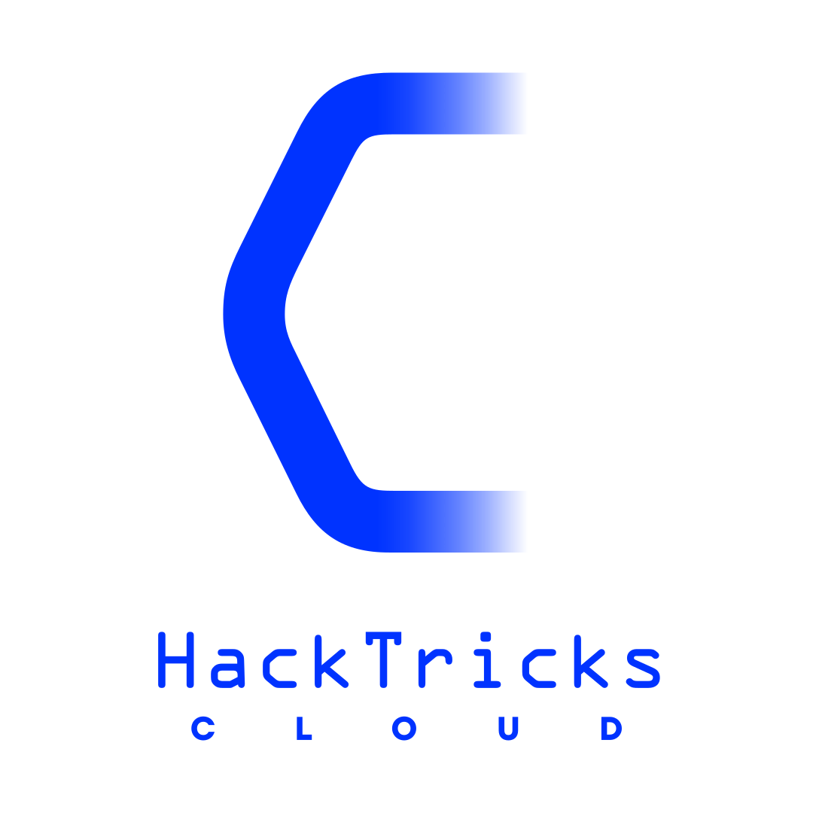

# Pentesting-CI/CD-Methodik

{{#include ../banners/hacktricks-training.md}}

<figure><figcaption></figcaption></figure>

## VCS

VCS steht für **Version Control System**; diese Systeme ermöglichen Entwicklern, **ihren Quellcode zu verwalten**. Das am weitesten verbreitete System ist **Git**, ein verteiltes Versionskontrollsystem. Unternehmen nutzen es üblicherweise auf einer der folgenden **Plattformen**.<sup>[[5]](#references)</sup>

- Github
- Gitlab
- Bitbucket
- Gitea
- Gitblit
- Cloud-Anbieter (sie bieten ihre eigenen VCS-Plattformen an).<sup>[[5]](#references)</sup>


## CI/CD-Pipelines

CI/CD-Pipelines ermöglichen Entwicklern, die **Ausführung von Code zu automatisieren**, beispielsweise zum Erstellen, Testen und Bereitstellen von Anwendungen. Diese automatisierten Workflows werden durch **bestimmte Aktionen ausgelöst**, etwa durch Code-Pushes, Pull Requests oder geplante Aufgaben. Sie helfen dabei, den Prozess von der Entwicklung bis zur Produktion zu optimieren.<sup>[[1]](#references)[[9]](#references)[[10]](#references)[[11]](#references)[[12]](#references)</sup>

Diese Systeme müssen jedoch **irgendwo ausgeführt werden** und benötigen dafür üblicherweise **privilegierte Zugangsdaten, um Code bereitzustellen oder auf sensible Informationen zuzugreifen**.<sup>[[1]](#references)[[13]](#references)[[14]](#references)</sup>

## VCS-Pentesting-Methodik

> [!NOTE]
> Auch wenn einige VCS-Plattformen Pipelines ermöglichen, analysieren wir in diesem Abschnitt nur potenzielle Angriffe auf die Kontrolle über den Quellcode.

Plattformen, auf denen sich der Quellcode Ihres Projekts befindet, enthalten sensible Informationen. Daher müssen Berechtigungen, die innerhalb dieser Plattformen vergeben werden, mit großer Sorgfalt behandelt werden. Dies sind einige häufige Probleme bei VCS-Plattformen, die ein Angreifer ausnutzen könnte.<sup>[[5]](#references)</sup>

- **Leaks**: Wenn Ihr Code Leaks in Commits enthält und der Angreifer auf das Repository zugreifen kann (weil es öffentlich ist oder weil er Zugriff darauf hat), könnte er diese Leaks entdecken.<sup>[[5]](#references)</sup>
- **Zugriff**: Wenn ein Angreifer **auf ein Konto innerhalb der VCS-Plattform zugreifen** kann, könnte er **mehr Einblick und Berechtigungen** erhalten.<sup>[[6]](#references)[[27]](#references)</sup>
  - **Registrierung**: Bei einigen Plattformen können externe Benutzer ein Konto erstellen.<sup>[[6]](#references)</sup>
  - **SSO**: Bei einigen Plattformen können sich Benutzer nicht registrieren, aber jeder kann mit einer gültigen SSO-Identität darauf zugreifen.<sup>[[6]](#references)</sup>
  - **Zugangsdaten**: Benutzernamen und Passwörter, persönliche Tokens, SSH-Schlüssel, OAuth-Tokens und Cookies gehören zu den Zugangsdaten, die ein Angreifer stehlen könnte, um auf ein Repository zuzugreifen.<sup>[[6]](#references)[[15]](#references)[[27]](#references)</sup>
- **Webhooks**: VCS-Plattformen ermöglichen Benutzern, Webhooks zu erstellen. Wenn diese **nicht** mit hochentropischen Secrets und einer Signaturvalidierung geschützt sind, könnte ein **Angreifer sie ausnutzen**.<sup>[[7]](#references)</sup>
  - Wenn kein Secret eingerichtet ist, könnte der Angreifer den Webhook der Drittanbieterplattform ausnutzen.<sup>[[7]](#references)</sup>
  - Wenn sich das Secret in der URL befindet, könnte dasselbe passieren, und der Angreifer hätte auch das Secret.<sup>[[7]](#references)</sup>
- **Kompromittierung von Code:** Wenn ein Angreifer über eine Art **Schreibzugriff** auf die Repositories verfügt, könnte er versuchen, **bösartigen Code einzuschleusen**. Um erfolgreich zu sein, muss er möglicherweise **Branch-Schutzmaßnahmen umgehen**.<sup>[[8]](#references)</sup>
  - Den Main-Branch kompromittieren, um **die Produktionsumgebung zu kompromittieren**.<sup>[[1]](#references)[[8]](#references)</sup>
  - Den Main-Branch (oder andere Branches) kompromittieren, um **die Rechner von Entwicklern zu kompromittieren**, da diese üblicherweise Tests, Terraform oder andere Repository-Inhalte auf ihren Rechnern ausführen.<sup>[[1]](#references)</sup>
  - **Die Pipeline kompromittieren** (siehe nächsten Abschnitt).<sup>[[1]](#references)</sup>

## Pentesting-Methodik für Pipelines

Die gängigste Methode zur Definition einer Pipeline ist eine **im Repository gespeicherte CI-Konfigurationsdatei**, die von der Pipeline verarbeitet wird. Diese Datei beschreibt die Reihenfolge der ausgeführten Jobs, Bedingungen, die den Ablauf beeinflussen, sowie Einstellungen der Build-Umgebung.\
Diese Dateien haben üblicherweise einen einheitlichen Namen und ein einheitliches Format, zum Beispiel Jenkinsfile (Jenkins), .gitlab-ci.yml (GitLab), .circleci/config.yml (CircleCI) und die GitHub-Actions-YAML-Dateien unter .github/workflows. Beim Auslösen **ruft der Pipeline-Job den Code** aus der ausgewählten Quelle ab (z. B. Commit / Branch) und **führt die in der CI-Konfigurationsdatei angegebenen Befehle** für diesen Code aus.<sup>[[1]](#references)[[9]](#references)[[10]](#references)[[11]](#references)[[12]](#references)</sup>

Das ultimative Ziel des Angreifers besteht daher darin, **diese Konfigurationsdateien** oder die **von ihnen ausgeführten Befehle** irgendwie zu kompromittieren.<sup>[[1]](#references)[[4]](#references)</sup>

> [!TIP]
> Bei einigen gehosteten Build-Systemen können Mitwirkende den Docker-Build-Kontext und den Pfad zur Dockerfile auswählen. Wenn der Kontext vom Angreifer kontrolliert wird, können Sie ihn außerhalb des Repositorys festlegen (z. B. auf „..“), um während des Builds Hostdateien einzulesen und Secrets zu exfiltrieren.<sup>[[18]](#references)[[19]](#references)</sup> Siehe:
>
>{{#ref}}
>docker-build-context-abuse.md
>{{#endref}}

### Statisches GitLab-CI-Linting und reguläre Ausdrücke für Repository-Pfade

GitLab 19.2 führte `rules:exists:regexp` ein, womit beim Verarbeiten eines bedingten `include` ein Ruby-regulärer Ausdruck auf Repository-Pfade angewendet werden kann.<sup>[[11]](#references)</sup> Das Muster wird im Ruby-Prozess von GitLab ausgeführt, nicht in einem CI-Runner.<sup>[[43]](#references)</sup> `rules:changes:regexp` wurde ebenfalls in Version 19.2 eingeführt und gleicht geänderte Pfade ab. GitLab unterstützt es jedoch nur für Jobs, nicht für Includes.<sup>[[11]](#references)</sup> Mit der CI-Lint-API des Projekts kann ein ausgewählter Commit statisch geparst werden, ohne eine Pipeline zu erstellen. Dies stellt eine andere Angriffsfläche dar als die [poisoned pipeline execution](#ppe---poisoned-pipeline-execution).<sup>[[43]](#references)[[44]](#references)</sup>

Ein Angreifer, der eine `.gitlab-ci.yml` und einen speziell benannten Pfad in ein öffentliches Projekt committen kann, könnte beispielsweise einen Regex für Repository-Pfade in eine Include-Regel einfügen. Die Regel wird ausgewertet, wenn GitLab die Konfiguration auflöst. Das folgende verkürzte Muster veranschaulicht die Parsing-Abweichung bei Wiederholungen; es ist **kein vollständiger Payload zur Codeausführung**.<sup>[[43]](#references)</sup>

```yaml
include:
  - local: /benign.yml
    rules:
      - exists:
          regexp: '[[:word:]]{5(?#)7805}'
```

In betroffenen Builds sucht GitLabs repeat scanner innerhalb von `{...}` nach zusammenhängenden Ziffern, während Onigmo den `(?#)`-Kommentar ignoriert und dies als Wiederholungsgrenze von 57.805 liest.<sup>[[43]](#references)</sup>

Der vollständige Exploit benötigt außerdem einen Pfad mit einem gültigen vier Byte langen UTF-8-Zeichen.<sup>[[43]](#references)</sup> Ruby kann den Ausdruck für die Codierung dieses Pfads **nachdem** GitLab die Größe des zunächst kompilierten Programms geprüft hat, erneut kompilieren.<sup>[[43]](#references)[[45]](#references)</sup> Diese Neukompilierung erfolgt vor dem zeitbegrenzten Matching, sodass das Match-Timeout die dabei benötigte Speicherzuweisung nicht begrenzt.<sup>[[43]](#references)[[45]](#references)</sup>

Sobald der Branch existiert, wählt der demonstrierte Trigger dessen Commit über `content_ref` aus.<sup>[[43]](#references)[[44]](#references)</sup> Bei einem öffentlichen Projekt kann die Anfrage ohne Zugangsdaten gesendet werden, doch zum Vorbereiten des bösartigen Branches sind weiterhin Schreibrechte für das Projekt erforderlich.<sup>[[43]](#references)</sup> Eine fehlgeschlagene HTTP-Antwort oder ein Absturz des Workers allein belegt keine Codeausführung.<sup>[[43]](#references)</sup>

```http
GET /api/v4/projects/<project-id>/ci/lint?content_ref=<payload-ref>
```

### PPE - Poisoned Pipeline Execution

Der Pfad Poisoned Pipeline Execution (PPE) nutzt Berechtigungen in einem SCM-Repository aus, um eine CI-Pipeline zu manipulieren und schädliche Befehle auszuführen. Benutzer mit den erforderlichen Berechtigungen können CI-Konfigurationsdateien oder andere von einem Pipeline-Job verwendete Dateien ändern und schädliche Befehle einfügen. Dadurch wird die CI-Pipeline „vergiftet“ und führt diese schädlichen Befehle aus.<sup>[[1]](#references)[[4]](#references)</sup>

Damit ein Angreifer erfolgreich einen PPE-Angriff durchführen kann, muss er:

- **Schreibzugriff auf die VCS-Plattform** haben, da Pipelines üblicherweise durch einen Push oder einen Pull Request ausgelöst werden. (Eine Zusammenfassung, wie man Zugriff erhält, findest du in der VCS-pentesting-Methodik.)<sup>[[1]](#references)[[4]](#references)[[34]](#references)</sup>
  - Beachte, dass ein **externer PR manchmal als „Schreibzugriff“** auf den Ausführungspfad der Pipeline gilt.<sup>[[13]](#references)[[34]](#references)</sup>
- Selbst bei Schreibberechtigungen sicherstellen, dass er **die CI-Konfigurationsdatei oder andere Dateien ändern kann, von denen die Konfiguration abhängt**.<sup>[[1]](#references)[[4]](#references)</sup>
  - Dafür muss er möglicherweise **Branch-Schutzmaßnahmen umgehen** können.<sup>[[8]](#references)</sup>

Es gibt drei Varianten von PPE.<sup>[[1]](#references)[[4]](#references)</sup>

- **D-PPE**: Ein **Direct-PPE**-Angriff liegt vor, wenn der Angreifer die **auszuführende CI-Konfigurationsdatei ändert**.<sup>[[1]](#references)[[4]](#references)</sup>
- **I-PPE**: Ein **Indirect-PPE**-Angriff liegt vor, wenn der Angreifer eine **Datei ändert**, **von der die auszuführende CI-Konfigurationsdatei abhängt** (z. B. eine Makefile- oder Terraform-Konfiguration).<sup>[[1]](#references)[[4]](#references)</sup>
- **Public PPE oder 3PE**: In einigen Fällen können Pipelines von **Benutzern ohne Schreibzugriff auf das Repository** ausgelöst werden (die möglicherweise nicht einmal zur Organisation gehören), weil sie einen PR senden können.<sup>[[1]](#references)[[4]](#references)[[34]](#references)</sup>
  - **3PE Command Injection**: CI/CD-Pipelines können **Umgebungsvariablen mit Informationen über den PR setzen**. Wenn ein Angreifer den Wert kontrollieren kann (z. B. den Titel des PR) und dieser an einer **gefährlichen Stelle verwendet** wird (z. B. beim Ausführen von **Shell-Befehlen**), kann er möglicherweise **Befehle einschleusen**.<sup>[[13]](#references)[[34]](#references)</sup>

### Vorteile der Ausnutzung

Nachdem wir die drei Varianten von Pipeline Poisoning kennen, sehen wir uns an, was ein Angreifer nach erfolgreicher Ausnutzung erreichen könnte.<sup>[[1]](#references)[[4]](#references)</sup>

- **Secrets**: Wie bereits erwähnt, benötigen Pipelines **Berechtigungen** für ihre Jobs (Code abrufen, erstellen, bereitstellen usw.), und diese Berechtigungen werden üblicherweise in **Secrets hinterlegt**. Diese Secrets sind normalerweise über **Umgebungsvariablen oder Dateien im System** zugänglich. Ein Angreifer wird daher versuchen, möglichst viele Secrets zu exfiltrieren.<sup>[[1]](#references)[[13]](#references)[[14]](#references)[[35]](#references)</sup>
  - Je nach Pipeline-Plattform muss der Angreifer die Secrets möglicherweise **in der Konfiguration angeben**. Kann er die CI-Pipeline-Konfiguration nicht ändern (**z. B. bei I-PPE**), kann er **nur die Secrets exfiltrieren, über die diese Pipeline verfügt**.<sup>[[1]](#references)[[13]](#references)[[35]](#references)</sup>
- **Rechenleistung**: Der Code wird irgendwo ausgeführt. Je nachdem, wo dies geschieht, kann ein Angreifer möglicherweise weiter pivotieren.<sup>[[1]](#references)</sup>
  - **On-Premises**: Werden die Pipelines On-Premises ausgeführt, könnte ein Angreifer in einem **internen Netzwerk mit Zugriff auf weitere Ressourcen** landen.<sup>[[1]](#references)</sup>
  - **Cloud**: Der Angreifer könnte auf **andere Maschinen in der Cloud** zugreifen und von ihnen IAM-Rollen- oder Service-Account-**Tokens exfiltrieren**, um **weiteren Zugriff innerhalb der Cloud** zu erlangen.<sup>[[1]](#references)</sup>
  - **Plattformmaschinen**: Manchmal werden Jobs auf den **Maschinen der Pipeline-Plattform** ausgeführt, die sich üblicherweise in einer Cloud **ohne zusätzliche Zugriffsrechte** befinden.<sup>[[1]](#references)</sup>
  - **Auswahl**: Manchmal sind für die **Pipeline-Plattform mehrere Maschinen konfiguriert**. Wenn du die **CI-Konfigurationsdatei ändern** kannst, kannst du **festlegen, wo der schädliche Code ausgeführt werden soll**. In diesem Fall könnte ein Angreifer auf jeder verfügbaren Maschine eine Reverse Shell ausführen, um zu versuchen, sie weiter auszunutzen.<sup>[[1]](#references)</sup>
- **Produktion kompromittieren**: Wenn du dich innerhalb der Pipeline befindest und die finale Version dort erstellt und bereitgestellt wird, könntest du **den Code kompromittieren, der letztendlich in der Produktion ausgeführt wird**.<sup>[[1]](#references)</sup>

### Missbrauch der Supply Chain von Abhängigkeiten und Registries

Die Kompromittierung einer CI/CD-Pipeline oder der Diebstahl von Zugangsdaten aus ihr kann einem Angreifer ermöglichen, von der **Pipeline-Ausführung** zur **Codeausführung im gesamten Ökosystem** überzugehen, indem er Abhängigkeiten oder Release-Tools mit Backdoors versieht.<sup>[[2]](#references)</sup>

- **Codeausführung bei der Installation über Package-Hooks**: Veröffentliche eine Paketversion, die `preinstall`, `postinstall`, `prepare` oder ähnliche Hooks hinzufügt, sodass der Payload während der Installation von Abhängigkeiten automatisch auf Entwickler-Workstations und CI-Runners ausgeführt wird.<sup>[[2]](#references)[[21]](#references)</sup>
- **Sekundäre Ausführungspfade**: Selbst wenn Ziele mit `--ignore-scripts` installieren, kann ein schädliches Paket im Feld `bin` weiterhin einen **gängigen CLI-Namen** registrieren. Dadurch wird der vom Angreifer kontrollierte Wrapper nach `PATH` symlinked und später ausgeführt, wenn der Befehl verwendet wird.<sup>[[20]](#references)[[22]](#references)</sup>
- **Bootstrapping zur Laufzeit**: Ein kleiner Installer kann während der Installation eine zweite Runtime oder Toolchain herunterladen (z. B. Bun oder einen gepackten Interpreter) und damit anschließend den Haupt-Payload starten, wodurch lokale Abhängigkeiten vermieden werden.<sup>[[2]](#references)[[21]](#references)</sup>
- **Zugangsdaten aus Build-Umgebungen abgreifen**: Sobald Code in CI ausgeführt wird, prüfe Umgebungsvariablen, `~/.npmrc`, `~/.git-credentials`, SSH-Schlüssel, Cloud-CLI-Konfigurationen und lokale Tools wie `gh auth token`. Suche bei GitHub Actions auch nach Runner-spezifischen Secrets und Artefakten.<sup>[[2]](#references)[[26]](#references)[[27]](#references)[[35]](#references)[[36]](#references)</sup>
- **Workflow-Injection mit gestohlenen GitHub-Tokens**: Ein Token mit den Berechtigungen **`repo` + `workflow`** kann einen Branch erstellen, eine schädliche Datei in `.github/workflows/` committen, den Workflow auslösen, die erzeugten Artefakte/Logs sammeln und anschließend den temporären Branch und Workflow-Lauf löschen, um Spuren zu reduzieren.<sup>[[14]](#references)[[15]](#references)[[16]](#references)[[17]](#references)[[36]](#references)</sup>
- **Wurmförmige Verbreitung über Registries**: Gestohlene npm-Tokens sollten auf **Publish**-Berechtigungen und darauf geprüft werden, ob sie 2FA umgehen. Falls ja, ermittle beschreibbare Pakete, lade deren Tarballs herunter, füge einen Loader wie `setup.mjs` ein, setze `preinstall` so, dass er diesen ausführt, erhöhe die Patch-Version und veröffentliche das Paket erneut. So wird aus einer CI-Kompromittierung eine automatische Ausführung in nachgelagerten Umgebungen.<sup>[[2]](#references)[[23]](#references)[[24]](#references)[[25]](#references)</sup>

#### Transitive Cargo-Abhängigkeiten und `build.rs`-Ausführung

Cargo kompiliert ein Paket normalerweise und führt dessen `build.rs` im Stammverzeichnis aus, bevor es das Paket erstellt. Das Skript kann Crates verwenden, die unter `[build-dependencies]` aufgeführt sind. Daher kann `cargo build` oder `cargo check` das Build-Skript einer transitiven Abhängigkeit auf einem Entwickler- oder CI-Host ausführen, selbst wenn das Projekt niemals die Library-API dieses Crates aufruft.<sup>[[46]](#references)[[47]](#references)</sup>

Ein kompromittierter Publisher kann ein ähnlich aussehendes Crate als Abhängigkeit eines vertrauenswürdigen Crates hinzufügen und das schädliche Verhalten in die `build.rs` des ähnlich aussehenden Crates einbauen. Dessen regulärer Library-Quellcode kann weiterhin legitim wirken. Eine neue Auflösung oder `cargo update` kann dieses Crate zu `Cargo.lock` hinzufügen. Das Skript wird jedoch erst ausgeführt, wenn Cargo das Crate anschließend erstellt oder prüft, nicht beim Aktualisieren der Lockfile.<sup>[[46]](#references)[[47]](#references)</sup>

Um ein verdächtiges Crate in einem bereits aufgelösten Projekt nachzuverfolgen, prüfe `Cargo.lock` und führe `cargo tree --locked -i proc-macro1` im relevanten Workspace-Mitglied aus; `--workspace` erweitert die Ausgabe der Rückwärtsabhängigkeiten auf den gesamten Workspace.<sup>[[48]](#references)</sup> Vergleiche `Cargo.toml`, `build.rs` und Build-Abhängigkeiten des veröffentlichten Crates mit der Vorgängerversion und dem legitimen Crate, das es imitiert, statt allein seinem Repository zu vertrauen. Siehe [Prüfungen veröffentlichter Artefakte](#practical-checks-during-an-assessment).<sup>[[46]](#references)</sup>

Unter Windows kann ein lang laufender Child-Prozess eines Cargo-Build-Skripts im Job-Objekt von Cargo verbleiben und den Build blockieren. Der gemeldete Dropper verwendete einen versteckten `wscript`/VBS-zu-PowerShell-Launcher, um den Prozess abzulösen, statt ihn direkt aus `build.rs` zu starten.<sup>[[46]](#references)</sup>

#### Paketintegrität bei kompromittierter Bezugsquelle

Eine kompromittierte Registry, ein kompromittierter Mirror, CDN oder Git-Host kann veränderte Bytes für eine Abhängigkeit ausliefern, deren Name und Version unverändert geblieben sind. Das unterscheidet sich von der Übernahme eines Publisher-Kontos: TLS authentifiziert weiterhin den kompromittierten Endpunkt, während eine Versionsfixierung allein das heruntergeladene Artefakt nicht authentifiziert. Ein Hash in einer Lockfile hilft nur, wenn sein erwarteter Wert über einen vertrauenswürdigen Kanal bezogen wurde und der Installer eine Abweichung zurückweist, statt einen neuen Hash aus derselben Quelle zu akzeptieren.<sup>[[37]](#references)</sup>

- **Abweichung akzeptiert:** Pub speichert SHA-256-Hashes in `pubspec.lock`, aber `flutter pub get` gibt normalerweise eine Warnung aus, installiert das zurückgegebene Archiv und schreibt die Lockfile neu, wenn dessen Hash abweicht; mit `--enforce-lockfile` wird die Abweichung zu einem Fehler. `flutter run` und `flutter test` können Pub automatisch aufrufen. Dadurch schützt ein eingecheckter Hash im standardmäßigen Workflow nicht vor einer Ersetzung durch die Bezugsquelle.<sup>[[37]](#references)[[38]](#references)</sup> Vor pnpm 11.4 konnten auch nicht eingefrorene Installationen ein abweichendes Tarball erneut auflösen und dessen gespeicherten Integritätswert ersetzen; mit Version 11.4 wurde diese Abweichung standardmäßig zu einem harten Fehler.<sup>[[39]](#references)</sup>
- **Kennung fälschlich als Nachweis betrachtet:** Eine Conan-Rezeptrevision wählt ein Rezept aus, wird aber bei der Installation nicht als Integritätsprüfung neu berechnet und umfasst nicht die separate Binärrevision. Ein CocoaPods-Eintrag unter `SPEC CHECKSUMS` umfasst das Podspec, nicht jedoch den Git-Inhalt, der über dessen Tag abgerufen wird. Composer kann eine Git-Commit-Referenz speichern und gleichzeitig ein GitHub-ZIP mit leerem `shasum` installieren, ohne zu prüfen, ob das Archiv mit dem referenzierten Git-Baum übereinstimmt. In jedem Fall bleibt eine andere Artefaktgrenze, an der veränderte Bytes ausgeliefert werden können, ohne die gespeicherte Kennung zu ändern.<sup>[[37]](#references)</sup>
- **Signatur nicht erzwungen oder nicht unabhängig vertrauenswürdig:** `npm install` führt nicht die separate Prüfung `npm audit signatures` aus.<sup>[[37]](#references)[[40]](#references)</sup> NuGets Standardeinstellung `signatureValidationMode=accept` erlaubt unsignierte Pakete und behandelt Pakete mit nicht vertrauenswürdigen Zertifikaten wie unsignierte Pakete; ein vertrauenswürdiger Signierer wird nicht erzwungen. Mit `require` und der Konfiguration von `trustedSigners` lässt sich diese Richtlinie ändern.<sup>[[37]](#references)[[41]](#references)[[42]](#references)</sup> Ein von der Registry bereitgestellter Verifizierungsschlüssel kann keine Unabhängigkeit von einer vollständig kompromittierten Registry belegen: Die Studie stellte fest, dass `pnpm audit signatures` seine Schlüssel von derselben Registry bezieht.<sup>[[37]](#references)</sup>

Informationen zur Kompromittierung von Publisher-Zugangsdaten und zur Ausführung während der Installation in GitHub Actions findest du unter [GH Actions - npm Supply Chain Abuse](github-security/abusing-github-actions/gh-actions-npm-supply-chain-abuse.md).

#### Praktische Prüfungen während eines Assessments

- Prüfe die Release-Automatisierung auf neu hinzugefügte Package-Manager-Hooks in `package.json`, unerwartete `bin`-Einträge oder Versionsänderungen, die nur das Release-Artefakt betreffen.<sup>[[20]](#references)[[21]](#references)</sup>
- Prüfe, ob CI langfristig gültige Registry-Zugangsdaten in Klartextdateien wie `~/.npmrc` speichert, statt kurzlebiges OIDC oder Trusted Publishing zu verwenden.<sup>[[23]](#references)[[25]](#references)</sup>
- Überprüfe, ob in CI verfügbare GitHub-Tokens Workflow-Dateien ändern oder Branches/Tags erstellen können.<sup>[[14]](#references)[[15]](#references)[[16]](#references)</sup>
- Bei Verdacht auf ein kompromittiertes Paket solltest du das veröffentlichte Tarball und nicht nur das Git-Repository prüfen, da der schädliche Loader bzw. die Runtime möglicherweise nur im veröffentlichten Artefakt enthalten ist.<sup>[[2]](#references)[[20]](#references)</sup>
- Suche in CI nach unerwarteten Package-Manager-Aufrufen, etwa `npm install` statt `npm ci`, unerwarteten Bun-Downloads bzw. -Ausführungen oder neuen Workflow-Artefakten, die von temporären Branches erzeugt wurden.<sup>[[2]](#references)[[17]](#references)[[21]](#references)[[36]](#references)</sup>
- Berücksichtige auch GitOps-Deployment-Engines als CI/CD-Ziele. Argo-CD-spezifische Enumeration, Missbrauch des Repo-Servers und Angriffe durch Redis-Cache-Poisoning werden unter [Argo CD Security](argocd-security.md) behandelt.<sup>[[33]](#references)</sup>

## Weitere relevante Informationen

### Tools & CIS-Benchmark

- [**Chain-bench**](https://github.com/aquasecurity/chain-bench) ist ein Open-Source-Tool zur Prüfung der Sicherheit und Compliance deines Software-Supply-Chain-Stacks auf Grundlage des neuen [**CIS-Benchmarks für Software Supply Chains**](https://github.com/aquasecurity/chain-bench/blob/main/docs/CIS-Software-Supply-Chain-Security-Guide-v1.0.pdf). Die Prüfung deckt den gesamten SDLC-Prozess ab und kann Risiken vom Zeitpunkt der Codeerstellung bis zur Bereitstellung aufdecken.<sup>[[28]](#references)[[29]](#references)</sup>

### Die 10 größten CI/CD-Sicherheitsrisiken

Lies diesen Artikel über die laut Cider zehn größten CI/CD-Risiken: [**https://www.cidersecurity.io/top-10-cicd-security-risks/**](https://www.cidersecurity.io/top-10-cicd-security-risks/).<sup>[[4]](#references)[[30]](#references)</sup>

### Labs

- Für jede Plattform, die du lokal ausführen kannst, findest du eine Anleitung zum lokalen Starten, damit du sie nach Bedarf konfigurieren und testen kannst.
- Gitea + Jenkins-Lab: [https://github.com/cider-security-research/cicd-goat](https://github.com/cider-security-research/cicd-goat).<sup>[[31]](#references)</sup>

### Automatische Tools

- [**Checkov**](https://github.com/bridgecrewio/checkov): **Checkov** ist ein Tool zur statischen Codeanalyse für Infrastructure-as-Code.<sup>[[32]](#references)</sup>

## References

- [1] [PPE — Ausführung einer vergifteten Pipeline](https://www.cidersecurity.io/blog/research/ppe-poisoned-pipeline-execution/?utm_source=github&utm_medium=github_page&utm_campaign=ci%2fcd%20goat_060422)
- [2] [Die npm-Bedrohungslandschaft: Angriffsfläche und Gegenmaßnahmen](https://unit42.paloaltonetworks.com/monitoring-npm-supply-chain-attacks/)
- [3] [Checkmarx-Sicherheitsupdate: 22. April 2026](https://checkmarx.com/blog/checkmarx-security-update-april-22/?p=108469)
- [4] [CICD-SEC-04: Ausführung einer vergifteten Pipeline](https://owasp.org/www-project-top-10-ci-cd-security-risks/CICD-SEC-04-Poisoned-Pipeline-Execution)
- [5] [Über Versionskontrolle](https://git-scm.com/book/en/v2/Getting-Started-About-Version-Control.html)
- [6] [Dokumentation zur GitHub-Authentifizierung](https://docs.github.com/en/authentication)
- [7] [Webhook-Zustellungen validieren](https://docs.github.com/en/webhooks/using-webhooks/validating-webhook-deliveries)
- [8] [Über geschützte Branches](https://docs.github.com/en/repositories/configuring-branches-and-merges-in-your-repository/managing-protected-branches/about-protected-branches)
- [9] [Workflow-Syntax für GitHub Actions](https://docs.github.com/en/actions/writing-workflows/workflow-syntax-for-github-actions)
- [10] [Pipeline as Code mit Jenkins](https://www.jenkins.io/doc/book/pipeline/pipeline-as-code/)
- [11] [Referenz zur CI/CD-YAML-Syntax](https://docs.gitlab.com/ci/yaml/)
- [12] [Pipelines](https://circleci.com/docs/guides/orchestrate/pipelines/)
- [13] [Referenz zur sicheren Verwendung](https://docs.github.com/en/actions/security-for-github-actions/security-guides/security-hardening-for-github-actions)
- [14] [Automatische Token-Authentifizierung](https://docs.github.com/en/actions/security-for-github-actions/security-guides/automatic-token-authentication)
- [15] [Scopes für OAuth-Apps](https://docs.github.com/en/apps/oauth-apps/building-oauth-apps/scopes-for-oauth-apps)
- [16] [REST-API-Endpunkte für GitHub-Actions-Workflows](https://docs.github.com/en/rest/actions/workflows)
- [17] [REST-API-Endpunkte für Workflow-Läufe](https://docs.github.com/en/rest/actions/workflow-runs)
- [18] [Build-Kontext](https://docs.docker.com/build/concepts/context/)
- [19] [Ausbruch aus dem Hosting eines MCP-Servers](https://blog.gitguardian.com/breaking-mcp-server-hosting/)
- [20] [package.json](https://docs.npmjs.com/cli/v11/configuring-npm/package-json/)
- [21] [npm-Skripte](https://docs.npmjs.com/cli/v11/using-npm/scripts/)
- [22] [npm-Konfiguration](https://docs.npmjs.com/cli/v11/using-npm/config/)
- [23] [Informationen zu Zugriffstokens](https://docs.npmjs.com/about-access-tokens/)
- [24] [2FA für die Paketveröffentlichung und die Änderung von Einstellungen verlangen](https://docs.npmjs.com/requiring-2fa-for-package-publishing-and-settings-modification/)
- [25] [Vertrauenswürdige Publisher](https://docs.npmjs.com/trusted-publishers/)
- [26] [gh auth token](https://cli.github.com/manual/gh_auth_token)
- [27] [Git-Zugangsdaten](https://git-scm.com/docs/gitcredentials.html)
- [28] [chain-bench](https://github.com/aquasecurity/chain-bench)
- [29] [CIS-Leitfaden zur Sicherheit der Software Supply Chain v1.0](https://github.com/aquasecurity/chain-bench/blob/main/docs/CIS-Software-Supply-Chain-Security-Guide-v1.0.pdf)
- [30] [Die 10 größten CI/CD-Sicherheitsrisiken](https://www.cidersecurity.io/top-10-cicd-security-risks/)
- [31] [CICD Goat](https://github.com/cider-security-research/cicd-goat)
- [32] [Checkov](https://github.com/bridgecrewio/checkov)
- [33] [Argo-CD-Sicherheit](https://argo-cd.readthedocs.io/en/stable/operator-manual/security/)
- [34] [Ereignisse, die Workflows auslösen](https://docs.github.com/en/actions/writing-workflows/choosing-when-your-workflow-runs/events-that-trigger-workflows)
- [35] [Secrets in GitHub Actions verwenden](https://docs.github.com/en/actions/how-tos/write-workflows/choose-what-workflows-do/use-secrets)
- [36] [Workflow-Artefakte](https://docs.github.com/en/actions/concepts/workflows-and-actions/workflow-artifacts)
- [37] [Paketmanager haben ein Integritätsproblem](https://blog.trailofbits.com/2026/10/14/package-managers-have-an-integrity-problem/)
- [38] [Pub-Inhaltshash](https://dart.dev/resources/glossary#pub-content-hash)
- [39] [pnpm 11.4](https://pnpm.io/blog/releases/11.4)
- [40] [npm-Signaturprüfungen](https://docs.npmjs.com/cli/v11/commands/npm-audit/#audit-signatures)
- [41] [Referenz zu nuget.config](https://learn.microsoft.com/en-us/nuget/reference/nuget-config-file)
- [42] [Vertrauensgrenzen von Paketen verwalten](https://learn.microsoft.com/en-us/nuget/consume-packages/installing-signed-packages)
- [43] [Rapid7-Analyse: Integer-Überlauf in einem regulären Ausdruck von GitLab CI/CD](https://rapid7.com/blog/post/ra-gitlab-ci-cd-regex-integer-overflow-technical-analysis-cve-2026-97229)
- [44] [GitLab-CI-Lint-API](https://docs.gitlab.com/api/lint/)
- [45] [Quellcode zur Neukompilierung regulärer Ausdrücke in Ruby 3.3.12](https://github.com/ruby/ruby/blob/v3_3_12/re.c#L1586-L1664)
- [46] [Kompromittierung der Crates.io-Supply-Chain nutzt den Typosquat proc-macro1, um Rust-Builds zu infizieren](https://research.jfrog.com/post/arrayref-proc-macro1-crates-io)
- [47] [Cargo-Build-Skripte](https://doc.rust-lang.org/cargo/reference/build-scripts.html)
- [48] [cargo tree](https://doc.rust-lang.org/cargo/commands/cargo-tree.html)
{{#include ../banners/hacktricks-training.md}}
