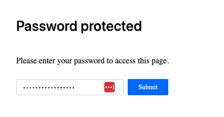

# Az Static Web Apps

{{#include ../../../banners/hacktricks-training.md}}

## Thông tin cơ bản về Static Web Apps

Azure Static Web Apps là dịch vụ đám mây dùng để lưu trữ **web app tĩnh với CI/CD tự động từ các repository như GitHub**. Dịch vụ cung cấp khả năng phân phối nội dung toàn cầu, backend serverless và HTTPS tích hợp sẵn, giúp ứng dụng an toàn và có khả năng mở rộng.<sup>[[3]](#references)</sup> Tuy nhiên, dù dịch vụ có tên là "tĩnh", điều đó không có nghĩa là nó hoàn toàn an toàn. Các rủi ro bao gồm cấu hình CORS sai, xác thực không đầy đủ và nội dung bị giả mạo; nếu không được quản lý đúng cách, chúng có thể khiến ứng dụng bị tấn công như XSS và rò rỉ dữ liệu.

### Xác thực triển khai

> [!TIP]
> Khi tạo Static App, bạn có thể chọn **chính sách ủy quyền triển khai** giữa **Azure deployment token** và **GitHub access token**.<sup>[[4]](#references)</sup>

- **Deployment token**: Một token được tạo và dùng để xác thực quá trình triển khai. Chỉ cần có **token này là có thể triển khai phiên bản mới của ứng dụng**. Một **GitHub Action sẽ tự động được triển khai** trong repo, với token được lưu trong secret để triển khai phiên bản mới của ứng dụng mỗi khi repo được cập nhật.<sup>[[4]](#references)[[5]](#references)</sup>
- **GitHub access token**: Workflow GitHub Actions được tạo sẽ lấy OIDC ID token bằng **`actions/github-script@v6`** và truyền token đó dưới dạng **`github_id_token`** cho **`Azure/static-web-apps-deploy@v1`**; workflow vẫn bao gồm `azure_static_web_apps_api_token` như trong ví dụ của Microsoft.<sup>[[4]](#references)</sup>


### Xác thực cơ bản cho Web App

Bạn có thể **cấu hình mật khẩu** để truy cập Web App. Web console cho phép cấu hình để chỉ bảo vệ các môi trường staging hoặc bảo vệ cả staging và production.<sup>[[6]](#references)</sup>

Tại thời điểm viết bài, Web App được bảo vệ bằng mật khẩu sẽ trông như sau:

<figure><figcaption></figcaption></figure>


Thao tác ARM `Get Basic Auth` cho biết **xác thực cơ bản có được bật hay không** và những môi trường nào được bảo vệ bằng:

```bash
az rest --method GET \
--url "/subscriptions/<subscription-id>/resourceGroups/<resource-group>/providers/Microsoft.Web/staticSites/<app-name>/basicAuth/default?api-version=2025-05-01"
```

Phản hồi cho biết trạng thái basic-auth và các môi trường áp dụng, nhưng **không hiển thị mật khẩu dưới dạng văn bản thuần**.<sup>[[6]](#references)</sup>

### Routes và Vai trò

Routes xác định **cách các yêu cầu HTTP đến được xử lý** trong một static web app. Được cấu hình trong tệp **`staticwebapp.config.json`**, chúng kiểm soát việc viết lại URL, chuyển hướng, hạn chế quyền truy cập và ủy quyền dựa trên vai trò, đảm bảo xử lý tài nguyên và bảo mật phù hợp.<sup>[[7]](#references)</sup>

Một số ví dụ:

```json
{
  "routes": [
    {
      "route": "/",
      "rewrite": "/index.html"
    },
    {
      "route": "/about",
      "rewrite": "/about.html"
    },
    {
      "route": "/api/*",
      "allowedRoles": ["authenticated"]
    },
    {
      "route": "/admin",
      "redirect": "/login",
      "statusCode": 302
    },
    {
      "route": "/google",
      "redirect": "https://google.com",
      "statusCode": 302
    }
  ],
  "navigationFallback": {
    "rewrite": "/index.html",
    "exclude": ["/api/*", "/assets/*"]
  }
}
```

Lưu ý rằng có thể **bảo vệ một đường dẫn bằng một role**; người dùng cần xác thực với ứng dụng và được cấp role đó để truy cập đường dẫn. Cũng có thể **tạo lời mời** cấp các role cụ thể cho những người dùng cụ thể. Các nhà cung cấp xác thực được cấu hình sẵn hiện tại là Microsoft Entra ID và GitHub; các nhà cung cấp tùy chỉnh cần được cấu hình riêng.<sup>[[7]](#references)[[8]](#references)</sup>

> [!TIP]
> Lưu ý rằng có thể cấu hình App để không chấp nhận **các thay đổi đối với tệp `staticwebapp.config.json`**. Trong trường hợp này, chỉ thay đổi tệp trên GitHub có thể là chưa đủ; bạn cũng cần **thay đổi cài đặt trong App**.<sup>[[9]](#references)</sup>

URL staging cho một pull request có định dạng sau: `https://<DEFAULT_HOST_NAME>-<PR_NUMBER>.<LOCATION>.azurestaticapps.net`.<sup>[[10]](#references)</sup>

### Snippets

Azure Static Web Apps có thể chèn code tùy chỉnh vào `head` hoặc `body` của mọi trang tại runtime thông qua snippets.<sup>[[11]](#references)</sup> Có thể dùng tính năng này để **chèn code độc hại** vào ứng dụng, chẳng hạn như **code JS để đánh cắp thông tin xác thực**, **keylogger**... Xem thêm thông tin trong phần privilege escalation.

### Managed Identities

Azure Static Web Apps có thể được cấu hình để dùng **managed identities**. Tuy nhiên, như mô tả trong [FAQ](https://learn.microsoft.com/en-gb/azure/static-web-apps/faq#does-static-web-apps-support-managed-identity-), chúng chỉ được hỗ trợ để **truy xuất secret xác thực từ Azure Key Vault, chứ không phải để truy cập các tài nguyên Azure khác**.<sup>[[12]](#references)[[13]](#references)</sup>

Để biết thêm thông tin, xem hướng dẫn của Microsoft về [bảo mật secret xác thực trong Azure Key Vault](https://learn.microsoft.com/en-us/azure/static-web-apps/key-vault-secrets).<sup>[[13]](#references)</sup>

## Enumeration

Azure CLI cung cấp các lệnh `list`, `show`, appsettings, environment, secrets, users và backend cho Static Web Apps.<sup>[[14]](#references)</sup> Module Az.Websites cung cấp các cmdlet `Get-AzStaticWebApp*` tương ứng.<sup>[[15]](#references)</sup>

{{#tabs }}
{{#tab name="az cli" }}
```bash
# List Static Webapps
az staticwebapp list --output table

# Get Static Webapp details
az staticwebapp show --name <name> --resource-group <res-group> --output table

# Get appsettings
az staticwebapp appsettings list --name <name>

# Get env information
az staticwebapp environment list --name <name>
az staticwebapp environment functions --name <name>

# Get deployment token (API key)
az staticwebapp secrets list --name <name>

# Get invited users
az staticwebapp users list --name <name>

# Get current snippets
az rest --method GET \
  --url "https://management.azure.com/subscriptions/<subscription-id>/resourceGroups/<res-group>/providers/Microsoft.Web/staticSites/<app-name>/snippets?api-version=2022-03-01"

# Check connected backends
az staticwebapp backends show --name <name> --resource-group <res-group>
```
{{#endtab }}

{{#tab name="Az Powershell" }}
```powershell
Get-Command -Module Az.Websites

# Retrieves details of a specific Static Web App in the specified resource group.
Get-AzStaticWebApp -ResourceGroupName <ResourceGroupName> -Name <Name>

# Lists the build environments for a Static Web App.
Get-AzStaticWebAppBuild -ResourceGroupName <ResourceGroupName> -Name <Name>

# Retrieves the application settings for a specific build environment in a Static Web App.
Get-AzStaticWebAppBuildAppSetting -ResourceGroupName <ResourceGroupName> -Name <Name> -EnvironmentName <EnvironmentName>

# Retrieves functions for a specific build environment in a Static Web App.
Get-AzStaticWebAppBuildFunction -ResourceGroupName <ResourceGroupName> -Name <Name> -EnvironmentName <EnvironmentName>

# Retrieves function app settings for a specific build environment in a Static Web App.
Get-AzStaticWebAppBuildFunctionAppSetting -ResourceGroupName <ResourceGroupName> -Name <Name> -EnvironmentName <EnvironmentName>

# Retrieves the configured roles for a Static Web App.
Get-AzStaticWebAppConfiguredRole -ResourceGroupName <ResourceGroupName> -Name <Name>

# Retrieves the custom domains configured for a Static Web App.
Get-AzStaticWebAppCustomDomain -ResourceGroupName <ResourceGroupName> -Name <Name>

# Retrieves details of the functions associated with a Static Web App.
Get-AzStaticWebAppFunction -ResourceGroupName <ResourceGroupName> -Name <Name>

# Retrieves the app settings for the function app associated with a Static Web App.
Get-AzStaticWebAppFunctionAppSetting -ResourceGroupName <ResourceGroupName> -Name <Name>

# Retrieves the secrets for a Static Web App.
Get-AzStaticWebAppSecret -ResourceGroupName <ResourceGroupName> -Name <Name>         

# Retrieves general app settings for a Static Web App.
Get-AzStaticWebAppSetting -ResourceGroupName <ResourceGroupName> -Name <Name>   

# Retrieves user details for a Static Web App with a specified authentication provider.
Get-AzStaticWebAppUser -ResourceGroupName <ResourceGroupName> -Name <Name> -AuthProvider <AuthProvider>

# Retrieves user-provided function apps associated with a Static Web App.
Get-AzStaticWebAppUserProvidedFunctionApp -ResourceGroupName <ResourceGroupName> -Name <Name> 

```
{{#endtab }}
{{#endtabs }}

> [!WARNING]
> Tài liệu hiện tại của Microsoft liệt kê Database Connections cho Static Web Apps với ngày ngừng hoạt động là 30 tháng 11 năm 2025, vì vậy các ví dụ REST về kết nối database cũ đã được lược bỏ.<sup>[[16]](#references)</sup>


## Ví dụ tạo Web Apps

Xem hướng dẫn trên portal tại [Quickstart: Build your first static web app](https://learn.microsoft.com/en-us/azure/static-web-apps/get-started-portal?tabs=react&pivots=github).<sup>[[17]](#references)</sup>

1. Fork repository https://github.com/staticwebdev/react-basic/generate vào tài khoản GitHub của bạn và đặt tên là `my-first-static-web-app`.
2. Trong Azure portal, tạo Static Web App, cấu hình quyền truy cập GitHub và chọn repository mới đã fork trước đó.
3. Tạo ứng dụng, đợi vài phút rồi kiểm tra trang mới của bạn.

## Privilege Escalation and Post Exploitation

Bạn có thể tìm thấy toàn bộ thông tin về privilege escalation và post exploitation trong Azure Static Web Apps tại liên kết sau:

{{#ref}}
../az-privilege-escalation/az-static-web-apps-privesc.md
{{#endref}}

## References

- [1] [Tổng quan về App Service](https://learn.microsoft.com/en-in/azure/app-service/overview)
- [2] [Các gói hosting của Azure App Service](https://learn.microsoft.com/en-us/azure/app-service/overview-hosting-plans)
- [3] [Azure Static Web Apps là gì?](https://learn.microsoft.com/en-us/azure/static-web-apps/overview)
- [4] [Cấu hình build cho Azure Static Web Apps](https://learn.microsoft.com/en-us/azure/static-web-apps/build-configuration)
- [5] [Đặt lại deployment token trong Azure Static Web Apps](https://learn.microsoft.com/en-us/azure/static-web-apps/deployment-token-management)
- [6] [Static Sites - Lấy Basic Auth](https://learn.microsoft.com/en-us/rest/api/appservice/static-sites/get-basic-auth?view=rest-appservice-2025-05-01)
- [7] [Cấu hình Azure Static Web Apps](https://learn.microsoft.com/en-us/azure/static-web-apps/configuration)
- [8] [Xác thực và cấp quyền cho Static Web Apps](https://learn.microsoft.com/en-us/azure/static-web-apps/authentication-authorization)
- [9] [Static Sites - Tạo hoặc cập nhật Static Site](https://learn.microsoft.com/en-us/rest/api/appservice/static-sites/create-or-update-static-site?view=rest-appservice-2026-03-15)
- [10] [Môi trường preview trong Azure Static Web Apps](https://learn.microsoft.com/en-us/azure/static-web-apps/preview-environments)
- [11] [Snippet trong Azure Static Web Apps](https://learn.microsoft.com/en-us/azure/static-web-apps/snippets)
- [12] [Câu hỏi thường gặp về Azure Static Web Apps](https://learn.microsoft.com/en-us/azure/static-web-apps/faq)
- [13] [Bảo vệ secret xác thực trong Azure Key Vault cho Azure Static Web Apps](https://learn.microsoft.com/en-us/azure/static-web-apps/key-vault-secrets)
- [14] [az staticwebapp](https://learn.microsoft.com/en-us/cli/azure/staticwebapp?view=azure-cli-latest)
- [15] [Module Az.Websites](https://learn.microsoft.com/en-us/powershell/module/az.websites/?view=azps-16.2.0)
- [16] [Kết nối với database bằng Azure Static Web Apps](https://learn.microsoft.com/en-us/azure/static-web-apps/database-overview)
- [17] [Hướng dẫn nhanh: Tạo static web app đầu tiên](https://learn.microsoft.com/en-us/azure/static-web-apps/get-started-portal?tabs=react&pivots=github)
{{#include ../../../banners/hacktricks-training.md}}
