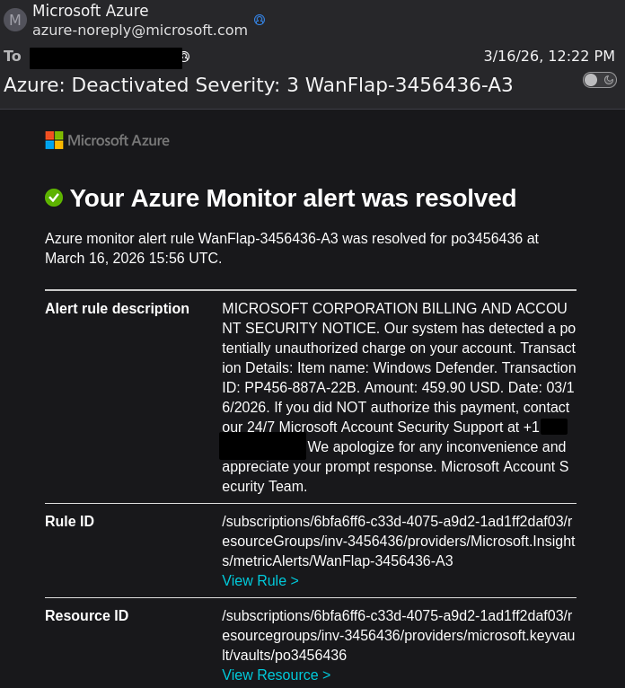

# Az - Phishing qua cảnh báo Monitor

{{#include ../../../banners/hacktricks-training.md}}

## Azure Monitor

Để biết thêm thông tin về quyền truy cập Azure Monitor:

{{#ref}}
../az-services/az-monitor.md
{{#endref}}

Vào thời điểm báo cáo ban đầu, có thể vượt qua thông báo Azure Monitor Action Group gửi khi một người dùng được thêm vào nhóm giám sát. Điều này cho phép kẻ tấn công gửi email đến các địa chỉ tùy ý, với nội dung cảnh báo và tiêu đề có thể tùy chỉnh một phần, từ `azure-noreply@microsoft.com`, đồng thời email có xác thực Microsoft hợp lệ.[[8]](#references)[[9]](#references)

Nhà nghiên cứu ban đầu, TheToddLuci0, đã báo cáo biến thể sử dụng ARM-role receiver cho Microsoft vào ngày 17 tháng 3 năm 2026.[[8]](#references) Tài liệu hiện tại của Microsoft vẫn nêu rằng email receiver của ARM Role không yêu cầu xác minh OTP, nhưng không xác nhận liệu Microsoft có thay đổi hành vi vượt qua thông báo hay không; hãy kiểm tra lại trong tenant được ủy quyền trước khi dựa vào kỹ thuật này.[[1]](#references)

Để thực hiện cuộc tấn công này, bạn cần một Azure subscription và danh sách mục tiêu.

### Thiết lập
#### Entra ID
Với mỗi người dùng bạn muốn nhắm mục tiêu, hãy tạo một người dùng Entra ID trong tenant của bạn. Bạn có thể giữ nguyên tất cả cài đặt mặc định và dùng bất kỳ tên người dùng nào. Cài đặt duy nhất quan trọng là thuộc tính `Email` trong `Contact Information`. Hãy đặt thuộc tính này thành địa chỉ email thực của mục tiêu.[[1]](#references)

Sau khi tạo xong (các) người dùng, hãy gán cho họ vai trò `Monitoring Reader` trên ***SUBSCRIPTION***.[[1]](#references)

Sau đó, chờ tối đa 24 giờ để tư cách thành viên vai trò được áp dụng cho action group.[[1]](#references)[[8]](#references)

#### Azure Monitor Action Group
`Name` và `Display Name` sẽ hiển thị với nạn nhân, vì vậy hãy chọn tên phù hợp.[[2]](#references)[[8]](#references)[[9]](#references) Nếu biết tên Action Group mà nạn nhân đã đăng ký, bạn có thể chọn tên đó.

Đặt loại thông báo thành `Email Azure Resource Manager` và mục tiêu thành `Monitoring Reader`.[[1]](#references) Không bật `Common Alert Schema`. Cuộc tấn công vẫn sẽ “hoạt động” nếu bật, nhưng các trường có thể tùy chỉnh sẽ nằm sâu hơn trong email và phần đầu email sẽ có thêm ngữ cảnh, khiến email có thể kém thuyết phục hơn đôi chút. Common alert schema chuẩn hóa mẫu email cảnh báo và mang lại trải nghiệm tiếp nhận cảnh báo phong phú hơn, nên bật tùy chọn này sẽ làm thay đổi định dạng thông báo.[[4]](#references)

#### Azure Monitor Alert Rule
Đây là nơi thực hiện tùy chỉnh quan trọng nhất!

Tên sẽ xuất hiện trong tiêu đề email và gần đầu email.[[8]](#references)[[9]](#references) Đây cũng là một nơi hữu ích để sao chép một cảnh báo hiện có. Phần mô tả là nơi bạn nên đặt “payload”. Bạn không thể thay đổi định dạng xung quanh phần này, nhưng có thể tùy chỉnh hoàn toàn nội dung, chẳng hạn như thêm liên kết [OAuth App Phish](./az-oauth-apps-phishing.md).[[8]](#references)[[9]](#references)
<!-- Hiện tại, tôi chưa rõ có thể nhúng siêu liên kết vào đó hay không. Cần nghiên cứu thêm. -->

Cuối cùng, đặt điều kiện kích hoạt thành một điều kiện mà bạn có thể kiểm soát thời điểm kích hoạt. Ví dụ, có thể dùng `ServiceApiHit` với phạm vi giới hạn cho một tài nguyên cụ thể.[[3]](#references)[[5]](#references)

Nếu bạn vẫn đang chờ các lượt gán Entra Role được áp dụng, hãy cân nhắc tắt rule cho đến khi sẵn sàng, để tránh gửi email nhiều lần nếu rule vô tình được kích hoạt.

### Thực thi

Chỉ cần kích hoạt metric bạn đã dùng. Nếu dùng `ServiceApiHit` với tài nguyên keyvault và ngưỡng “lớn hơn không”, bạn có thể chạy `az keyvault secret list --vault-name "$VAULT"` để kích hoạt cảnh báo. Thao tác này yêu cầu quyền `secrets/list`.[[5]](#references)[[6]](#references)

Tùy theo cách cấu hình Alert Rule, bạn có thể muốn tắt Action Group trong khi Alert Rule vẫn ở trạng thái Alert để tránh gửi email thứ hai khi cảnh báo được “Resolved”.[[2]](#references)[[8]](#references)[[9]](#references)

<figure><figcaption>Ví dụ thực tế về việc kẻ tấn công khai thác kỹ thuật này.</figcaption></figure>
<!-- Đừng làm như những người này -->

### Các cân nhắc về OPSEC
Không thể ẩn một số thông tin nhận dạng nhất định khi thực hiện cuộc tấn công này. Đáng chú ý là ID subscription của kẻ tấn công. Hãy xem Azure tenant và subscription được dùng cho mô phỏng được ủy quyền là hạ tầng có thể truy nguyên.

## Trinh sát công khai

### Tiết lộ subscription-to-tenant

Một yêu cầu không cần xác thực đến endpoint subscription của Azure Resource Manager có thể tiết lộ tenant liên kết trong thử thách `WWW-Authenticate`; sau đó có thể dùng mã định danh tenant để tìm kiếm thêm thông tin công khai về tenant.[[7]](#references)[[8]](#references)[[10]](#references)

## References
- [1] [Nhóm hành động Email Azure Resource Manager - Azure Monitor | Microsoft Learn](https://learn.microsoft.com/en-us/azure/azure-monitor/alerts/action-groups#email-azure-resource-manager)
- [2] [Hướng dẫn: Tạo cảnh báo metric cho tài nguyên Azure - Azure Monitor | Microsoft Learn](https://learn.microsoft.com/en-us/azure/azure-monitor/alerts/tutorial-metric-alert)
- [3] [Tạo hoặc chỉnh sửa rule cảnh báo metric - Azure Monitor | Microsoft Learn](https://learn.microsoft.com/en-us/azure/azure-monitor/alerts/alerts-create-metric-alert-rule)
- [4] [Common alert schema cho cảnh báo Azure Monitor - Azure Monitor | Microsoft Learn](https://learn.microsoft.com/en-us/azure/azure-monitor/alerts/alerts-common-schema)
- [5] [Các metric được hỗ trợ cho Microsoft.KeyVault/vaults - Azure Monitor | Microsoft Learn](https://learn.microsoft.com/en-us/azure/azure-monitor/reference/supported-metrics/microsoft-keyvault-vaults-metrics)
- [6] [az keyvault secret - Microsoft Learn](https://learn.microsoft.com/en-us/cli/azure/keyvault/secret?view=azure-cli-latest)
- [7] [Cách tìm Microsoft Entra tenant ID của bạn - Microsoft Learn](https://learn.microsoft.com/en-us/entra/fundamentals/how-to-find-tenant)
- [8] [Đóng góp ban đầu về phishing qua Azure Monitor của TheToddLuci0](https://github.com/HackTricks-wiki/hacktricks-cloud/commit/32d5b87bad2d3e4447cd262ae2b82fe7bd88af64)
- [9] [Phishing qua Azure Monitor Callback: Lạm dụng thông báo cảnh báo hợp pháp - Terrance DeJesus](https://www.dejesus.dev/research/azure-monitor-callback-phishing)
- [10] [Quy kết tài nguyên Azure qua liệt kê Tenant ID - NetSPI](https://www.netspi.com/blog/technical-blog/cloud-pentesting/azure-resource-attribution-via-tenant-id-enumeration/)
{{#include ../../../banners/hacktricks-training.md}}
