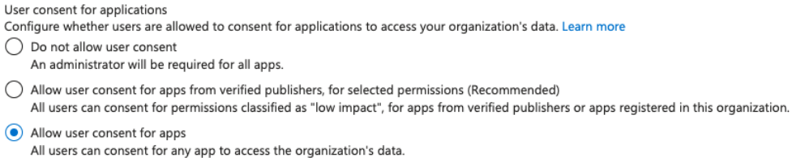

# Az - OAuth Apps Phishing

{{#include ../../../banners/hacktricks-training.md}}

## Entra ID

Để biết thêm thông tin về quyền truy cập Entra ID:

{{#ref}}
../az-services/az-azuread.md
{{#endref}}

## Credential leak tiềm ẩn

### Mã phản hồi ủy quyền OAuth

Tham số `code` trong phản hồi ủy quyền là credential có thời hạn ngắn mà client tương ứng có thể đổi lấy token. Việc đổi mã bị ràng buộc bởi client, redirect URI và bất kỳ PKCE verifier hoặc xác thực confidential-client nào. Authorization code không phải là access token; riêng `client_id`, `login_hint` và `session_state` không cấp quyền truy cập. Audience và permissions của token được cấp sẽ quyết định quyền truy cập.<sup>[[23]](#references)</sup>

Dùng pattern Python `re` này để phát hiện các URL callback Microsoft/VS Code hoặc callback cục bộ có khả năng chứa code trong logs thuộc quyền quản lý, bản xuất từ browser và các artifact được chia sẻ. Các kết quả khớp chỉ là ứng viên: ví dụ và code đã hết hạn vẫn có thể khớp. Hãy che các redirect URL nhạy cảm và xem xét sign-in/session liên quan thay vì chia sẻ hoặc phát lại kết quả khớp.

```regex
https?://(?:login\.microsoftonline\.com|insiders\.vscode\.dev|vscode-redirect\.azurewebsites\.net|localhost(?::[0-9]+)?|127\.0\.0\.1(?::[0-9]+)?)(?:/[^\s"'<>?]*)?\?(?:[^\s"'<>#]*&)?code=[A-Za-z0-9._~%+-]{8,}
```

## OAuth App Phishing

**Microsoft Entra applications** có thể yêu cầu các quyền delegated (scopes) do Microsoft Graph và các API khác cung cấp. Sau khi được chấp thuận, token delegated cho phép ứng dụng hoạt động thay mặt người dùng đã đăng nhập; ứng dụng không thể truy cập dữ liệu mà người dùng đó không thể truy cập. Quyền ứng dụng là một mô hình app-only riêng biệt và không bị giới hạn bởi quyền của người dùng đã đăng nhập.<sup>[[4]](#references)</sup>

### Quyền chấp thuận ứng dụng

Việc **người dùng có thể chấp thuận ứng dụng hay không** được kiểm soát bởi chính sách tenant. Tenant sử dụng chính sách chấp thuận của người dùng kiểu cũ sẽ cho phép người dùng chấp thuận các quyền không yêu cầu quản trị viên chấp thuận; thay vào đó, quản trị viên có thể giới hạn việc chấp thuận ở **các ứng dụng từ publisher đã xác minh đối với những quyền được chọn** hoặc tắt quyền chấp thuận của người dùng.<sup>[[3]](#references)[[5]](#references)</sup>

<figure><figcaption></figcaption></figure>

Nếu người dùng không thể chấp thuận, **quản trị viên** có thể chấp thuận ứng dụng thay mặt người dùng. Vai trò cụ thể tùy thuộc vào API và quyền: `Application Administrator` và `Cloud Application Administrator` có thể cấp quyền delegated và hầu hết quyền ứng dụng, trong khi quyền ứng dụng Microsoft Graph yêu cầu quản trị viên có đặc quyền cao hơn, chẳng hạn như `Privileged Role Administrator`.<sup>[[3]](#references)[[12]](#references)</sup>

Hướng dẫn ứng phó sự cố hiện tại của Microsoft liệt kê `openid`, `profile`, `email`, `User.Read`, `User.ReadBasic.All` và `offline_access` (khi kết hợp với một quyền rủi ro thấp khác) là tập quyền rủi ro thấp ban đầu. Danh sách thực tế phụ thuộc vào chính sách chấp thuận của tenant và có thể thay đổi.<sup>[[3]](#references)[[5]](#references)</sup>

Nếu chính sách của tenant cho phép người dùng chấp thuận mọi ứng dụng, họ có thể chấp thuận bất kỳ quyền nào không yêu cầu quản trị viên chấp thuận.<sup>[[3]](#references)[[5]](#references)</sup>

### 2 loại tấn công

- **Phishing chấp thuận không cần xác thực / từ tài khoản bên ngoài**: Từ một tài khoản nằm ngoài tenant mục tiêu, đăng ký ứng dụng đa tenant với các quyền delegated rủi ro thấp như `User.Read` và `User.ReadBasic.All`, sau đó phishing người dùng mục tiêu để họ chấp thuận ứng dụng. `User.ReadBasic.All` cung cấp một tập thuộc tính hồ sơ cơ bản giới hạn của những người dùng khác, thay mặt người dùng đã đăng nhập.<sup>[[3]](#references)[[4]](#references)[[19]](#references)</sup>
  - Cách này yêu cầu người dùng bị phishing **có thể chấp thuận ứng dụng từ tenant bên ngoài** theo chính sách của tenant mục tiêu.<sup>[[5]](#references)</sup>
  - Nếu người dùng bị phishing là quản trị viên có quyền chấp thuận cần thiết, ứng dụng có thể yêu cầu thêm các quyền delegated đặc quyền cao hơn, tùy theo API và giới hạn vai trò.<sup>[[3]](#references)[[12]](#references)</sup>
- **Phishing chấp thuận có xác thực / trong tenant**: Sau khi xâm nhập một principal có thể tạo hoặc quản lý ứng dụng trong tenant mục tiêu, tạo ứng dụng tại đó rồi phishing người dùng có đặc quyền, người có thể chấp thuận các quyền delegated đặc quyền cao hơn.<sup>[[3]](#references)[[12]](#references)</sup>
  - Trong trường hợp này, kẻ tấn công có thể đã nhìn thấy thư mục, nên `User.ReadBasic.All` ít hữu ích hơn.
  - Các quyền đáng nhắm đến là những quyền yêu cầu quản trị viên chấp thuận, vì người dùng thông thường chỉ có thể chấp thuận các quyền được chính sách tenant cho phép, không phải các quyền bị giới hạn cho quản trị viên.<sup>[[4]](#references)[[6]](#references)</sup>

### Người dùng được phép chấp thuận

Các lệnh gọi Microsoft Graph trong phạm vi tenant này phải được thực thi bằng danh tính được cấp quyền trong tenant mục tiêu. Để đọc chính sách ủy quyền, cần có `Policy.Read.All`; để liệt kê các chính sách cấp quyền, cần có `Policy.Read.PermissionGrant`.<sup>[[9]](#references)[[10]](#references)</sup>

```bash
az rest --method GET --url "https://graph.microsoft.com/v1.0/policies/authorizationPolicy"
```

- **Người dùng có thể chấp thuận mọi ứng dụng**: Nếu `permissionGrantPoliciesAssigned` chứa `ManagePermissionGrantsForSelf.microsoft-user-default-legacy`, người dùng có thể chấp thuận mọi quyền không yêu cầu sự chấp thuận của quản trị viên.<sup>[[5]](#references)</sup>
- **Người dùng có thể chấp thuận ứng dụng từ nhà phát hành đã xác minh hoặc tổ chức, với một số quyền được chọn**: Nếu trường này chứa `ManagePermissionGrantsForSelf.microsoft-user-default-low`, quyền chấp thuận của người dùng chỉ áp dụng cho các ứng dụng đã được xác minh hoặc thuộc tenant và các quyền được phân loại là có tác động thấp.<sup>[[5]](#references)</sup>
- **Tắt quyền chấp thuận của người dùng**: Không có chính sách `ManagePermissionGrantsForSelf.*` nào được gán. Giữ nguyên mọi mục `ManagePermissionGrantsForOwnedResource.*` hiện có vì chúng điều chỉnh các tình huống chấp thuận tài nguyên riêng biệt.<sup>[[5]](#references)</sup>

Để kiểm tra điều kiện và ý nghĩa của từng chính sách cấp quyền, hãy truy vấn:

```bash
az rest --method GET --url "https://graph.microsoft.com/v1.0/policies/permissionGrantPolicies"
```

### **Application Admins**

Sử dụng các giá trị `roleTemplateId` tích hợp sẵn, bất biến thay vì các ID đối tượng directory-role dành riêng cho tenant được hard-code. Endpoint members của `directoryRoles` chấp nhận ID đối tượng role hoặc ID template role tích hợp sẵn; role phải được kích hoạt trong tenant.<sup>[[11]](#references)[[12]](#references)</sup>

```bash
# Get activated directory roles
az rest --method GET --url "https://graph.microsoft.com/v1.0/directoryRoles"

# Get Global Administrators (roleTemplateId: 62e90394-69f5-4237-9190-012177145e10)
az rest --method GET --url "https://graph.microsoft.com/v1.0/directoryRoles(roleTemplateId='62e90394-69f5-4237-9190-012177145e10')/members"

# Get Application Administrators (roleTemplateId: 9b895d92-2cd3-44c7-9d02-a6ac2d5ea5c3)
az rest --method GET --url "https://graph.microsoft.com/v1.0/directoryRoles(roleTemplateId='9b895d92-2cd3-44c7-9d02-a6ac2d5ea5c3')/members"

# Get Cloud Application Administrators (roleTemplateId: 158c047a-c907-4556-b7ef-446551a6b5f7)
az rest --method GET --url "https://graph.microsoft.com/v1.0/directoryRoles(roleTemplateId='158c047a-c907-4556-b7ef-446551a6b5f7')/members"
```

## **Tổng quan luồng tấn công**

Một minh họa về phishing yêu cầu consent có thể kết hợp domain giả mạo do operator kiểm soát, app đa tenant, delegated permissions và redirect bằng authorization code. Microsoft Entra trả authorization code về redirect URI đã đăng ký sau khi đăng nhập và consent; sau đó ứng dụng đổi code lấy token.<sup>[[1]](#references)[[7]](#references)[[8]](#references)</sup>

1. **Đăng ký domain và hosting**: Đăng ký domain trông giống một site đáng tin cậy, chẳng hạn `safedomainlogin.com`, rồi host ứng dụng consent-flow tại một subdomain như `companyname.safedomainlogin.com`.<sup>[[1]](#references)</sup>
2. **Đăng ký ứng dụng**: Đăng ký ứng dụng đa tenant trong tenant của operator, đặt display name phù hợp với mục tiêu và cấu hình redirect URI trỏ đến endpoint được host.<sup>[[1]](#references)[[7]](#references)</sup>
3. **Permissions**: Chỉ yêu cầu các delegated API permissions cần thiết cho bài kiểm thử được ủy quyền, chẳng hạn `Mail.Read`, `Notes.Read.All`, `Files.ReadWrite.All`, `User.ReadBasic.All` và `User.Read`. Token được cấp vẫn bị giới hạn bởi quyền truy cập của người dùng đã đăng nhập và chính sách consent của tenant mục tiêu.<sup>[[1]](#references)[[4]](#references)[[19]](#references)</sup>
4. **Authorization link**: Tạo authorization link có chứa client ID của ứng dụng và gửi cho những người dùng được chọn trong khuôn khổ engagement đã được phê duyệt. Mục tiêu vẫn phải xác thực và đáp ứng mọi yêu cầu về consent, MFA hoặc Conditional Access.<sup>[[1]](#references)[[8]](#references)</sup>

## Phishing authorization-code bằng first-party đáng tin cậy

Volexity đã ghi nhận việc làm lộ authorization response thông qua các workflow Microsoft first-party hợp lệ, đôi khi không cần hiển thị lời nhắc consent mới. Vì vậy, trang đăng nhập Microsoft chính chủ không chứng minh rằng request xung quanh nó là đáng tin cậy.<sup>[[24]](#references)</sup>

### Diễn giải redirect và state

Authorization code không phải access token. Code có thời hạn ngắn; Microsoft ghi nhận thời hạn thông thường khoảng một phút. Không nên áp dụng khái quát thời hạn dài bất thường được báo cáo trong một workflow đã quan sát cho các client khác. Khi được sử dụng, PKCE liên kết việc đổi code với một verifier.<sup>[[23]](#references)</sup>

Tham số `state` chứa trạng thái ứng dụng và thông tin đối chiếu CSRF; việc hiển thị nó không xác thực nội dung. Các redirect Visual Studio Code được báo cáo đã phản chiếu state gây hiểu nhầm hoặc làm lộ thông tin nhạy cảm tại các trang loopback trống.<sup>[[23]](#references)[[24]](#references)</sup>

### Hệ quả của việc đăng ký thiết bị

Báo cáo cũng mô tả việc đăng ký thiết bị trái phép có liên quan đến Microsoft Authentication Broker và Device Registration Service. Hãy xem xét việc đăng ký riêng với consent. Thiết bị đã đăng ký không nhất thiết được quản lý hoặc tuân thủ; Conditional Access vẫn được áp dụng.<sup>[[24]](#references)[[25]](#references)</sup>

Để tìm hiểu về danh tính thiết bị và mô hình session, xem:

{{#ref}}
../az-device-registration.md
{{#endref}}

{{#ref}}
../az-lateral-movement-cloud-on-prem/az-primary-refresh-token-prt.md
{{#endref}}

Để xem các biến thể phishing liên quan, xem [Device Code Authentication Phishing](az-device-code-authentication-phishing.md#authorization-code-handoff-phishing).

### Phát hiện và hunting

- Điều tra các yêu cầu chia sẻ authentication code hoặc URL của trình duyệt qua ứng dụng nhắn tin, kể cả sau khi đăng nhập trên trang do Microsoft host.<sup>[[24]](#references)</sup>
- Thiết lập baseline cho quyền truy cập Graph của Visual Studio Code và các redirect liên quan đến `insiders.vscode.dev` hoặc `vscode-redirect.azurewebsites.net` trước khi chặn hoạt động hợp lệ.<sup>[[24]](#references)</sup>
- Đối chiếu ID thiết bị mới, địa chỉ đăng ký, client ID và hoạt động mailbox; Graph có thể hiển thị địa chỉ Microsoft thay vì nguồn ban đầu.<sup>[[24]](#references)</sup>
- Phân biệt tham số redirect thực tế với state được hiển thị hoặc mồi nhử giả danh cuộc họp.<sup>[[23]](#references)[[24]](#references)</sup>

## Ví dụ tấn công

Chỉ sử dụng ví dụ này trong môi trường kiểm thử được ủy quyền.

1. Đăng ký **ứng dụng mới**. Dùng đăng ký single-tenant cho lab chỉ giới hạn trong directory hiện tại, hoặc đăng ký đa tenant khi bài kiểm thử cần người dùng từ một tenant khác. Đặt **redirect URI** thành endpoint sẽ nhận authorization code (`http://localhost:8000/callback` theo mặc định). Redirect URI phải khớp chính xác với giá trị đã đăng ký; HTTPS là bắt buộc, ngoại trừ các trường hợp localhost được cho phép.<sup>[[7]](#references)[[8]](#references)</sup>

<figure><figcaption></figcaption></figure>

2. Với luồng authorization-code dành cho confidential web-app trong ví dụ này, hãy tạo application secret và lưu giá trị đó một cách an toàn.<sup>[[7]](#references)[[15]](#references)</sup>

<figure><figcaption></figcaption></figure>

3. Chọn delegated API permissions (ví dụ: `Mail.Read`, `Notes.Read.All`, `Files.ReadWrite.All`, `User.ReadBasic.All` và `User.Read`). Các permissions hiển thị trong lời nhắc consent và những permissions mà token thực sự có thể sử dụng phụ thuộc vào chính sách của tenant mục tiêu và quyền truy cập của người dùng.<sup>[[4]](#references)[[5]](#references)[[19]](#references)</sup>

<figure><figcaption></figcaption></figure>

>[!WARNING]
>Ứng dụng có thể yêu cầu permissions từ các API không phải Microsoft Graph. Azure Resource Manager cung cấp delegated scope `user_impersonation`, thường được yêu cầu dưới dạng `https://management.azure.com/user_impersonation`; token được tạo ra vẫn chỉ cho phép các thao tác mà người dùng đã đăng nhập có quyền thực hiện. Các resource API khác cung cấp resource identifier và scope riêng.<sup>[[4]](#references)[[6]](#references)[[20]](#references)</sup>

4. **Chạy trang web** ([**azure_oauth_phishing_example**](https://github.com/carlospolop/azure_oauth_phishing_example)) yêu cầu các permissions. Ví dụ này tạo authorization-code request và in ra access token cùng refresh token được trả về, vì vậy hãy coi token thu thập được là thông tin nhạy cảm.<sup>[[8]](#references)[[15]](#references)</sup>

```bash
# From https://github.com/carlospolop/azure_oauth_phishing_example
python3 azure_oauth_phishing_example.py --client-secret <client-secret> --client-id <client-id> --scopes "email,Files.ReadWrite.All,Mail.Read,Notes.Read.All,offline_access,openid,profile,User.Read"
```

5. **Gửi URL cho nạn nhân**
   1. Trong ví dụ này, URL cục bộ là `http://localhost:8000`.<sup>[[15]](#references)</sup>
6. **Người dùng phải chấp nhận lời nhắc** nếu chính sách consent của tenant mục tiêu cho phép các quyền được yêu cầu. Tenant có thể chặn yêu cầu hoặc yêu cầu consent của quản trị viên.<sup>[[3]](#references)[[5]](#references)[[15]](#references)</sup>

<figure><figcaption></figcaption></figure>

7. Dùng **access token để truy cập các quyền thực sự được cấp**. Các lệnh gọi sau liệt kê thư mục gốc trong drive của người dùng đã đăng nhập, thư email trong mailbox và các sổ tay OneNote khi token có các delegated permissions phù hợp.<sup>[[16]](#references)[[17]](#references)[[18]](#references)</sup>

```bash
export ACCESS_TOKEN=<ACCESS_TOKEN>

# List drive files
curl -X GET \
  https://graph.microsoft.com/v1.0/me/drive/root/children \
  -H "Authorization: Bearer $ACCESS_TOKEN" \
  -H "Accept: application/json"

# List emails
curl -X GET \
  https://graph.microsoft.com/v1.0/me/messages \
  -H "Authorization: Bearer $ACCESS_TOKEN" \
  -H "Accept: application/json"

# List notes
curl -X GET \
  https://graph.microsoft.com/v1.0/me/onenote/notebooks \
  -H "Authorization: Bearer $ACCESS_TOKEN" \
  -H "Accept: application/json"
```

## Công cụ khác

- [**365-Stealer**](https://github.com/AlteredSecurity/365-Stealer): Xem [Giới thiệu về 365-Stealer](https://www.alteredsecurity.com/post/introduction-to-365-stealer) để tìm hiểu workflow và cấu hình cấp consent bất hợp pháp. Repository ghi lại CLI Python và giao diện web hiện tại của công cụ.<sup>[[1]](#references)[[2]](#references)[[21]](#references)</sup>
- [**O365-Attack-Toolkit**](https://github.com/mdsecactivebreach/o365-attack-toolkit): Bộ công cụ cho operator, gồm endpoint phishing OAuth, các dịch vụ Graph backend và giao diện quản lý.<sup>[[22]](#references)</sup>

## Post-Exploitation

### Post-Exploitation bằng Phishing

Tùy vào các quyền được cấp, token có thể truy cập dữ liệu tenant (ví dụ: người dùng hoặc nhóm mà người dùng đã đăng nhập có quyền truy cập) và các tệp, ghi chú hoặc email của người dùng. Quyền ghi delegated cũng có thể cho phép thay đổi tài nguyên hoặc cài đặt directory mà người dùng đã đăng nhập được phép chỉnh sửa. Token không thể vượt quá phần giao nhau giữa các scope delegated và quyền hiệu lực của người dùng đã đăng nhập.<sup>[[4]](#references)[[16]](#references)[[17]](#references)[[18]](#references)[[19]](#references)</sup>

### Quản trị viên ứng dụng Entra ID

Nếu một principal bị xâm nhập có thể quản lý application registration—ví dụ, với tư cách owner hoặc thông qua role `Application Administrator` hay `Cloud Application Administrator`—principal đó có thể cập nhật thuộc tính xác thực và các quyền được yêu cầu của ứng dụng. Việc quản lý ứng dụng bao gồm redirect URI và collection `requiredResourceAccess`, thành phần điều khiển trải nghiệm consent; chỉ thêm các quyền được yêu cầu sẽ không cấp các quyền đó.<sup>[[12]](#references)[[13]](#references)[[14]](#references)</sup>

- Kẻ tấn công có thể thêm một redirect URI do mình kiểm soát mà không xóa URI hợp lệ, sau đó gửi authorization request có tham số `redirect_uri` sử dụng giá trị vừa thêm. URI phải được đăng ký và khớp chính xác. Nếu người dùng đang có phiên hoạt động, quá trình đăng nhập có thể tiếp tục mà không yêu cầu nhập thông tin xác thực lần nữa, nhưng MFA, Conditional Access, consent và các bước kiểm tra trạng thái riêng của ứng dụng vẫn có thể can thiệp.<sup>[[7]](#references)[[8]](#references)</sup>
- Trong authorization-code flow, phản hồi bị chuyển hướng thường là authorization code có thời hạn ngắn, chứ không tự động là access token; để đổi mã này vẫn cần client secret hoặc PKCE verifier chính xác. Mức độ ảnh hưởng phụ thuộc vào flow và cấu hình client của ứng dụng.<sup>[[8]](#references)[[15]](#references)</sup>
- Việc thêm quyền có thể khiến người dùng thấy một lời nhắc consent mới. Các grant hiện có không tự động bao gồm những quyền mới được yêu cầu; ứng dụng phải nhận được consent cần thiết từ người dùng hoặc quản trị viên.<sup>[[5]](#references)[[14]](#references)</sup>
- Kẻ tấn công không cần sửa mã nguồn ứng dụng để thêm redirect URI hoặc thay đổi các quyền được yêu cầu, nhưng việc lấy được token vẫn phụ thuộc vào authorization flow và thông tin xác thực nêu trên.<sup>[[13]](#references)[[14]](#references)</sup>

### Application Post Exploitation

Kiểm tra các mục Applications và Service Principal trên trang:

{{#ref}}
../az-privilege-escalation/az-entraid-privesc/
{{#endref}}

## References

- [1] [Giới thiệu về 365-Stealer - Tìm hiểu và thực hiện tấn công cấp Illicit Consent Grant](https://www.alteredsecurity.com/post/introduction-to-365-stealer)
- [2] [Azure AD - Phishing - Những điều cần biết về nội bộ](https://swisskyrepo.github.io/InternalAllTheThings/cloud/azure/azure-phishing/)
- [3] [Điều tra việc cấp consent cho ứng dụng](https://learn.microsoft.com/en-us/security/operations/incident-response-playbook-app-consent)
- [4] [Tổng quan về quyền và consent trong nền tảng Microsoft identity](https://learn.microsoft.com/en-us/entra/identity-platform/permissions-consent-overview)
- [5] [Cấu hình cách người dùng cấp consent cho ứng dụng](https://learn.microsoft.com/en-us/entra/identity/enterprise-apps/configure-user-consent)
- [6] [Scopes và quyền trong nền tảng Microsoft identity](https://learn.microsoft.com/en-us/entra/identity-platform/scopes-oidc)
- [7] [Các loại ứng dụng cho nền tảng Microsoft identity](https://learn.microsoft.com/en-us/entra/identity-platform/v2-app-types)
- [8] [Lấy quyền truy cập thay mặt người dùng](https://learn.microsoft.com/en-us/graph/auth-v2-user)
- [9] [Lấy authorizationPolicy](https://learn.microsoft.com/en-us/graph/api/authorizationpolicy-get?view=graph-rest-1.0)
- [10] [Liệt kê permissionGrantPolicies](https://learn.microsoft.com/en-us/graph/api/permissiongrantpolicy-list?view=graph-rest-1.0)
- [11] [Liệt kê thành viên của directory role](https://learn.microsoft.com/en-us/graph/api/directoryrole-list-members?view=graph-rest-1.0)
- [12] [Các role tích hợp sẵn của Microsoft Entra](https://learn.microsoft.com/en-us/entra/identity/role-based-access-control/permissions-reference)
- [13] [Cập nhật ứng dụng](https://learn.microsoft.com/en-us/graph/api/application-update?view=graph-rest-1.0)
- [14] [Quản lý ứng dụng Microsoft Entra bằng Microsoft Graph](https://learn.microsoft.com/en-us/graph/tutorial-applications-basics)
- [15] [azure_oauth_phishing_example.py](https://raw.githubusercontent.com/carlospolop/azure_oauth_phishing_example/main/azure_oauth_phishing_example.py)
- [16] [Liệt kê nội dung của thư mục](https://learn.microsoft.com/en-us/graph/api/driveitem-list-children?view=graph-rest-1.0)
- [17] [Liệt kê thư](https://learn.microsoft.com/en-us/graph/api/user-list-messages?view=graph-rest-1.0)
- [18] [Liệt kê notebook](https://learn.microsoft.com/en-us/graph/api/onenote-list-notebooks?view=graph-rest-1.0)
- [19] [Tài liệu tham khảo về quyền Microsoft Graph](https://learn.microsoft.com/en-us/graph/permissions-reference)
- [20] [Tài liệu tham khảo API JavaScript xác thực: Azure service scopes](https://learn.microsoft.com/en-us/fabric/extensibility-toolkit/authentication-javascript-api)
- [21] [365-Stealer](https://github.com/AlteredSecurity/365-Stealer)
- [22] [o365-attack-toolkit](https://github.com/mdsecactivebreach/o365-attack-toolkit)
- [23] [Nền tảng Microsoft identity và OAuth 2.0 authorization code flow](https://learn.microsoft.com/en-us/entra/identity-platform/v2-oauth2-auth-code-flow)
- [24] [Phishing để lấy mã: Các tác nhân đe dọa Nga nhắm vào workflow OAuth của Microsoft 365](https://www.volexity.com/blog/2025/04/22/phishing-for-codes-russian-threat-actors-target-microsoft-365-oauth-workflows/)
- [25] [Cách hoạt động của đăng ký thiết bị Microsoft Entra](https://learn.microsoft.com/en-us/entra/identity/devices/device-registration-how-it-works)
{{#include ../../../banners/hacktricks-training.md}}
