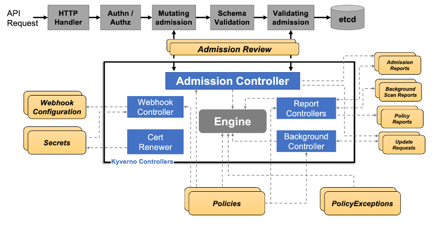

# K8s - Objetos de Política de Admission e Enumeração

{{#include ../../../banners/hacktricks-training.md}}

**O autor original desta página é** [**Guillaume**](https://www.linkedin.com/in/guillaume-chapela-ab4b9a196)

## Definição

`ValidatingWebhookConfiguration` é um recurso do Kubernetes que registra um ou mais admission webhooks de validação. Esses webhooks recebem solicitações AdmissionReview do API server após a autenticação e a autorização, mas antes de o objeto ser persistido.<sup>[[3]](#references)[[10]](#references)</sup>

Os webhooks de validação podem rejeitar uma solicitação. Webhooks de mutação, configurados com `MutatingWebhookConfiguration`, podem primeiro alterar o objeto. As revisões de segurança geralmente devem inspecionar ambos os recursos, pois um webhook de mutação malicioso ou fraco pode reescrever workloads, enquanto um webhook de validação ou mecanismo de políticas pode bloqueá-los ou permiti-los.<sup>[[3]](#references)</sup>

## Finalidade

A finalidade de um `ValidatingWebhookConfiguration` é definir quando o API server deve chamar um webhook de validação e como deve tratar o resultado do webhook.<sup>[[3]](#references)[[8]](#references)</sup> A questão de segurança importante não é apenas "há uma política instalada?", mas também:

- Quais grupos de API, recursos, operações e escopos ela corresponde?<sup>[[8]](#references)</sup>
- Quais namespaces ou objetos são excluídos pelos seletores?<sup>[[8]](#references)</sup>
- `matchConditions` ignora alguma classe de solicitações?<sup>[[7]](#references)[[8]](#references)</sup>
- `failurePolicy` falha em modo aberto com `Ignore` ou em modo fechado com `Fail`?<sup>[[3]](#references)[[8]](#references)</sup>
- O serviço do webhook pode ser acessado, é confiável de acordo com o `caBundle` configurado e é executado por uma service account com privilégios elevados?
- O mecanismo de políticas também expõe recursos de exceção, usuários excluídos ou grupos excluídos?

**Exemplo**

Aqui está um exemplo de ValidatingWebhookConfiguration:

```yaml
apiVersion: admissionregistration.k8s.io/v1
kind: ValidatingWebhookConfiguration
metadata:
  name: example-validation-webhook
webhooks:
  - name: pods.example.local
    admissionReviewVersions: ["v1"]
    sideEffects: None
    failurePolicy: Fail
    timeoutSeconds: 5
    clientConfig:
      service:
        namespace: webhook-system
        name: example-validation-webhook
        path: /validate
      caBundle: <base64-ca-bundle>
    rules:
      - apiGroups: [""]
        apiVersions: ["v1"]
        operations: ["CREATE", "UPDATE"]
        resources: ["pods"]
        scope: "Namespaced"
    namespaceSelector:
      matchExpressions:
        - key: kubernetes.io/metadata.name
          operator: NotIn
          values: ["kube-system"]
```

O exemplo usa os campos de webhook v1 para correspondência de requisições, transporte via service/CA, tratamento de falhas e semântica de dry-run.<sup>[[3]](#references)[[8]](#references)</sup>

A principal diferença entre um ValidatingWebhookConfiguration e as policies:

<figure><figcaption><p>Kyverno.png</p></figcaption></figure>

- **ValidatingWebhookConfiguration (VWC)**: Um recurso do Kubernetes que define um validating webhook, um componente do lado do servidor que valida requisições recebidas da API do Kubernetes em relação a um conjunto de regras e restrições predefinidas.<sup>[[8]](#references)</sup>
- **Kyverno ClusterPolicy**: Uma definição de policy que especifica um conjunto de regras e restrições para validar e aplicar políticas a recursos do Kubernetes, como pods, deployments e services.<sup>[[13]](#references)</sup>

## Enumeração

```
$ kubectl get validatingwebhookconfigurations,mutatingwebhookconfigurations
$ kubectl get validatingwebhookconfiguration <name> -o yaml
$ kubectl get mutatingwebhookconfiguration <name> -o yaml
$ kubectl get svc,deploy,pod -A | grep -i webhook
```

Liste os dois tipos de configuração de webhook e inspecione o YAML, além do serviço ou URL referenciado:<sup>[[3]](#references)[[4]](#references)</sup>

Campos a inspecionar:

- `rules`: Verifique os grupos, versões, recursos, sub-recursos, operações e escopo da API abrangidos.<sup>[[8]](#references)</sup>
- `namespaceSelector` / `objectSelector`: Procure namespaces ou labels que excluam recursos da política.<sup>[[8]](#references)</sup>
- `matchConditions`: Expressões CEL podem ignorar solicitações intencionalmente ou por acidente.<sup>[[7]](#references)[[8]](#references)</sup>
- `failurePolicy`: `Ignore` permite que as solicitações prossigam se o webhook falhar; `Fail` as bloqueia.<sup>[[3]](#references)[[8]](#references)</sup>
- `sideEffects`: Webhooks com efeitos colaterais podem não oferecer suporte a testes em dry-run.<sup>[[3]](#references)</sup>
- `timeoutSeconds`: Tempos limite muito curtos combinados com `Ignore` podem resultar em comportamento fail-open.<sup>[[3]](#references)[[4]](#references)</sup>
- `clientConfig`: Verifique se o webhook aponta para um Service dentro do cluster ou para uma URL externa.<sup>[[3]](#references)</sup> Inspecione a workload e a service account subjacentes.
- `reinvocationPolicy`: Webhooks de mutação podem ser invocados novamente quando uma mutação posterior altera o objeto.<sup>[[3]](#references)</sup>

### Políticas de admissão CEL nativas

Clusters modernos também podem aplicar lógica de admissão com objetos de política nativos em `admissionregistration.k8s.io`, não apenas com configurações de webhook. `ValidatingAdmissionPolicy` é uma alternativa baseada em CEL e executada no próprio processo aos webhooks de validação.<sup>[[5]](#references)[[7]](#references)</sup> Ela só fica ativa quando uma `ValidatingAdmissionPolicyBinding` a seleciona.<sup>[[5]](#references)</sup> `MutatingAdmissionPolicy` é estável no Kubernetes v1.36.<sup>[[6]](#references)</sup> Ela é ativada por `MutatingAdmissionPolicyBinding` para mutações geradas por CEL.<sup>[[6]](#references)</sup>

Liste-as com:

```bash
kubectl api-resources --api-group=admissionregistration.k8s.io -o wide
kubectl get validatingadmissionpolicies,validatingadmissionpolicybindings
kubectl get mutatingadmissionpolicies,mutatingadmissionpolicybindings 2>/dev/null || true
kubectl get validatingadmissionpolicy <name> -o yaml
kubectl get validatingadmissionpolicybinding <name> -o yaml
```

Inspecione as policies junto com seus bindings, pois o binding define o escopo e o comportamento de enforcement.<sup>[[5]](#references)[[6]](#references)</sup>

Verificações de segurança:

- Uma policy sem binding não aplica nada.<sup>[[5]](#references)[[6]](#references)</sup>
- `validationActions` no binding determina se as falhas de validação são negadas, avisadas, auditadas ou apenas registradas.<sup>[[5]](#references)</sup>
- `failurePolicy: Ignore` permite que erros de avaliação CEL ou configurações incorretas falhem em modo fail open.<sup>[[5]](#references)</sup>
- `matchConstraints`, `matchConditions`, `namespaceSelector` e `objectSelector` podem excluir solicitações sensíveis.<sup>[[5]](#references)[[7]](#references)</sup>
- `paramKind` e `paramRef` podem incluir ConfigMaps ou objetos de parâmetros respaldados por CRD no limite da policy; verifique quem pode modificar esses objetos de parâmetros.<sup>[[5]](#references)[[6]](#references)</sup>
- Escritas em policies, bindings e recursos de parâmetros devem ser tratadas como alterações privilegiadas de controle de admissão.<sup>[[4]](#references)[[5]](#references)</sup>

{{#include ../../../banners/hacktricks-training.md}}

## References

- [1] [Open Policy Agent Gatekeeper](https://github.com/open-policy-agent/gatekeeper)
- [2] [Kyverno](https://kyverno.io/)
- [3] [Controle dinâmico de admissão | Kubernetes](https://kubernetes.io/docs/reference/access-authn-authz/extensible-admission-controllers/)
- [4] [Boas práticas para webhooks de admissão | Kubernetes](https://kubernetes.io/docs/concepts/cluster-administration/admission-webhooks-good-practices/)
- [5] [Policy de admissão de validação | Kubernetes](https://kubernetes.io/docs/reference/access-authn-authz/validating-admission-policy/)
- [6] [Policy de admissão de mutação | Kubernetes](https://kubernetes.io/docs/reference/access-authn-authz/mutating-admission-policy/)
- [7] [Linguagem de expressão comum no Kubernetes](https://kubernetes.io/docs/reference/using-api/cel/)
- [8] [ValidatingWebhookConfiguration | Kubernetes](https://kubernetes.io/docs/reference/kubernetes-api/admissionregistration/validating-webhook-configuration-v1/)
- [9] [Namespaces | Kubernetes](https://kubernetes.io/docs/concepts/overview/working-with-objects/namespaces/)
- [10] [Controlando o acesso à API do Kubernetes | Kubernetes](https://kubernetes.io/docs/concepts/security/controlling-access/)
- [11] [Controladores de admissão do Kubernetes | Kyverno](https://kyverno.io/docs/guides/admission-controllers/)
- [12] [Isentando namespaces do webhook de admissão do Gatekeeper](https://open-policy-agent.github.io/gatekeeper/website/docs/v3.15.x/exempt-namespaces/)
- [13] [Visão geral de ClusterPolicy | Kyverno](https://kyverno.io/docs/policy-types/cluster-policy/overview/)
- [14] [Regras de validação | Kyverno](https://kyverno.io/docs/policy-types/cluster-policy/validate/)
- [15] [Configurar contas de serviço para pods | Kubernetes](https://kubernetes.io/docs/tasks/configure-pod-container/configure-service-account/)
- [16] [Secrets como variáveis de ambiente | Kubernetes](https://kubernetes.io/docs/concepts/configuration/secret/#using-secrets-as-environment-variables)
- [17] [Quotas de recursos | Kubernetes](https://kubernetes.io/docs/concepts/policy/resource-quotas/)
- [18] [Limites de intervalo | Kubernetes](https://kubernetes.io/docs/concepts/policy/limit-range/)
