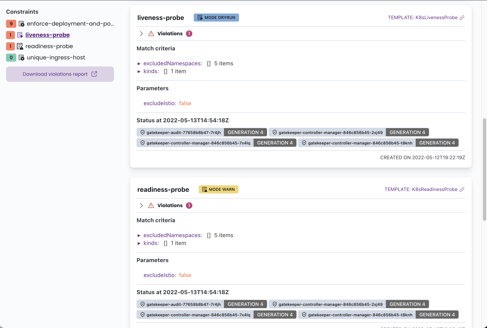

# K8s - OPA Gatekeeper Bypass

{{#include ../../../banners/hacktricks-training.md}}

**L'autore originale di questa pagina è** [**Guillaume**](https://www.linkedin.com/in/guillaume-chapela-ab4b9a196)

## Sfruttare una configurazione errata

### Enumerare le regole

Avere una panoramica può aiutare a capire quali regole sono attive, in quale modalità e chi può aggirarle.

#### Con la CLI

```bash
$ kubectl api-resources | grep gatekeeper
k8smandatoryannotations                                                             constraints.gatekeeper.sh/v1beta1                  false        K8sMandatoryAnnotations
k8smandatorylabels                                                                  constraints.gatekeeper.sh/v1beta1                  false        K8sMandatoryLabel
constrainttemplates                                                                 templates.gatekeeper.sh/v1                         false        ConstraintTemplate
```

**ConstraintTemplate** e **Constraint** sono CRD di Gatekeeper utilizzate per definire e applicare policy alle risorse Kubernetes.<sup>[[1]](#references)[[3]](#references)</sup>

```bash
$ kubectl get constrainttemplates
$ kubectl get k8smandatorylabels
```

#### Con l'interfaccia grafica

Potrebbe essere disponibile anche un'interfaccia grafica per accedere alle regole OPA con **Gatekeeper Policy Manager.** È un'interfaccia web di sola lettura che consente di visualizzare lo stato delle policy OPA Gatekeeper in un cluster Kubernetes.<sup>[[2]](#references)</sup>

<figure><figcaption></figcaption></figure>

Cerca il servizio esposto :

```bash
$ kubectl get services -A | grep gatekeeper
$ kubectl get services -A | grep 'gatekeeper-policy-manager-system'
```

### Namespace escluse

Come illustrato nell'immagine sopra, alcune regole potrebbero non essere applicate universalmente a tutti i namespace o utenti. I criteri di corrispondenza di Gatekeeper possono escludere esplicitamente determinati namespace.<sup>[[4]](#references)</sup> Per esempio, il vincolo `liveness-probe` non viene applicato ai cinque namespace specificati.

### Bypass

Con una panoramica completa della configurazione di Gatekeeper, è possibile individuare potenziali configurazioni errate che potrebbero essere sfruttate per ottenere privilegi. Cerca namespace autorizzati o esclusi a cui la regola non si applica.<sup>[[3]](#references)[[4]](#references)</sup> Poi esegui lì il tuo attacco.

{{#ref}}
../kubernetes-privilege-escalation/
{{#endref}}

## Abuso di ValidatingWebhookConfiguration

Un altro modo per aggirare i vincoli è concentrarsi sulla risorsa `ValidatingWebhookConfiguration` e sul suo comportamento di corrispondenza.<sup>[[5]](#references)</sup>

{{#ref}}
../kubernetes-privilege-escalation/validating-admission-policies.md
{{#endref}}

{{#include ../../../banners/hacktricks-training.md}}

## References

- [1] [Open Policy Agent Gatekeeper](https://github.com/open-policy-agent/gatekeeper)
- [2] [Gatekeeper Policy Manager](https://github.com/sighupio/gatekeeper-policy-manager)
- [3] [Come usare Gatekeeper](https://open-policy-agent.github.io/gatekeeper/website/docs/howto/)
- [4] [Esentare i namespace](https://open-policy-agent.github.io/gatekeeper/website/docs/exempt-namespaces/)
- [5] [ValidatingWebhookConfiguration | Kubernetes](https://kubernetes.io/docs/reference/kubernetes-api/admissionregistration/validating-webhook-configuration-v1/)
