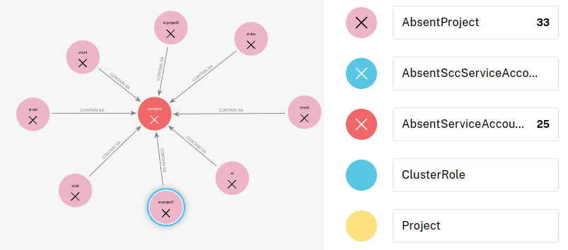
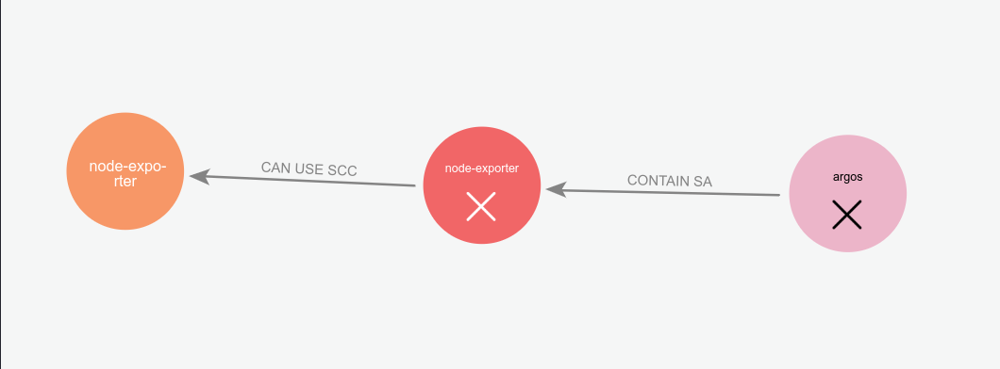

# OpenShift - Tài khoản dịch vụ bị thiếu

{{#include ../../../banners/hacktricks-training.md}}

## Tài khoản dịch vụ bị thiếu

Tài khoản dịch vụ OpenShift được định danh bằng project và tên theo dạng `system:serviceaccount:<project>:<name>`. Có thể cấp Role cho danh tính đó thông qua các liên kết RBAC, trong khi quyền truy cập Security Context Constraint (SCC) có thể được cấp trực tiếp hoặc thông qua RBAC.[[1]](#references)[[2]](#references)[[3]](#references)

Do đó, các template được cấu hình sẵn và các đối tượng cluster đã cũ có thể để lại RoleBinding, ClusterRoleBinding hoặc quyền SCC tham chiếu đến một tài khoản dịch vụ chưa tồn tại. RoleBinding có thể chỉ định một tài khoản chưa tồn tại trong project hiện có; ClusterRoleBinding có phạm vi cluster hoặc quyền SCC được cấp trực tiếp cũng có thể chỉ định một tài khoản trong project chưa tồn tại. Nếu attacker có thể tạo tài khoản dịch vụ được tham chiếu — hoặc, với tham chiếu cấp cluster, tạo project còn thiếu trước — danh tính được tạo sẽ khớp với quyền cấp sẵn và nhận được quyền Role hoặc SCC tương ứng. OpenShiftGrapher mô tả kiểu tấn công tham chiếu treo này và biểu diễn các đối tượng còn thiếu dưới dạng các node `AbsentProject` và `AbsentServiceAccount`.[[4]](#references)[[5]](#references)

> [!WARNING]
> Chỉ tạo tài khoản dịch vụ không đảm bảo attacker có thể xác thực bằng tài khoản đó. Việc khai thác còn cần cách sử dụng tài khoản, chẳng hạn như quyền tạo workload bằng tài khoản đó hoặc tạo TokenRequest `serviceaccounts/token`. OpenShift 4.16 trở lên không còn tự động tạo Secret chứa API token tồn tại lâu dài cho mỗi tài khoản dịch vụ mới.[[2]](#references)[[6]](#references)

<figure><figcaption></figcaption></figure>

Đồ thị phía trên cho thấy một số project còn thiếu được các quan hệ cấp quyền tham chiếu đến, cùng với một tài khoản dịch vụ còn thiếu. Tạo project và tài khoản với đúng tên được tham chiếu có thể kích hoạt các quyền cấp sẵn này và dẫn đến leo thang đặc quyền.[[4]](#references)[[5]](#references)

Ví dụ sau cho thấy một tài khoản dịch vụ còn thiếu có thể sử dụng SCC `node-exporter`:

<figure><figcaption></figcaption></figure>

## Công cụ

Dự án OpenShiftGrapher hiện được duy trì sẽ liệt kê các đối tượng và quan hệ OpenShift trong Neo4j. Các truy vấn được tài liệu hóa bao gồm đường dẫn từ project và tài khoản dịch vụ không tồn tại đến cluster role và SCC có thể sử dụng.[[5]](#references)

## References

- [1] [Sử dụng RBAC Authorization - Kubernetes](https://kubernetes.io/docs/reference/access-authn-authz/rbac/)
- [2] [Tìm hiểu và tạo tài khoản dịch vụ - OpenShift Container Platform 4.22](https://docs.redhat.com/en/documentation/openshift_container_platform/4.22/html/authentication_and_authorization/understanding-and-creating-service-accounts)
- [3] [Quản lý security context constraints - OpenShift Container Platform 4.22](https://docs.redhat.com/en/documentation/openshift_container_platform/4.22/html/authentication_and_authorization/managing-pod-security-policies)
- [4] [OpenShiftGrapher - kho lưu trữ ban đầu](https://github.com/maxDcb/OpenShiftGrapher)
- [5] [OpenShiftGrapher - kho lưu trữ được duy trì](https://github.com/AmadeusITGroup/OpenShiftGrapher)
- [6] [Thực hành tốt về Role Based Access Control - Kubernetes](https://kubernetes.io/docs/concepts/security/rbac-good-practices/)
{{#include ../../../banners/hacktricks-training.md}}
