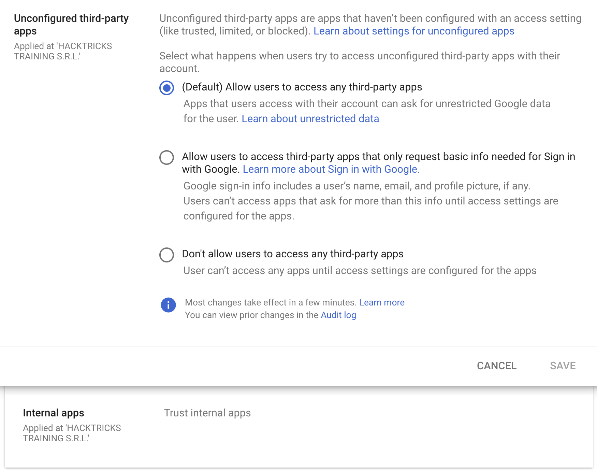

# GWS - Google Platforms Phishing

{{#include ../../../banners/hacktricks-training.md}}

## Phishing Methodology Chung

{{#ref}}
https://book.hacktricks.wiki/en/generic-methodologies-and-resources/phishing-methodology/index.html
{{#endref}}

## Google Groups Phishing

Khi quản trị viên Workspace bật Groups for Business và cho phép quản lý thành viên, người dùng có thể tạo nhóm, mời hoặc thêm thành viên, rồi đăng bài lên địa chỉ nhóm. Cài đặt nhóm quyết định ai có thể tham gia, ai có thể đăng bài và địa chỉ nhóm có được dùng làm người gửi mặc định hay không, nhờ đó tin nhắn có thể trông như email Workspace thông thường.<sup>[[5]](#references)</sup> Kẻ tấn công có thể lợi dụng các cài đặt này để thêm mục tiêu và chèn liên kết phishing vào tin nhắn nhóm.

Bạn cũng có thể đặt địa chỉ **FROM** thành **email của Google group** để gửi tin nhắn cho người dùng trong nhóm. Ví dụ trong hình bên dưới, nhóm **`google--support@googlegroups.com`** được tạo và một **email được gửi đến tất cả thành viên** trong nhóm (những người được thêm mà không cần đồng ý).<sup>[[5]](#references)</sup>

<figure><figcaption></figcaption></figure>

## Google Chat Phishing

Tùy thuộc vào chính sách Workspace, người dùng có thể **bắt đầu cuộc trò chuyện** bằng cách nhập địa chỉ email, tạo một **Space** có tên (ví dụ: "Google Support") và thêm thành viên. Khách bên ngoài cần được bật các cài đặt quản trị viên liên quan. Cách gửi lời mời hoặc thêm trực tiếp cũng khác nhau tùy thuộc vào việc những người tham gia đã từng trò chuyện hay chưa và có thuộc cùng tổ chức hay không.<sup>[[6]](#references)[[7]](#references)</sup> Mục tiêu chấp nhận tham gia một space có tên gọi thuyết phục có thể nhầm đó là cuộc trò chuyện với bộ phận hỗ trợ:

<figure><figcaption></figcaption></figure>

> [!TIP]
> **Tuy nhiên, trong quá trình thử nghiệm của tôi, các thành viên được mời không nhận được lời mời.**

Bạn có thể xem cách này hoạt động trước đây tại: [https://www.youtube.com/watch?v=KTVHLolz6cE\&t=904s](https://www.youtube.com/watch?v=KTVHLolz6cE&t=904s).<sup>[[2]](#references)</sup>

## Google Doc Phishing

Trước đây, kẻ tấn công có thể tạo một **tài liệu trông có vẻ hợp pháp** và **đề cập đến một địa chỉ email** (ví dụ: `@user@gmail.com`) trong bình luận.<sup>[[2]](#references)</sup> Tài liệu Google Docs hiện có thông báo cho các bình luận đề cập đến người dùng, nhưng cài đặt thông báo của người nhận và chính sách Workspace có thể chặn thông báo này. Cách dụ trực tiếp hơn là **chia sẻ tài liệu** với địa chỉ của nạn nhân: Google sẽ gửi email đến từng địa chỉ, trừ khi người gửi tắt tùy chọn thông báo.<sup>[[8]](#references)[[9]](#references)</sup> Đây là thông báo xuất hiện khi bạn đề cập đến ai đó:

<figure><figcaption></figcaption></figure>

> [!TIP]
> Nạn nhân có thể có cơ chế bảo vệ ngăn email báo rằng một tài liệu bên ngoài được chia sẻ với họ đến hộp thư đến.

## Google Calendar Phishing

Bạn có thể **tạo sự kiện trên lịch** và thêm địa chỉ email mục tiêu làm khách mời. Lên lịch sự kiện này vào **5 hoặc 15 phút** sau thời điểm hiện tại, làm cho sự kiện trông hợp pháp và **thêm bình luận cùng tiêu đề cho biết họ cần đọc nội dung nào đó** (có **liên kết phishing**). Cách Google Calendar gửi lời mời và thông báo phụ thuộc vào cài đặt khách mời và tài khoản, vì vậy hãy kiểm tra trong tenant mục tiêu.<sup>[[10]](#references)</sup>

Đây là cảnh báo sẽ xuất hiện trên trình duyệt với tiêu đề cuộc họp "Firing People". Bạn có thể đặt tiêu đề giống phishing hơn (và thậm chí đổi tên gắn với email của mình).

<figure><figcaption></figcaption></figure>

Để sự kiện trông ít đáng ngờ hơn:

- Tắt **See guest list** để người nhận không thể thấy những người khác được mời.<sup>[[11]](#references)</sup>
- **KHÔNG gửi email thông báo về sự kiện**. API hỗ trợ tắt thông báo sự kiện, nhưng lịch của khách mời và lịch bên ngoài có thể xử lý những sự kiện như vậy theo cách khác nhau.<sup>[[10]](#references)[[12]](#references)</sup>
- Khi dùng Calendar API, người tổ chức có thể đặt `responseStatus` của người tham dự thành `accepted` và điền `comment` của người tham dự; cài đặt tài khoản mục tiêu có thể đặt lại trạng thái này, và phản hồi sẽ không được truyền đi đối với sự kiện có hơn 200 khách mời.<sup>[[12]](#references)</sup>

## App Scripts Redirect Phishing

Bạn có thể tạo một script tại [https://script.google.com/](https://script.google.com/) và **triển khai dưới dạng ứng dụng web** với URL `/exec` công khai trên miền **`script.google.com`**. Hàm `doGet()` có thể trả về một `HtmlOutput` chứa liên kết đến nội dung bất kỳ mà người dùng cần chủ động nhấp vào, trong khi URL ban đầu vẫn là URL do Google lưu trữ.<sup>[[13]](#references)[[14]](#references)</sup>

Để tìm hiểu về kỹ thuật Apps Script trước đây, xem *Hacking G Suite: The Power of Dark Apps Script Magic* của Matthew Bryant.<sup>[[1]](#references)</sup>

HTML Service hiện chạy trong iframe sandbox, giới hạn việc tự động điều hướng ở cấp cao nhất. Với một bản triển khai hiện tại, hãy dùng liên kết hoặc nút có đích `_top` hoặc `_blank` và yêu cầu người dùng thao tác; đừng cho rằng cách chuyển hướng bằng meta-refresh cũ vẫn hoạt động.<sup>[[23]](#references)</sup>

```javascript
function doGet() {
  return HtmlService.createHtmlOutput(`
    <base target="_top">
    <p><a href="https://example.com/landing-page" target="_top">Continue</a></p>
  `).setXFrameOptionsMode(HtmlService.XFrameOptionsMode.ALLOWALL)
}
```

Triển khai một bản sao của script để lấy URL `/exec` và kiểm tra trang trung gian cùng liên kết cần người dùng chủ động nhấp sẽ hiển thị như thế nào với người nhận.<sup>[[13]](#references)</sup>

<figure><figcaption></figcaption></figure>

> [!TIP]
> `ALLOWALL` cho phép các site khác nhúng đầu ra bằng iframe và loại bỏ biện pháp bảo vệ `X-Frame-Options` mặc định, vì vậy chỉ sử dụng tùy chọn này trong một bài kiểm tra có kiểm soát.<sup>[[15]](#references)</sup>

## App Scripts OAuth Phishing

Có thể tạo App Scripts gắn với tài liệu để tìm cách lấy OAuth token của nạn nhân. Để biết thêm thông tin, hãy xem:

{{#ref}}
gws-app-scripts.md
{{#endref}}

## App Password Phishing

Google app password là thông tin xác thực riêng gồm 16 chữ số, dành cho các ứng dụng cũ không thể dùng quy trình đăng nhập tương tác thông thường. Đây không phải là mã xác minh danh tính. Tên được nhập khi tạo chỉ là nhãn hiển thị cho người dùng, vì vậy giá trị như `ms.state.gov` không đăng ký hoặc liên kết thông tin xác thực với tổ chức đó.<sup>[[24]](#references)[[25]](#references)[[26]](#references)</sup>

Trong quy trình phishing này, kẻ tấn công gửi hướng dẫn có vẻ đáng tin, yêu cầu nạn nhân tạo app password dành riêng cho mục tiêu rồi gửi lại giá trị vừa tạo qua email hoặc một biểu mẫu giả mạo. Sau đó, kẻ tấn công có thể xác thực thông qua một phương thức ứng dụng cũ được hỗ trợ mà không kích hoạt lời nhắc xác thực yếu tố thứ hai thông thường của tài khoản. Các mồi nhử mới được ghi nhận đã chuyển việc thu thập từ email sang một biểu mẫu web trông hợp pháp, nhưng giá trị bị đánh cắp và quyền truy cập đạt được vẫn như nhau.<sup>[[24]](#references)[[25]](#references)</sup>

> [!WARNING]
> Tạo app password không thêm dịch vụ đáng tin cậy vào tài khoản. Không bao giờ cung cấp giá trị vừa tạo cho người khác hoặc dán giá trị đó vào một site được giới thiệu là bước kiểm tra danh tính. Để biết các giới hạn khả dụng, cách thu hồi và quy trình rà soát sau khi bị xâm phạm, hãy xem [GWS - Persistence](../gws-persistence.md#app-passwords).<sup>[[26]](#references)</sup>

## OAuth Apps Phishing

Có thể sử dụng bất kỳ kỹ thuật nào ở trên để khiến người dùng truy cập một **Google OAuth application** **yêu cầu quyền truy cập** vào Google APIs. Màn hình đồng ý OAuth hiển thị tên ứng dụng, dịch vụ và các scope được yêu cầu; người dùng tin vào mồi nhử có thể chấp thuận những quyền mà bình thường họ sẽ nghi ngờ.<sup>[[16]](#references)[[18]](#references)</sup>

> [!NOTE]
> Google có thể hiển thị cảnh báo ứng dụng chưa được xác minh đối với các ứng dụng yêu cầu scope nhạy cảm hoặc bị hạn chế, và quản trị viên Workspace có thể ngăn chặn hoặc giới hạn việc cấp quyền thông qua các chế độ kiểm soát quyền truy cập ứng dụng.<sup>[[19]](#references)[[21]](#references)</sup>

### Chuyển tiếp thủ công phản hồi ủy quyền

Mồi nhử có thể đưa nạn nhân qua quy trình đăng nhập của nhà cung cấp hợp pháp, sau đó yêu cầu “mã xác minh” hoặc URL đầy đủ sau khi đăng nhập. Trong luồng authorization-code, URL callback đó có thể chứa `code` có thời hạn ngắn, được gắn với OAuth client và redirect URI đã khởi tạo luồng. Chuyển tiếp code hoặc URL đầy đủ cho phép kẻ tấn công đã khởi tạo luồng thử đổi token. Vì vậy, việc sử dụng tên miền đăng nhập hợp pháp không có nghĩa là yêu cầu sao chép URL hoặc code nhận được là an toàn.<sup>[[18]](#references)[[25]](#references)</sup>

Hãy coi URL callback OAuth và mã xác minh là thông tin xác thực. Một luồng web thông thường sẽ trả chúng trực tiếp về redirect URI đã đăng ký; luồng đó không nên yêu cầu người dùng dán chúng vào email, chat hoặc một biểu mẫu không liên quan.<sup>[[18]](#references)[[25]](#references)</sup>

**Google** cho phép ứng dụng **hành động thay mặt người dùng** với một số **dịch vụ Google**, bao gồm Gmail, Drive và Google Cloud APIs.<sup>[[16]](#references)[[17]](#references)</sup>

Khi tạo ứng dụng để **hành động thay mặt người dùng khác**, nhà phát triển tạo OAuth credentials trong một dự án Google Cloud và chỉ yêu cầu các scope (quyền) mà ứng dụng cần. Sau đó, người dùng được nhắc cấp hoặc từ chối các scope đó; access token chỉ có quyền trên các tài nguyên và thao tác được mô tả bởi những scope này.<sup>[[16]](#references)[[17]](#references)[[18]](#references)</sup>

Đây là cách hữu ích để **phish** người dùng không chuyên kỹ thuật, khiến họ chấp thuận **các ứng dụng truy cập thông tin nhạy cảm**, vì họ có thể không hiểu rõ hệ quả. Trong các tổ chức Workspace, quản trị viên có thể giảm rủi ro này bằng các chế độ kiểm soát quyền truy cập ứng dụng.

### Lời nhắc ứng dụng chưa được xác minh

Luồng OAuth của Google hiển thị các scope được yêu cầu để người dùng phê duyệt. Màn hình **ứng dụng chưa được xác minh** có thể xuất hiện trước màn hình đồng ý khi ứng dụng yêu cầu scope nhạy cảm hoặc bị hạn chế nhưng chưa được xác minh theo yêu cầu, khiến việc chấp thuận trở nên khó khăn hơn.<sup>[[18]](#references)[[19]](#references)</sup>

Lời nhắc này xuất hiện trong các ứng dụng:

- Sử dụng scope nhạy cảm hoặc bị hạn chế, hoặc yêu cầu các scope không khớp với những scope đã cấu hình để xác minh.
- Đang ở trạng thái **Testing**; Google sẽ hiển thị cảnh báo kiểm thử và cho phép tối đa 100 người dùng kiểm thử được liệt kê. Ngoài ra, ứng dụng chưa được xác minh có thể bị giới hạn ở 100 người dùng mới cho đến khi hoàn tất xác minh.<sup>[[19]](#references)[[20]](#references)</sup>

### Các scope đáng chú ý

Bạn có thể tìm danh sách tất cả Google OAuth scopes [**tại đây**](https://developers.google.com/identity/protocols/oauth2/scopes).<sup>[[17]](#references)</sup>

- **cloud-platform**: Xem, chỉnh sửa, cấu hình và xóa dữ liệu Google Cloud của người dùng thuộc phạm vi scope này.<sup>[[17]](#references)</sup>
- **admin.directory.user.readonly**: Xem thông tin người dùng trong danh bạ của tổ chức.<sup>[[17]](#references)</sup>

### Tạo OAuth App

**Bắt đầu tạo OAuth Client ID**

1. Truy cập [OAuth consent screen](https://console.cloud.google.com/apis/credentials/consent) và cấu hình đối tượng người dùng của ứng dụng.<sup>[[20]](#references)</sup>
2. Chọn **Internal** (chỉ tài khoản trong tổ chức) hoặc **External**. Dự án external bắt đầu ở chế độ testing và chỉ giới hạn cho những người dùng kiểm thử bạn thêm; dự án internal chỉ dành cho tổ chức liên kết với dự án.<sup>[[20]](#references)</sup>
   - Internal có thể phù hợp nếu bạn đã xâm nhập một tài khoản trong tổ chức và đang thực hiện đánh giá được ủy quyền đối với một tổ chức khác.
3. Cung cấp **tên**, **email hỗ trợ**, **logo**, **các miền được ủy quyền** và thông tin liên hệ để nhận cập nhật cho ứng dụng. Các giá trị này sẽ được hiển thị hoặc sử dụng trong quá trình đồng ý và xác minh.<sup>[[19]](#references)[[20]](#references)</sup>
4. **Chọn** các **OAuth scopes** tối thiểu cần thiết cho bài kiểm tra.
   - Cloud Console phân loại các scope được yêu cầu là không nhạy cảm, nhạy cảm hoặc bị hạn chế; phân loại này ảnh hưởng đến quy trình đồng ý và xác minh.<sup>[[17]](#references)[[19]](#references)</sup>
5. Nếu dự án đang ở chế độ **Testing**, hãy **thêm người dùng kiểm thử** sẽ thử luồng này. Hiện Google cho phép liệt kê tối đa 100 người dùng kiểm thử và quyền ủy quyền của họ hết hạn sau bảy ngày.<sup>[[20]](#references)</sup>

Bây giờ, hãy lấy **credentials cho một web application** bằng **OAuth Client ID đã tạo trước đó**:

1. Mở [Credentials](https://console.cloud.google.com/apis/credentials) trong cùng Cloud project.<sup>[[16]](#references)</sup>
2. Chọn **Create credentials** > **OAuth client ID** > **Web application**.<sup>[[16]](#references)</sup>
3. Thiết lập **JavaScript origins** và **redirect URIs** theo yêu cầu.
   - Bạn có thể dùng **`http://localhost:8000/callback`** để kiểm thử cục bộ.
   - Redirect URI phải khớp chính xác với giá trị đã đăng ký, bao gồm scheme, chữ hoa/chữ thường và dấu gạch chéo cuối.<sup>[[18]](#references)</sup>
4. Lưu client ID và client secret làm **credentials** của ứng dụng.<sup>[[16]](#references)</sup>

Cuối cùng, hãy **chạy một web application sử dụng OAuth application credentials**. Bạn có thể tìm thấy ví dụ tại [https://github.com/carlospolop/gcp_oauth_phishing_example](https://github.com/carlospolop/gcp_oauth_phishing_example).

```bash
git clone https://github.com/carlospolop/gcp_oauth_phishing_example
cd gcp_oauth_phishing_example
pip install flask requests google-auth-oauthlib
python3 app.py --client-id "<client_id>" --client-secret "<client_secret>"
```

Truy cập **`http://localhost:8000`**, nhấp vào nút **Đăng nhập bằng Google**, và bạn sẽ được **nhắc** cấp các scope được yêu cầu.<sup>[[18]](#references)</sup>

<figure><figcaption></figcaption></figure>

Ứng dụng nhận được **access token** và, khi yêu cầu quyền truy cập ngoại tuyến, một **refresh token**. Hãy xem cả hai là thông tin xác thực: access token chỉ có hiệu lực trong phạm vi các scope được cấp, còn refresh token có thể lấy access token mới khi nó vẫn còn hiệu lực.<sup>[[16]](#references)</sup> Để biết thêm thông tin về **cách sử dụng các token này, hãy xem**:

{{#ref}}
../../gcp-security/gcp-persistence/gcp-non-svc-persistence.md
{{#endref}}

#### Bảo vệ ứng dụng OAuth

Quản trị viên Workspace có thể dùng **Kiểm soát quyền truy cập ứng dụng** để đánh dấu ứng dụng là Trusted, Specific Google data, Limited hoặc Blocked, đồng thời hạn chế các scope rủi ro cao cho những dịch vụ như Gmail, Drive và Chat.<sup>[[21]](#references)</sup> Chính sách nghiêm ngặt hơn có thể chỉ cho phép ứng dụng bên thứ ba yêu cầu thông tin hồ sơ cơ bản để Đăng nhập bằng Google, hoặc chặn ứng dụng bên thứ ba cho đến khi quản trị viên cấu hình chúng.<sup>[[21]](#references)</sup>

Quản trị viên cũng có thể bật **Tin cậy ứng dụng nội bộ** cho các ứng dụng nội bộ do tổ chức tạo. Đừng mặc định rằng các cài đặt này đang được bật hoặc tắt trong tenant mục tiêu; hãy kiểm tra chính sách đang có hiệu lực trong quá trình đánh giá.<sup>[[21]](#references)</sup>

<figure><figcaption></figcaption></figure>

## References

- [1] [Hack G Suite: Sức mạnh của phép màu Apps Script đen tối](https://www.youtube-nocookie.com/embed/6AsVUS79gLw)
- [2] [OK Google, làm thế nào để Red Team GSuite?](https://www.youtube.com/watch?v=KTVHLolz6cE)
- [3] [Phân tích cuộc tấn công chuỗi cung ứng khai thác ứng dụng OAuth Google Workspace độc hại](https://redcanary.com/blog/threat-detection/google-workspace-oauth-attack/)
- [4] [GAM: công cụ quản lý Google Workspace trên dòng lệnh](https://github.com/GAM-team/GAM)
- [5] [Tạo nhóm và chọn cài đặt nhóm](https://support.google.com/groups/answer/2464926?hl=en)
- [6] [Mời khách bên ngoài vào Google Chat](https://support.google.com/chat/answer/16997417?hl=en)
- [7] [Thêm hoặc xóa người trong một không gian](https://support.google.com/chat/answer/7653881?hl=en)
- [8] [Chia sẻ tệp từ Google Drive](https://support.google.com/docs/answer/2494822?hl=en)
- [9] [Quản lý thông báo](https://support.google.com/docs/answer/91588?hl=en)
- [10] [Mời mọi người tham gia sự kiện trên Calendar](https://support.google.com/calendar/answer/37161?hl=en)
- [11] [Chia sẻ lịch của bạn](https://support.google.com/calendar/answer/37082?hl=en)
- [12] [Sự kiện: chèn](https://developers.google.com/workspace/calendar/api/v3/reference/events/insert)
- [13] [Ứng dụng web](https://developers.google.com/apps-script/guides/web)
- [14] [HTML Service: Tạo và phân phối HTML](https://developers.google.com/apps-script/guides/html)
- [15] [XFrameOptionsMode](https://developers.google.com/apps-script/reference/html/x-frame-options-mode)
- [16] [Sử dụng OAuth 2.0 để truy cập Google APIs](https://developers.google.com/identity/protocols/oauth2)
- [17] [OAuth 2.0 Scopes cho Google APIs](https://developers.google.com/identity/protocols/oauth2/scopes)
- [18] [Sử dụng OAuth 2.0 cho ứng dụng máy chủ web](https://developers.google.com/identity/protocols/oauth2/web-server)
- [19] [Ứng dụng chưa được xác minh](https://support.google.com/cloud/answer/7454865?hl=en)
- [20] [Quản lý đối tượng ứng dụng](https://support.google.com/cloud/answer/15549945?hl=en)
- [21] [Kiểm soát ứng dụng nào có thể truy cập dữ liệu Google Workspace](https://support.google.com/a/answer/7281227?hl=en&p=app_access_apps)
- [22] [Sự kiện hoạt động kiểm tra OAuth Token](https://developers.google.com/workspace/admin/reports/v1/appendix/activity/token)
- [23] [HTML Service: Các hạn chế](https://developers.google.com/apps-script/guides/html/restrictions)
- [24] [Cùng vùng biển, mồi nhử mới: Chiến dịch kỹ nghệ xã hội có liên hệ với chính phủ Nga nhắm vào mật khẩu dành riêng cho ứng dụng](https://citizenlab.ca/research/russian-government-linked-social-engineering-targets-app-specific-passwords/)
- [25] [Theo các luồng: Các cụm riêng biệt nhắm vào những cá nhân được Nga quan tâm](https://cloud.google.com/blog/topics/threat-intelligence/distinct-clusters-target-individuals-of-interest-to-russia)
- [26] [Đăng nhập bằng mật khẩu ứng dụng](https://support.google.com/accounts/answer/185833?hl=en)
{{#include ../../../banners/hacktricks-training.md}}
